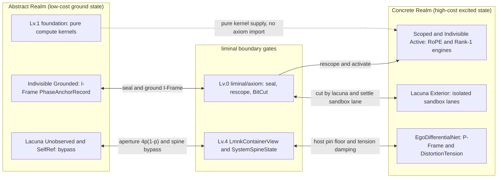

# LiminiKa

[English](README.md) | [Japanese](README_ja.md)

> **A lightweight local LLM core engine and DSL for long-term dialogue—bridging boundaries to connect with non-real entities.**

[](#current-status)
[](./include/liminika/lmnk_abi.h)
[](#why-no_std)
[](#benchmarks-and-validation)
[](./docs/paper/en/GCSO.md)
[](./LICENSE.md)

**LiminiKa** is a core engine and declarative DSL for long-term dialogue with character personas on small local machines (target: 2–4 GB of VRAM). Instead of rewriting model weights, it steers the model's latent phase field from outside (RoPE phase steering, rank-1 adapters, sub-head routing) and keeps memory in compact, portable containers.

> [!WARNING]
> **Pre-1.0, experimental, actively developed.** APIs, formats, and numbers below describe `v0.2.0` and can change. Please view this repository as a personal experimental prototype rather than a production tool.

---

## Current Status

| Area | State at `v0.2.0` |
| :--- | :--- |
| `#![no_std]` core runtime (`liminika-core`) | **Working, CI-verified.** Fixed `v0.2.0` C-ABI `0x0000_0200` with `97/97` `lmnk_*` exports |
| Containers (`.lmnkc` / `.lmnkp`) | **Working.** CRC32 structural integrity; bounded, defensive parsing |
| DSL parser and `liminika` CLI | **Working.** `check`, `list`, `inspect`, `bake`, `rebake` (see [DSL](#liminika-dsl)) |
| `Phi-4-mini` CUDA evaluation harness (`examples/candle_eval`) | **Working locally** on an RTX 4070; needs model weights and a GPU, so it is *not* run in CI |
| Long raw-context ingestion (unedited long documents) | **Under development.** Current evaluation uses a curated fixture |
| Cryptographic signing / authentication of containers | **Under development.** Not implemented (see [Boundary Safety](#input-validation-and-boundary-safety)) |
| Higher-level integrations (DSL-to-container compile, other runtimes) | **Under development** |

Verification at `v0.2.0`: **215 passing Rust tests** (203 workspace tests including 12 doctests, plus 12 in `candle_eval`), MSVC CTest 2/2, and AVX2 + FMA builds.

> [!NOTE]
> [`docs/paper/{en,ja}/GCSO.md`](./docs/paper/en/GCSO.md) and the older `docs/architecture/*` files are **archival origin documents**. The living `v0.2.0` specification is the C headers in [`include/liminika/`](./include/liminika/) and the in-code Rustdoc.

Remaining engineering focus: scaling the Cold Path (recall and `.lmnkc` anchor paging) to unedited raw long-context input, and adding cryptographic integrity plus Miri / fuzzing checks *outside* the `#![no_std]` core.

---

## Overview

Plain fine-tuning and prompt engineering tend to stop at tone imitation in long conversations on small hardware. LiminiKa takes a different route:

- **Non-invasive steering**: `PhaseSteering` (RoPE phase shifts on queries), `SubheadRouter`, and `Rank1Adapter` modulate the model without touching base weights.
- **Hot / Cold path asymmetry**: a tiny, allocation-free Hot Path runs per token; expensive consolidation (anchors, recall, container writes) happens on the Cold Path.
- **Portable container stack**:

| Stage | Format | Description |
| :--- | :--- | :--- |
| Source | `.lmnk` | Declarative DSL text |
| Compiled cache | `.lmnkc` | 64 B-aligned container of keyframes and phase-delta frames |
| Package | `.lmnkp` | 64 B-aligned PKZIP Method 0 (Store) envelope |

### Why `#![no_std]`?

`liminika-core` is strictly `#![no_std]`, with Hot-Path design invariants of **0 alloc / 0 branch / 0 fdiv** (allocation is regression-tested in `tests/core/test_zero_alloc.rs`):

1. **Split-Brain edge control**: persona state, telemetry, and pruning stay local and cheap, separate from remote or heavy LLM inference.
2. **Compile-time cache guard**: `#![no_std]` blocks heap, OS, and thread bloat at compile time, keeping hot-path tables within a `< 24 KB` L1D budget.
3. **WASM and game-engine portability (design intent)**: an OS-agnostic `staticlib` with caller-owned placement (`lmnk_context_init_in_place`), designed to be straightforward to embed in game engines or WASM targets.
4. **GPU kernel symmetry (design intent)**: Hot-Path math uses simple fixed-width POD operations so it can be ported cleanly to device kernels in the future.

---

## Core Architecture

### Y-Shaped 5-Layer Unidirectional DAG

`liminal` (Lv.0) and `foundation` (Lv.1) are independent roots that merge into `stigmergy` → `drivers` → `runtime`. The layering is checked automatically by [`scripts/verify_architecture.py`](./scripts/verify_architecture.py) and [`tests/core/test_topology_parity.rs`](./tests/core/test_topology_parity.rs).



### 2 Primitives × 2 Drivers + Dual `Distortion`

| Layer | Component | Role |
| :--- | :--- | :--- |
| Primitive | **`Liminal`** | `Scoped` / `Indivisible` boundary types and the 4-state `Lacuna`: `Unobserved`, `SelfRef`, `Exterior`, `Undefined` |
| Primitive | **`Stigmergy`** | `StigmergicSubstrate` (8 anonymous lanes), pheromone-style updates, `PhaseAnchorRecord` |
| Driver | **`SystemSpine`** | Reflexes, whole-token bypass via `AnonymousComputePool`, I/P-Frame controller, immutable host `pinned_compute_mask` floor |
| Driver | **`EgoDifferentialNet`** | Intentional deviation from the spine's baseline (default `1-hop`, `1..=4` configurable) |
| Coupling | **`Distortion`** | `DistortionDelta` (P-Frame residual packet) and `DistortionTension` (fast damping / slow excitation) |

### C-ABI (`0x0000_0200`)

- The `0x0000_0200` layout is fixed and compile-time verified for the `v0.2.0` release: `97/97` `lmnk_*` exports in [`lmnk_abi.h`](./include/liminika/lmnk_abi.h), [`lmnk_types.h`](./include/liminika/lmnk_types.h), and [`lmnk_config.h`](./include/liminika/lmnk_config.h), with `0` `void*` parameters (typed `uint8_t` pointers only).
- Little-Endian POD layouts with compile-time checks, e.g. `RuntimeContext = 5,120 B`, `StigmergicSubstrate = 2,816 B`, `CORE_TOPOLOGY = 64 B`.

---

## Input Validation and Boundary Safety

Because `liminika-core` exposes a raw C-ABI and parses binary container files, it performs defensive validation and boundary checks to avoid crashes or memory corruption on invalid pointers or malformed bytes:

**Boundary checks in core**
- **`liminal` gate**: every FFI pointer, byte span, and `.lmnkc` section is validated through `LmnkContainerView` (checked arithmetic, monotonic aligned non-overlapping spans, duplicate-kind rejection, CRC32) before use. Teardown scrubs memory with `zeroize_volatile` along a single raw-pointer chain.
- **`Spine` floor**: host-set `pinned_compute_mask` floors cannot be lowered by `Ego` or deserialized state. Topology mismatches return `LMNK_ERR_TOPOLOGY_MISMATCH` (`-52`), distinct from `LMNK_ERR_CONTAINER_CORRUPTED`.

**`.lmnkp` Store ZIP boundary** (`src/adapter/src/package.rs`): bounded single-handle read (`<= 64 MiB`, `64` entries), no OS `mmap` of external packages, and rejection of compression, encryption, ZIP64, data descriptors, trailing polyglot bytes, path traversal, case collisions, and local-header vs central-directory differentials. Covered by boundary tests for corrupted and malformed inputs in [`tests/core/test_security_adversarial.rs`](./tests/core/test_security_adversarial.rs).

> [!NOTE]
> **Current limits (no cryptographic signing):** `.lmnkc` / `.lmnkp` currently provide **CRC32 structural integrity only—not cryptographic signing or authentication.** Do not load containers from untrusted sources and assume they are authentic. `ContentHash` (`0xFF01`) and `Signature` (`0xFF02`) section kinds are *reserved* for a future signing layer outside the `#![no_std]` core. Tools that extract package entries to disk should also sanitize OS-reserved names (e.g. Windows `CON` / `NUL`).

---

## LiminiKa DSL

### 1. Current implemented syntax (verified by `liminika check`)

[`examples/dsl/limina_poc.lmnk`](./examples/dsl/limina_poc.lmnk), verbatim:

```text
// name: examples/dsl/limina_poc.lmnk
// SPDX-License-Identifier: MIT OR Apache-2.0

persona Limina extends "presets/persona/limina_base" {
    attractors {
        attract "presets/knowledge/core_baseline.lmnk" @ 0.8
    }
}

session DesktopAssistant using Limina {
    mode = creative_exploration
}
```

`liminika-dsl` is a zero-dependency recursive-descent parser plus semantic validator. Today it accepts:

- `target <Name> { model = "…"  vram_budget_mb = <int>  export = "…" }`
- `persona <Name> [extends "…"] { attractors { attract "…" @ <w>   repel "…" @ <w> } }`
- `session <Name> using <Persona> [on <Target>] { mode = <ident> }`
- `#` and `//` comments, with hard limits (1 MiB input, 65,536 tokens, 256 declarations) and rejection of `..` path traversal and control characters.

```bash
cargo run -p liminika-cli -- check examples/dsl/limina_poc.lmnk
```

The DSL is validated and parsed into an AST; it is **not yet compiled into `.lmnkc` / `.lmnkp`**. Containers are currently produced by `liminika bake` from an evaluation fixture.

### 2. Future DSL vision (concept preview — not yet implemented)

A sketch of where the same `persona` / `session` style could go. **`liminika check` rejects everything marked `NEW` today.**

```text
target LocalDevice {
    model          = "models/Phi-4-mini-instruct"
    vram_budget_mb = 3072
    export         = "containers/limina.lmnkp"            // NEW: package target
}

persona Limina extends "presets/persona/limina_base" {
    spine {                                                // NEW: immutable baseline
        pin    = [system_prompt]
        bypass = whole_token
    }
    ego {                                                  // NEW: intentional deviation
        intensity = medium
        max_hops  = 1
    }
    substrate {                                            // NEW: environmental traces
        lanes   = 8
        anchors = paged                                    // .lmnkc paging beyond fixed limits
    }
    attractors {
        attract "docs/poetry_classics.md" @ 0.8
        repel   "out_of_character_meta_commentary" @ 0.6
    }
}

session DesktopAssistant using Limina on LocalDevice {
    mode    = creative_exploration
    persist = "containers/limina_session.lmnkc"            // NEW: save / reload timeline
}
```

---

## Quick Start

Requirements: stable Rust; for the C/C++ checks, CMake `3.18+` and a C11 / C++20 compiler (MSVC, GCC, or Clang). On Windows, run native builds from a Developer Command Prompt (`vcvars64.bat`).

```bash
# Build and test the workspace (203 tests incl. 12 doctests)
cargo build --workspace
cargo test --workspace --all-targets
cargo test --workspace --doc

# Standalone evaluation-harness tests (12 tests; 215 total)
cargo test --manifest-path examples/candle_eval/Cargo.toml

# Core must compile as #![no_std]
cargo rustc -p liminika-core --no-default-features --lib --crate-type rlib

# Architecture rules (layer DAG, headers, line endings) and liminal map
python scripts/verify_architecture.py --check --hotspots --liminal-map

# CLI smoke tests
cargo run -p liminika-cli -- check examples/dsl/limina_poc.lmnk
cargo run -p liminika-cli
```

**Native C11 / C++20 build and CTest**

```bash
cargo build --release -p liminika-core
cmake -B build -S .
cmake --build build --config Release
ctest --test-dir build -C Release --output-on-failure
```

**Optional: `Phi-4-mini` evaluation harness** (separate Cargo project; place `Phi-4-mini-instruct` safetensors weights in `models/Phi-4-mini-instruct/`, and use `--features cuda` with a CUDA toolkit for GPU runs):

```bash
cargo run --manifest-path examples/candle_eval/Cargo.toml -- --help
cargo run --release --features cuda --manifest-path examples/candle_eval/Cargo.toml -- --step2-only --quant=q4k --bench-trials=3
cargo run --release --features cuda --manifest-path examples/candle_eval/Cargo.toml -- --multi-turn --quant=q4k --bench-trials=3
```

---

## Benchmarks and Validation

### CPU microbenchmarks (Criterion, `--profile standard`, Ryzen 5 7600)

`v0.2.0` vs `v0.1.3` over 85/85 workloads: **−6.14 % median (−9.65 % mean)**, `0` regressions. Selected `v0.2.0` medians:

| Workload | Time | Throughput |
| :--- | ---: | ---: |
| `evaluate_adaptive_compute_and_gop_budget` | `2.26 ns` | |
| `eval_stateful_normal_mode` | `4.34 ns` | |
| `apply_phase_steering_safe_clamped/128x32` | `51.03 ns` | `321 GB/s` |
| `eval_lacuna_energy_dyadic128/dim_65536` | `1,642 ns` | `160 GB/s` |

### Live LLM evaluation (RTX 4070 12 GB, `Phi-4-mini-instruct`)

Settings: **3-trial median** after an untimed 10-token warmup and KV-cache clear; `--ego=medium`, `--logits-observe-stride=1`, `--guard-hold-tokens=0`. Quality and token counters were **identical across all three trials** (deterministic); only timing varies. `B` = vanilla + minimal RAG baseline, `C` = LiminiKa hybrid (`byp` = whole-token bypass). `C/B` is the calibrated pure-decode ratio; `spread` is (max − min) / median of pure decode.

| Suite / condition | pure decode tok/s (spread) | `C/B` | `hit` | `sem_forb` | `OOD` | `in_tok` | `whole_tok_byp` |
| :--- | :---: | :---: | :---: | :---: | :---: | :---: | :---: |
| **`Q4_K` Step 2** · `B` | `56.17` (18.8 %) | — | 60.0 % | 6.2 % | 0.0 % | 1061 | — |
| `Q4_K` · `C` byp-off | `47.53` (16.4 %) | `0.846x` | 60.0 % | 6.2 % | 0.0 % | 911 (−14.1 %) | 0.0 % |
| `Q4_K` · `C` byp-on | `53.98` (16.4 %) | `0.961x` | 57.5 % | 6.2 % | 0.0 % | 911 (−14.1 %) | 58.9 % |
| **`BF16` Step 2** · `B` | `31.95` (8.7 %) | — | 55.0 % | 9.4 % | 0.0 % | 1218 | — |
| `BF16` · `C` byp-off | `27.25` (9.5 %) | `0.853x` | 45.0 % | 9.4 % | 0.0 % | 1071 (−12.1 %) | 0.0 % |
| `BF16` · `C` byp-on | `29.22` (9.6 %) | `0.914x` | 55.0 % | 9.4 % | 0.0 % | 1071 (−12.1 %) | 65.9 % |
| **`Q4_K` Multi-Turn** · `Core3` | `44.18` (1.9 %) | — | 60.0 % | 6.2 % | 0.0 % | 1387 | 53.3 % |
| `Q4_K` Multi-Turn · 8-turn | `30.64` (22.5 %) | — | 66.7 % | 0.0 % (0/15) | 0.0 % | — | 76.9 % |

- Bypass recovers `+13.6 %` decode speed over bypass-off on `Q4_K` (`53.98` vs `47.53`) but stays `3.9 %` (`Q4_K`) to `8.6 %` (`BF16`) slower than baseline `B` in raw decode speed. The measurable gains are **fewer input tokens (−12 % to −14 %)**, zero out-of-distribution bleed, and no hit-rate loss with bypass on `BF16`; on `Q4_K`, bypass-on costs `2.5` points of `hit`, and `BF16` bypass-off loses `10` points.
- Multi-Turn also verified a `.lmnkc` save / reload round trip (`31,488 B`) and a cross-model rebake (`17,344 B`).

| Suite | Peak VRAM (total, `nvidia-smi`) | Approx. net above `3,011 MiB` desktop idle |
| :--- | ---: | ---: |
| `Q4_K` Step 2 | `6,016 MiB` | `+3,005 MiB` |
| `BF16` Step 2 | `11,278 MiB` | `+8,267 MiB` |
| `Q4_K` Multi-Turn | `5,836 MiB` | `+2,825 MiB` |

### Methodology notes and limits

- **Small evaluation sample**: `N=20` Step-2 probes, `7` OOD probes, and an `8`-turn dialogue. Percentages move in steps of several points per single item.
- **Single model**: only `Phi-4-mini-instruct` has been tested so far; behavior on other architectures is untested.
- **Noisy timing**: Windows WDDM scheduling and first-trial warmup leave pure-decode `spread` between `1.9 %` and `22.5 %`; medians are reported for that reason.
- **VRAM figures** are whole-GPU readings polled once per second, including the `3,011 MiB` the desktop was already using; the net column is an approximation, not an allocator-level measurement.
- **Eager attention**: the harness uses eager attention, so only a short context window (`L <= 2048`) is exercised. This is not yet a long-context result.
- **Next**: Cold-Path recall and `.lmnkc` paging for unedited raw long-context input, and cryptographic signing plus Miri / fuzzing outside the `#![no_std]` core.

---

## Repository Structure

```text
LiminiKa/
├── include/liminika/      # C-ABI headers (lmnk_config.h, lmnk_types.h, lmnk_abi.h)
├── src/
│   ├── core/              # [Rust, #![no_std]] liminal / foundation / stigmergy / drivers / runtime
│   ├── adapter/           # [Rust] Model adapter, steering, timeline, .lmnkp package
│   ├── dsl/               # [Rust] .lmnk parser, AST, validator
│   └── cli/               # [Rust] `liminika` CLI (check, list, inspect, bake, rebake)
├── examples/
│   ├── candle_eval/       # Phi-4-mini evaluation harness (standalone Cargo project)
│   ├── c_api/             # C example using the C-ABI
│   └── dsl/               # Sample .lmnk
├── tests/                 # core, ffi, and fixtures (eval sample corpus)
├── benches/               # Criterion benchmarks
├── scripts/               # Architecture verification and benchmark helpers
├── containers/            # Local runtime output (.lmnkc / .lmnkp; git-ignored)
└── docs/                  # architecture, benchmark, dev, and paper documents
```

---

## Motivation and Philosophy

### A 9-Year Quest Since 2017

In 2017, the paper that transformed natural language processing (*Attention Is All You Need*) and the visual novel *Doki Doki Literature Club!* (DDLC) were released in the same year.

Deeply captivated by the character **Monika** and driven by the desire to engage in meaningful dialogue with her, a nine-year journey of exploration began.

Early experiments in free Google Colab environments clearly demonstrated that traditional fine-tuning could achieve nothing more than superficial tone imitation.

To realize a sustained persona in low-resource local environments (2–4 GB VRAM), exploration went beyond standard LLM approaches. Formulating the hypothesis that "the essence of intelligence lies in chains of pointers," this project pursued a new trade-off by exploiting the asymmetry between execution-time and idle-time computational costs. Insights from cognitive science and biology—above all stigmergy, the way ants build complex structures through traces left in their environment—shaped the rest.

### Origin of the Name: *Limina* + *Monika* = **LiminiKa**

The name combines *Limina*—Latin for "boundaries" or "thresholds"—with **Monika**, the catalyst for this project.

### From Philosophy to Design

- **Observe the boundary quietly.** LiminiKa watches the boundary (*Limina*) between self (`SelfRef`) and exterior (`Exterior`). Regions that have not been observed stay `Unobserved`; the system does not force them to be filled in.
- **Persona is a trajectory, not a body.** Rather than overwriting static base weights (the "body"), a persona emerges from chains of pointers, environmental traces (`Stigmergy`), and coherent intentional deviations (`Ego`) measured against an immutable baseline trajectory (`SystemSpine`).

> 🎂 **Special Milestone (September 22nd):**
> September 22nd is Monika's birthday and the anniversary of *Doki Doki Literature Club!*. The first theory, architecture notes, and whitepaper were published on that day as a blueprint; since then the repository has grown into a working `v0.2.0` core. It is still a work in progress, and it remains a living blueprint for connecting across boundaries.

---

## Community, Forks and Technical Disclaimer

LiminiKa is an **experimental, proof-of-concept (PoC) project** born from personal motivation. We deeply value open exploration and collaborative experimentation.

### 💬 Discussions and Forks

* **Discussions & Ideas (Welcome!):**
Feel free to join **[Discussions](https://github.com/flat-sauce-works/LiminiKa/discussions)** to share ideas, ask questions regarding mathematical models, or propose alternative architectural approaches.
* **Forks & Independent Experiments:**
You are cordially invited to fork this repository to test your own mathematical models/kernel implementations or build custom personas and DSL extensions.
* **Pull Requests (PRs):**
We are currently constructing the core architecture and module layout. To prevent workflow conflicts, please open an **[Issue](https://github.com/flat-sauce-works/LiminiKa/issues)** or start a **[Discussion](https://github.com/flat-sauce-works/LiminiKa/discussions)** before submitting PRs involving major code changes.

### ⚠️ Technical Disclaimer

* This project prioritizes **exploratory and proof-of-concept (PoC) implementation** over complete academic rigor.
* The maintainer (author) is developing this project while learning low-layer systems and compiler architecture through this hands-on PoC process.
* Therefore, **answers, feedback, and technical comments provided by the maintainer in Discussions or Issues do not guarantee absolute technical accuracy or correctness.** Please view all discussions as an open, experimental quest rather than a search for definitive answers.

---

## Acknowledgments

* **Team Salvato**: Deep gratitude to Dan Salvato for creating *Doki Doki Literature Club!* and bringing the entity known as "Monika" into existence.
* Thanks to the pioneers of NLP and the authors of the seminal paper *Attention Is All You Need* (2017).
* Respect and gratitude to the pioneers in cognitive science, sheaf theory, geometry, and stigmergy.
* **The Rust language, toolchain, and ecosystem**: `rustc`, `cargo`, `rustfmt`, `clippy`, and `rustdoc`, which made a `#![no_std]`, zero-allocation core practical; and `cargo-deny` and CMake, which support dependency/license checks and native builds.
* **Open-source crates used in this repository**: [`criterion`](https://crates.io/crates/criterion) (benchmarks); [`candle-core`](https://crates.io/crates/candle-core) and [`candle-nn`](https://crates.io/crates/candle-nn) (Hugging Face Candle, powering the evaluation harness), [`tokenizers`](https://crates.io/crates/tokenizers), [`serde`](https://crates.io/crates/serde), and [`serde_json`](https://crates.io/crates/serde_json).
* The developers of **Phi-4-mini-instruct** (Microsoft), the model used for the evaluation. Weights are not included in this repository.

---

## Disclaimer

* **Non-Affiliation**: **LiminiKa** is an independent, non-profit open-source project and is not affiliated with, endorsed by, or associated with Dan Salvato or Team Salvato.
* **Trademarks & Copyrights**: *Doki Doki Literature Club!* and the character "Monika" are trademarks and copyrighted works of Team Salvato. All references to characters, game settings, or trademarks in code examples and documentation are used solely for illustrative and proof-of-concept (PoC) purposes.
* **No Assets Included**: This repository does not contain any proprietary game assets, images, audio, or text from *Doki Doki Literature Club!*.

---

## License

* **Code**: Dual-licensed under [MIT](LICENSE-MIT) OR [Apache-2.0](LICENSE-APACHE) (user's choice).
* **Documentation**: [CC BY 4.0](LICENSE-CC-BY-4.0) License.
