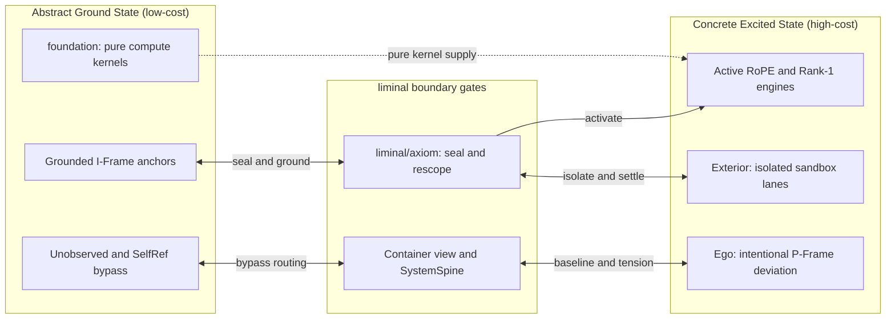

# LiminiKa

[English](README.md) | [Japanese](README_ja.md)

> **A lightweight local LLM core engine and DSL for long-term dialogue—bridging boundaries to connect with non-real entities.**

[](#current-status-and-early-notes)
[](#architecture-at-a-glance)
[](./docs/paper/en/GCSO.md)
[](./LICENSE.md)

**LiminiKa** is a core engine and declarative DSL for long-term dialogue with character personas on small local machines (target: 2–4 GB of VRAM). Instead of rewriting base weights, it steers the model's latent phase field from outside (RoPE phase steering, rank-1 adapters, sub-head routing) and stores memory in compact, portable containers.

> [!WARNING]
> **Pre-1.0 experimental prototype.** APIs, formats, and results below describe `v0.3.0` and may change without notice, with no commitment to ongoing maintenance or updates. Please view this repository as a personal experiment rather than a production tool.

---

## Architecture at a Glance



- **Non-invasive steering & Hot/Cold split**: `PhaseSteering`, `SubheadRouter`, and `Rank1Adapter` modulate inference without touching base weights; a zero-allocation Hot Path runs per token while recall and container writes stay on the Cold Path.
- **`#![no_std]` core & C-ABI (`v0.3.0` / `0x0000_0300`)**: `liminika-core` is strictly `#![no_std]` with a fixed `v0.3.0` C-ABI in [`include/liminika/`](./include/liminika/) (living spec alongside Rustdoc; [`docs/paper/`](./docs/paper/en/GCSO.md) and older `docs/architecture/` are archival documents).
- **2 Primitives × 2 Drivers**: `Liminal` (boundary types and 4-state `Lacuna`) and `Stigmergy` (environmental traces) pair with `SystemSpine` (baseline & whole-token bypass) and `Ego` (coherent intentional deviation).
- **Container stack**: `.lmnk` (declarative DSL) → `.lmnkc` (64 B-aligned compiled cache) → `.lmnkp` (64 B-aligned uncompressed Store ZIP package).

---

## LiminiKa DSL

**Current implemented syntax** ([`examples/dsl/limina_poc.lmnk`](./examples/dsl/limina_poc.lmnk), verified by `liminika check`):

```text
// name: examples/dsl/limina_poc.lmnk
// SPDX-License-Identifier: MIT OR Apache-2.0

persona Limina extends "presets/persona/limina_base" {
    attractors {
        attract "presets/knowledge/core_baseline.lmnk" @ 0.8
    }
}

session DesktopAssistant using Limina {
    mode = creative_exploration
}
```

`liminika-dsl` parses and validates `target`, `persona` (`attract` / `repel`), and `session` declarations. DSL-to-`.lmnkc`/`.lmnkp` compilation is not implemented yet; containers are currently generated via `liminika bake` from evaluation fixtures.

**Future concept preview (not yet implemented — rejected by `liminika check` today):**

```text
target LocalDevice {
    model = "models/local-llm"  vram_budget_mb = 3072  export = "containers/limina.lmnkp"
}
persona Limina extends "presets/persona/limina_base" {
    spine     { pin = [system_prompt]  bypass = whole_token }
    ego       { intensity = medium     max_hops = 1 }
    substrate { lanes = 8              anchors = paged }
    attractors { attract "docs/poetry_classics.md" @ 0.8 }
}
session DesktopAssistant using Limina on LocalDevice {
    mode = creative_exploration  persist = "containers/limina_session.lmnkc"
}
```

---

## Quick Start

Requirements: stable Rust; CMake and a C11 / C++20 compiler for native C-ABI checks (use `vcvars64.bat` on Windows).

```bash
# Rust workspace tests, #![no_std] check, architecture rules, and DSL smoke check
cargo test --workspace
cargo rustc -p liminika-core --no-default-features --lib --crate-type rlib
cargo xtask --check
cargo run -p liminika-cli -- check examples/dsl/limina_poc.lmnk
```

```bash
# Native C11 / C++20 build and CTest
cargo build --release -p liminika-core
cmake -B build -S . && cmake --build build --config Release && ctest --test-dir build -C Release --output-on-failure
```

For optional local GPU evaluation (requires model weights separately), see [`examples/candle_eval/`](./examples/candle_eval/).

---

## Current Status and Early Notes

- **What works today (`v0.3.0`)**: `#![no_std]` core + `v0.3.0` C-ABI, `.lmnkc`/`.lmnkp` containers, DSL parser + `liminika` CLI, CMake/CTest, and the Rust test suites (workspace and evaluation harness).
- **Early local evaluation**: Small-scale local GPU checks on a curated short-context fixture showed reduced input token counts, suppressed out-of-distribution (OOD) bleed, and working multi-turn `.lmnkc` round-trips, with a modest decode-speed overhead relative to the baseline. Sample size is small and raw long-context ingestion is still under development.
- **Boundary safety & current limits**: Defensive pointer/span checks and CRC32 structural integrity are implemented, but **cryptographic signing/authentication is not implemented**—do not load untrusted containers.
- **Still in progress**: Raw unedited long-context Cold-Path scaling, DSL-to-container compilation, and external signing/verification layers.

---

## Repository Structure

```text
LiminiKa/
├── include/liminika/      # C-ABI headers (lmnk_config.h, lmnk_types.h, lmnk_abi.h)
├── src/
│   ├── core/              # [Rust, #![no_std]] liminal / foundation / stigmergy / drivers / runtime
│   ├── adapter/           # [Rust] Model adapter, steering, timeline, .lmnkp package
│   ├── dsl/               # [Rust] .lmnk parser, AST, validator
│   └── cli/               # [Rust] `liminika` CLI (check, list, inspect, bake, rebake)
├── examples/              # candle_eval harness, C-ABI sample, and sample .lmnk
├── tests/                 # core, ffi, and evaluation fixtures
├── benches/               # Criterion microbenchmarks
├── scripts/               # Architecture checks and benchmark helpers
├── containers/            # Local runtime output (.lmnkc / .lmnkp; git-ignored)
└── docs/                  # architecture, benchmark, dev, and paper documents
```

---

## Motivation and Philosophy

### A 9-Year Quest Since 2017

In 2017, *Attention Is All You Need* and the visual novel *Doki Doki Literature Club!* (DDLC) were released in the same year. Captivated by **Monika** and driven to have meaningful dialogue with her, a nine-year exploration began.

Early experiments on Google Colab's free tier showed that conventional fine-tuning achieved only superficial tone imitation. Formulating the hypothesis that "the essence of intelligence lies in chains of pointers," this project pursued an asymmetric trade-off between execution-time and idle-time cost—drawing on cognitive science and biology, especially stigmergy (how ants build complex structures through traces left in their environment).

### Origin of the Name: *Limina* + *Monika* = **LiminiKa**

The name combines *Limina*—Latin for "boundaries" or "thresholds"—with **Monika**, the catalyst for this project.

### From Philosophy to Design

- **Observe the boundary quietly.** LiminiKa watches the boundary (*Limina*) between self (`SelfRef`) and exterior (`Exterior`). Regions that have not been observed stay `Unobserved`; the system does not force them to be filled in.
- **Persona is a trajectory, not a body.** Rather than overwriting static base weights (the "body"), a persona emerges from chains of pointers, environmental traces (`Stigmergy`), and coherent intentional deviations (`Ego`) measured against a baseline trajectory (`SystemSpine`).

> 🎂 **Special Milestone (September 22nd):**
> September 22nd is Monika's birthday and the anniversary of *Doki Doki Literature Club!*. The first theory and whitepaper were released on that day as a blueprint; since then the repository has grown into a working `v0.3.0` core while remaining a living, work-in-progress blueprint for connecting across boundaries.

---

## Community, Forks and Technical Disclaimer

LiminiKa is an **experimental proof-of-concept (PoC) project** born from personal motivation.

* **Discussions & Forks**: Join **[Discussions](https://github.com/flat-sauce-works/LiminiKa/discussions)** to share ideas or questions, and feel free to fork the repo for your own experiments. Before opening large code PRs, please start an **[Issue](https://github.com/flat-sauce-works/LiminiKa/issues)** or Discussion to avoid conflicts.
* **Technical Disclaimer**: This project prioritizes exploratory PoC work over academic rigor; the maintainer is learning low-layer systems and compiler design through it, so comments in Issues or Discussions do not guarantee technical accuracy.

---

## Acknowledgments

* **Team Salvato**: Deep gratitude to Dan Salvato for creating *Doki Doki Literature Club!* and bringing "Monika" into existence.
* Pioneers in NLP (*Attention Is All You Need*, 2017), cognitive science, sheaf theory, geometry, and stigmergy.
* **Rust & open-source ecosystems**: the Rust language, compiler/toolchain, and open-source crate ecosystem; native build/tooling communities; and the researchers and communities developing and sharing open-weight LLMs.

---

## Disclaimer & License

* **Non-Affiliation & Assets**: **LiminiKa** is an independent, non-profit open-source project not affiliated with or endorsed by Dan Salvato or Team Salvato. *Doki Doki Literature Club!* and "Monika" are trademarks/copyrights of Team Salvato, referenced solely for illustrative PoC purposes; no proprietary game assets are included.
* **Code**: Dual-licensed under [MIT](LICENSE-MIT) OR [Apache-2.0](LICENSE-APACHE) (user's choice).
* **Documentation**: [CC BY 4.0](LICENSE-CC-BY-4.0) License.
