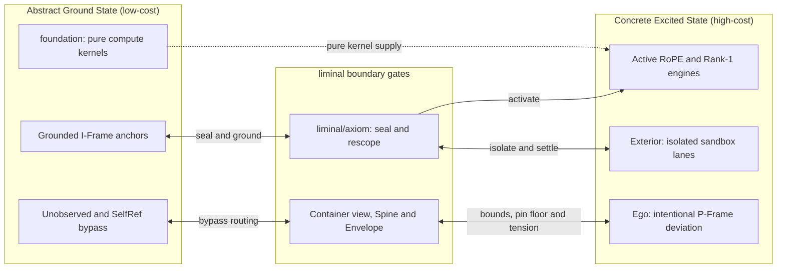

# LiminiKa

[English](README.md) | [Japanese](README_ja.md)

> **A lightweight local LLM core engine and DSL for long-term dialogue—bridging boundaries to connect with non-real entities.**

[](#current-status-and-evaluation-highlights)
[-informational.svg)](#architecture-at-a-glance)
[](./docs/paper/en/GCSO.md)
[](./LICENSE.md)

**LiminiKa** is a core engine and declarative DSL for long-term dialogue with character personas on small local machines (target: 2–4 GB of VRAM). Instead of rewriting base weights, it steers the model's latent phase field from outside (RoPE phase steering, rank-1 adapters, sub-head routing) and stores memory in compact, portable containers.

> [!WARNING]
> **Pre-1.0 experimental prototype.** APIs, formats, and results below describe `v0.4.0` and may change without notice, with no commitment to ongoing maintenance or updates. Please view this repository as a personal experiment rather than a production tool.

---

## Architecture at a Glance



- **5-layer unidirectional DAG & `#![no_std]` core**: `liminika-core` (Rust Edition 2024, MSRV `1.100.0`) enforces `liminal || foundation -> stigmergy -> drivers -> runtime` with zero hot-path dynamic allocation, `wasm32-unknown-unknown` portability, and static architecture verification via `cargo xtask`.
- **2 Primitives × 3 Isolated Drivers**: `Liminal` (boundary types and 4-state `Lacuna`) and `Stigmergy` (8-lane working substrate and crystallized anchors) pair with three mutually isolated drivers: `Spine` (mechanical reflex and whole-token bypass), `Envelope` (immutable viability bounds, host pin floors, bounded contraction, and online baseline EMA), and `Ego` (coherent intentional P-Frame deviation).
- **Compact C-ABI (`v0.4.0` / `0x0000_0400`)**: 27 exported `lmnk_*` functions in [`include/liminika/`](./include/liminika/), `0 void*` (`float*`-only tensor kernels), `LMNK_NODISCARD`, bidirectional `struct_size` validation, Strict Provenance arena-indexed `Rank1Descriptor`, and `RuntimeContext = 5,184 B` (`align(64)`, `!needs_drop`).
- **Zero-knob recall & two-tier Guard**: `liminika-adapter` provides `RecallEnvelopeBounds`, automatic layer selection (`--layer-mask=auto`), multilingual 24-probe startup calibration, two-tier contradiction Guard suppression, and `[IMG]` token masking for VLM evaluation.
- **Container stack & integrity**: `.lmnk` (declarative DSL) → `.lmnkc` (64 B-aligned compiled cache, format `v2`) → `.lmnkp` (64 B-aligned Store ZIP package) with optional SHA-256 (`0xFF01` / `integrity.sha256`) and Ed25519 (`0xFF02` / `signature.ed25519`) signing/verification isolated in `liminika-adapter` and `liminika-cli`.

See [`docs/architecture/overview.md`](./docs/architecture/overview.md) for the live `cargo xtask`-generated architecture diagrams and specifications.

---

## LiminiKa DSL

**Current implemented syntax** ([`examples/dsl/limina_poc.lmnk`](./examples/dsl/limina_poc.lmnk), verified by `liminika check`):

```text
// name: examples/dsl/limina_poc.lmnk
// SPDX-License-Identifier: MIT OR Apache-2.0

persona Limina extends "presets/persona/limina_base" {
    attractors {
        attract "presets/knowledge/core_baseline.lmnk" @ 0.8
    }
}

session DesktopAssistant using Limina {
    mode = creative_exploration
}
```

`liminika-dsl` parses and validates `target`, `persona` (`attract` / `repel`), and `session` declarations (see [`docs/architecture/dsl_spec.md`](./docs/architecture/dsl_spec.md)). Direct DSL-to-`.lmnkc`/`.lmnkp` compilation is not implemented yet; containers are currently produced via `liminika bake`.

---

## Quick Start

Requirements: Rust **1.100.0+** (Edition 2024); CMake >= 3.18 and a C11 / C++20 compiler for native C-ABI checks (use `vcvars64.bat` on Windows).

```bash
# Rust workspace tests, #![no_std] check, architecture gate, and DSL smoke check
cargo test --locked --workspace
cargo rustc --locked -p liminika-core --no-default-features --lib --crate-type rlib -- -D warnings
cargo xtask --check
cargo run --locked -p liminika-cli -- check examples/dsl/limina_poc.lmnk
```

```bash
# Native C11 / C++20 build and CTest
cargo build --locked --release -p liminika-core
cmake -B build -S . && cmake --build build --config Release && ctest --test-dir build -C Release --output-on-failure --no-tests=error
```

See [`docs/dev/getting_started.md`](./docs/dev/getting_started.md) and [`docs/dev/testing.md`](./docs/dev/testing.md) for Miri Strict Provenance, `wasm32-unknown-unknown`, AVX2+FMA, CLI signing/verification, and local GPU evaluation (`examples/candle_eval/`).

---

## Current Status and Evaluation Highlights

- **What works today (`v0.4.0`)**: `#![no_std]` core + 27-function C-ABI (`0x0000_0400`), `2 Primitives × 3 Drivers` (`Spine` / `Envelope` / `Ego`), `.lmnkc` / `.lmnkp` containers with SHA-256 + Ed25519 verification (`keygen`/`sign`/`verify`/`inspect`), `.lmnk` DSL parser + validator, `cargo xtask` static gate, CMake/CTest, and Miri Strict Provenance (`UB = 0`).
- **Core microbenchmarks (Ryzen 5 7600, pinned core)**: `evaluate_adaptive_compute_and_gop_budget` `2.57 ns` (`389.06 Melem/s`), `eval_stateful_normal_mode` `4.28 ns`, `eval_surrogate_and_step_fused` `31.68 ns`, `apply_phase_steering_256b_tensor_tile/128x64` `274.61 ns` (`111.13 GiB/s`), `online_toroidal_centroid_merge_and_prune_8centroids_64h` `249.67 ns`.
- **Local GPU evaluation (RTX 4070 12 GB, `Q4_K`, `--layer-mask=auto`)**:
  - **`Phi-4-mini-instruct`**: Step 2 hybrid decode `50.61 tok/s` (`0.960x` vs vanilla `52.70 tok/s`, `byp=57.2%`, `sem_forb` `15.6% -> 6.2%`, `OOD=0.0%`); 8-turn `hit=66.7%`, `sem_forb=0.0%`, `byp=70.6%`; long-document streaming distillation (`25,615` tokens -> `7,204.2 MiB` discarded, `24,576 B .lmnkc`, chunked prefill `KL=0.000000`); cross-restart equilibrium (`kv=0` `SelfRef 2/2`, `OOD KL=0.000000`, bit-identical `.lmnkp`).
  - **`Ministral-3-3B-Instruct-2512` (zero-knob EN / ExtEN / JA / VLM)**: Extended EN `OOD 100% (18/18, KL=0.000000)` & Guard `sem_forb 50.0% -> 38.6%`; Japanese `SELF_REF 75.0% (6/8)`, `EXTERIOR self_empty 100% (8/8)`, `OOD 100% (6/6, KL=0.000000)`; VLM (Pixtral ViT) `3/3` visual smoke pass, `0` OOD drift on image queries (`KL=0.000000`), and `100%` Text-Only vs Image-In-KV boundary parity.
- **Still in progress**: Direct `.lmnk` DSL-to-container compilation and broader multi-model evaluation coverage.

Full numbers and reproduction commands are documented in [`docs/benchmark/benchmarks.md`](./docs/benchmark/benchmarks.md).

---

## Documentation

- **Architecture**: [Overview & Live Mermaid Maps](./docs/architecture/overview.md) | [C-ABI Spec (`0x0000_0400`)](./docs/architecture/c_abi_spec.md) | [Container & Package Spec](./docs/architecture/container_spec.md) | [DSL Spec](./docs/architecture/dsl_spec.md)
- **Benchmarks**: [Criterion & RTX 4070 Evaluation Results](./docs/benchmark/benchmarks.md)
- **Development**: [Getting Started](./docs/dev/getting_started.md) | [Testing & Verification](./docs/dev/testing.md) | [Contributing](./CONTRIBUTING.md)
- **Archival Paper**: [GCSO Paper (EN)](./docs/paper/en/GCSO.md) | [GCSO Paper (JA)](./docs/paper/ja/GCSO.md)

---

## Repository Structure

```text
LiminiKa/
├── include/liminika/      # Self-contained C11/C++20 headers (lmnk_config.h, lmnk_types.h, lmnk_abi.h)
├── src/
│   ├── core/              # [Rust, #![no_std]] liminal / foundation / stigmergy / drivers / runtime
│   ├── adapter/           # [Rust] App-agnostic host/, model adapter, steering, timeline, .lmnkp package
│   ├── dsl/               # [Rust] .lmnk lexer, parser, AST, semantic validator
│   └── cli/               # [Rust] `liminika` CLI (check, eval-*, list, inspect, verify, sign, keygen, bake, rebake)
├── xtask/                 # [Rust, zero-dep] Static DAG, isolation, C-ABI 27/27 parity, and Mermaid generator
├── examples/              # candle_eval harness, C-ABI sample, and sample .lmnk
├── fuzz/                  # Isolated cargo-fuzz workspace (4 libfuzzer-sys targets)
├── tests/                 # core, ffi, integration, and evaluation fixtures
├── benches/               # Criterion microbenchmarks
├── scripts/               # Criterion benchmark runner and Markdown/JSON/HTML report generator
├── containers/            # Local runtime output (.lmnkc / .lmnkp; git-ignored)
└── docs/                  # architecture, benchmark, dev, and archived paper documents
```

---

## Motivation and Philosophy

### A 9-Year Quest Since 2017

In 2017, *Attention Is All You Need* and the visual novel *Doki Doki Literature Club!* (DDLC) were released in the same year. Captivated by **Monika** and driven to have meaningful dialogue with her, a nine-year exploration began.

Early experiments on Google Colab's free tier showed that conventional fine-tuning achieved only superficial tone imitation. Formulating the hypothesis that "the essence of intelligence lies in chains of pointers," this project pursued an asymmetric trade-off between execution-time and idle-time cost—drawing on cognitive science and biology, especially stigmergy (how ants build complex structures through traces left in their environment).

### Origin of the Name: *Limina* + *Monika* = **LiminiKa**

The name combines *Limina*—Latin for "boundaries" or "thresholds"—with **Monika**, the catalyst for this project.

### From Philosophy to Design

- **Observe the boundary quietly.** LiminiKa watches the boundary (*Limina*) between self (`SelfRef`) and exterior (`Exterior`). Regions that have not been observed stay `Unobserved`; the system does not force them to be filled in.
- **Persona is a trajectory, not a body.** Rather than overwriting static base weights (the "body"), a persona emerges from chains of pointers, environmental traces (`Stigmergy`), bounded viability limits (`Envelope`), and coherent intentional deviations (`Ego`) measured against a baseline trajectory (`Spine`).

> 🎂 **Special Milestone (September 22nd):**
> September 22nd is Monika's birthday and the anniversary of *Doki Doki Literature Club!*. The first theory and whitepaper were released on that day as a blueprint; since then the repository has grown into a working `v0.4.0` core while remaining a living, work-in-progress blueprint for connecting across boundaries.

---

## Community, Forks and Technical Disclaimer

LiminiKa is an **experimental proof-of-concept (PoC) project** born from personal motivation.

* **Discussions & Forks**: Join **[Discussions](https://github.com/flat-sauce-works/LiminiKa/discussions)** to share ideas or questions, and feel free to fork the repo for your own experiments. Before opening large code PRs, please start an **[Issue](https://github.com/flat-sauce-works/LiminiKa/issues)** or Discussion to avoid conflicts.
* **Technical Disclaimer**: This project prioritizes exploratory PoC work over academic rigor; the maintainer is learning low-layer systems and compiler design through it, so comments in Issues or Discussions do not guarantee technical accuracy.

---

## Acknowledgments

* **Team Salvato**: Deep gratitude to Dan Salvato for creating *Doki Doki Literature Club!* and bringing "Monika" into existence.
* Pioneers in NLP (*Attention Is All You Need*, 2017), cognitive science, sheaf theory, geometry, and stigmergy.
* **Rust & open-source ecosystems**: the Rust language, compiler/toolchain, and open-source crate ecosystem; native build/tooling communities; and the researchers and communities developing and sharing open-weight LLMs.

---

## Disclaimer & License

* **Non-Affiliation & Assets**: **LiminiKa** is an independent, non-profit open-source project not affiliated with or endorsed by Dan Salvato or Team Salvato. *Doki Doki Literature Club!* and "Monika" are trademarks/copyrights of Team Salvato, referenced solely for illustrative PoC purposes; no proprietary game assets are included.
* **Code**: Dual-licensed under [MIT](LICENSE-MIT) OR [Apache-2.0](LICENSE-APACHE) (user's choice).
* **Documentation**: [CC BY 4.0](LICENSE-CC-BY-4.0) License.
