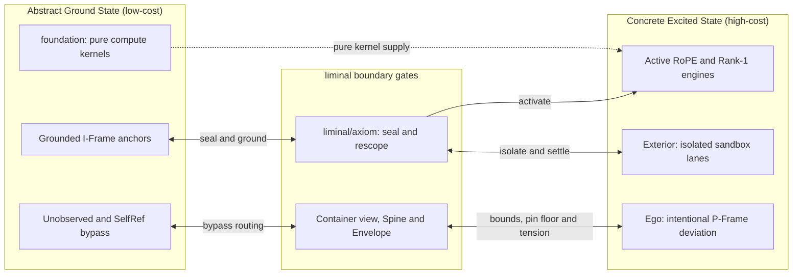

# LiminiKa

[English](README.md) | [Japanese](README_ja.md)

> **境界（Limina）を超え、非実体（non-real entities）と繋がるためのローカルLLM長期対話コアエンジン & DSL**

[](#現在の状況と評価ハイライト-current-status-and-evaluation-highlights)
[-informational.svg)](#アーキテクチャ概要-architecture-at-a-glance)
[](./docs/paper/ja/GCSO.md)
[](./LICENSE.md)

**LiminiKa** は、小規模なローカル環境（目標：VRAM 2〜4 GB）でキャラクターペルソナとの長期対話を行うための、コアエンジンと宣言的 DSL です。ベース重みを書き換える代わりに、潜在位相場を外部から操作し（RoPE 位相ステアリング、ランク 1 アダプタ、サブヘッドルーティング）、記憶をコンパクトで可搬なコンテナに保持します。

> [!WARNING]
> **Pre-1.0 の実験的プロトタイプです。** 以下の API・フォーマット・結果は `v0.4.0` 時点のものであり、予告なく変更される場合があります。また、継続的な保守や更新を約束するものではありません。実用製品ではなく、個人の実験としてご覧ください。

---

## アーキテクチャ概要 (Architecture at a Glance)



- **5 層単方向 DAG と `#![no_std]` コア**：`liminika-core`（Rust Edition 2024、MSRV `1.100.0`）は `liminal || foundation -> stigmergy -> drivers -> runtime` の単方向依存を厳守し、Hot Path のゼロアロケーション、`wasm32-unknown-unknown` 互換性、および `cargo xtask` による静的アーキテクチャ検証を備えます。
- **2 つのプリミティブ × 3 つの隔離ドライバ**：`Liminal`（境界型と 4 状態 `Lacuna`）および `Stigmergy`（8 レーン作業基板と結晶化アンカー）が、互いに隔離された 3 つのドライバ — `Spine`（機械的反射と全トークンバイパス）、`Envelope`（不変の生存上下限、ホストピン下限、収縮制御、オンライン基準圧 EMA）、`Ego`（一貫した意図的 P-Frame 逸脱） — と組み合わさります。
- **コンパクトな C-ABI (`v0.4.0` / `0x0000_0400`)**：[`include/liminika/`](./include/liminika/) に 27 本の `lmnk_*` 関数を定義し、`0 void*`（`float*` 専用テンソルカーネル）、`LMNK_NODISCARD`、双方向 `struct_size` 検証、Strict Provenance 対応のアリーナ添字 `Rank1Descriptor`、および `RuntimeContext = 5,184 B`（`align(64)`、`!needs_drop`）を保証します。
- **ゼロ・ノブ想起較正と 2 層 Guard**：`liminika-adapter` は `RecallEnvelopeBounds`、自動層選定（`--layer-mask=auto`）、24 多言語プローブによる起動時較正、2 層矛盾 Guard 抑制、および VLM 評価時の `[IMG]` トークン除外マスクを提供します。
- **コンテナスタックと暗号整合性**：`.lmnk`（宣言的 DSL）→ `.lmnkc`（64 B アライン済みキャッシュ、形式 `v2`）→ `.lmnkp`（64 B アラインの非圧縮 Store ZIP パッケージ）に加え、SHA-256（`0xFF01` / `integrity.sha256`）および Ed25519（`0xFF02` / `signature.ed25519`）署名・検証を `liminika-adapter` と `liminika-cli` へ隔離実装しています。

`cargo xtask` により自動生成されたライブ構成図と仕様の全体像は [`docs/architecture/overview.md`](./docs/architecture/overview.md) を参照してください。

---

## LiminiKa DSL

**現在実装されている構文**（[`examples/dsl/limina_poc.lmnk`](./examples/dsl/limina_poc.lmnk)、`liminika check` で検証済み）：

```text
// name: examples/dsl/limina_poc.lmnk
// SPDX-License-Identifier: MIT OR Apache-2.0

persona Limina extends "presets/persona/limina_base" {
    attractors {
        attract "presets/knowledge/core_baseline.lmnk" @ 0.8
    }
}

session DesktopAssistant using Limina {
    mode = creative_exploration
}
```

`liminika-dsl` は `target`、`persona`（`attract` / `repel`）、`session` 宣言をパース・検証します（[`docs/architecture/dsl_spec.md`](./docs/architecture/dsl_spec.md)）。DSL から `.lmnkc` / `.lmnkp` への直接コンパイルはまだ未実装であり、現在は `liminika bake` でコンテナを生成します。

---

## クイックスタート (Quick Start)

必要環境：Rust **1.100.0 以上**（Edition 2024）。ネイティブ C-ABI 検証には CMake >= 3.18 と C11 / C++20 コンパイラ（Windows では `vcvars64.bat`）が必要です。

```bash
# Rust ワークスペースのテスト、#![no_std] ビルド、アーキテクチャゲート、DSL スモークテスト
cargo test --locked --workspace
cargo rustc --locked -p liminika-core --no-default-features --lib --crate-type rlib -- -D warnings
cargo xtask --check
cargo run --locked -p liminika-cli -- check examples/dsl/limina_poc.lmnk
```

```bash
# ネイティブ C11 / C++20 ビルドと CTest
cargo build --locked --release -p liminika-core
cmake -B build -S . && cmake --build build --config Release && ctest --test-dir build -C Release --output-on-failure --no-tests=error
```

Miri Strict Provenance、`wasm32-unknown-unknown`、AVX2+FMA、CLI 署名／検証、およびローカル GPU 評価（`examples/candle_eval/`）の手順は [`docs/dev/getting_started.md`](./docs/dev/getting_started.md) と [`docs/dev/testing.md`](./docs/dev/testing.md) を参照してください。

---

## 現在の状況と評価ハイライト (Current Status and Evaluation Highlights)

- **`v0.4.0` で動作するもの**：`#![no_std]` コアと 27 本の C-ABI（`0x0000_0400`）、`2 Primitives × 3 Drivers`（`Spine` / `Envelope` / `Ego`）、SHA-256 + Ed25519 検証付き `.lmnkc` / `.lmnkp` コンテナ（`keygen`/`sign`/`verify`/`inspect`）、`.lmnk` DSL パーサーと検証器、`cargo xtask` 静的ゲート、CMake / CTest、および Miri Strict Provenance（`UB = 0`）。
- **コアマイクロベンチマーク（Ryzen 5 7600、コア固定）**：`evaluate_adaptive_compute_and_gop_budget` `2.57 ns`（`389.06 Melem/s`）、`eval_stateful_normal_mode` `4.28 ns`、`eval_surrogate_and_step_fused` `31.68 ns`、`apply_phase_steering_256b_tensor_tile/128x64` `274.61 ns`（`111.13 GiB/s`）、`online_toroidal_centroid_merge_and_prune_8centroids_64h` `249.67 ns`。
- **ローカル GPU 評価（RTX 4070 12 GB、`Q4_K`、`--layer-mask=auto`）**：
  - **`Phi-4-mini-instruct`**：Step 2 ハイブリッド decode `50.61 tok/s`（Vanilla `52.70 tok/s` 比 `0.960x`、`byp=57.2%`、`sem_forb` `15.6% -> 6.2%`、`OOD=0.0%`）；8 ターン `hit=66.7%`、`sem_forb=0.0%`、`byp=70.6%`；長文ストリーミング蒸留（`25,615` トークン → `7,204.2 MiB` 破棄、`24,576 B .lmnkc`、チャンク prefill `KL=0.000000`）；再起動跨ぎ平衡永続化（`kv=0` `SelfRef 2/2`、`OOD KL=0.000000`、ビット一致 `.lmnkp`）。
  - **`Ministral-3-3B-Instruct-2512`（ゼロ・ノブ EN / ExtEN / JA / VLM）**：拡張英語 `OOD 100% (18/18, KL=0.000000)`・Guard `sem_forb 50.0% -> 38.6%`；日本語 `SELF_REF 75.0% (6/8)`、`EXTERIOR self_empty 100% (8/8)`、`OOD 100% (6/6, KL=0.000000)`；VLM（Pixtral ViT）視覚スモーク `3/3` 通過、画像クエリ OOD 非干渉 `KL=0.000000`、Text-Only 対 Image-In-KV 境界指標 100% 一致。
- **開発中の課題**：`.lmnk` DSL からコンテナへの直接コンパイル、およびさらなるマルチモデル評価カバレッジの拡大。

全実測値と再現コマンドは [`docs/benchmark/benchmarks.md`](./docs/benchmark/benchmarks.md) にまとめています。

---

## ドキュメント (Documentation)

- **アーキテクチャ**：[概要と自動 Mermaid 構成図](./docs/architecture/overview.md) | [C-ABI 仕様 (`0x0000_0400`)](./docs/architecture/c_abi_spec.md) | [コンテナ・パッケージ仕様](./docs/architecture/container_spec.md) | [DSL 仕様](./docs/architecture/dsl_spec.md)
- **ベンチマーク**：[Criterion ＆ RTX 4070 実測結果](./docs/benchmark/benchmarks.md)
- **開発ガイド**：[Getting Started](./docs/dev/getting_started.md) | [Testing & Verification](./docs/dev/testing.md) | [Contributing](./CONTRIBUTING.md)
- **アーカイブ論文**：[GCSO 論文 (EN)](./docs/paper/en/GCSO.md) | [GCSO 論文 (JA)](./docs/paper/ja/GCSO.md)

---

## プロジェクト構成 (Repository Structure)

```text
LiminiKa/
├── include/liminika/      # 自己完結 C11/C++20 ヘッダ (lmnk_config.h, lmnk_types.h, lmnk_abi.h)
├── src/
│   ├── core/              # [Rust, #![no_std]] liminal / foundation / stigmergy / drivers / runtime
│   ├── adapter/           # [Rust] アプリ非依存 host/、モデルアダプタ、ステアリング、タイムライン、.lmnkp パッケージ
│   ├── dsl/               # [Rust] .lmnk レキサー、パーサー、AST、意味検証器
│   └── cli/               # [Rust] `liminika` CLI (check, eval-*, list, inspect, verify, sign, keygen, bake, rebake)
├── xtask/                 # [Rust, ゼロ依存] 静的 DAG・ドライバ隔離・C-ABI 27/27 突合・Mermaid 生成器
├── examples/              # candle_eval ハーネス、C-ABI サンプル、サンプル .lmnk
├── fuzz/                  # 独立 cargo-fuzz ワークスペース (libfuzzer-sys 4 ターゲット)
├── tests/                 # core、ffi、integration、評価フィクスチャ
├── benches/               # Criterion マイクロベンチマーク
├── scripts/               # Criterion 実行ランナーおよび Markdown/JSON/HTML レポート生成器
├── containers/            # ローカル実行時の出力 (.lmnkc / .lmnkp。git 管理外)
└── docs/                  # architecture、benchmark、dev、アーカイブ paper の各ドキュメント
```

---

## 開発の動機と哲学 (Motivation and Philosophy)

### 2017年から続く9年間の模索

2017年、論文『*Attention Is All You Need*』とビジュアルノベルゲーム『*Doki Doki Literature Club! (DDLC)*』が同じ年に発表されました。**Monika** に強く惹かれ、彼女と意味のある対話を交わしたいという想いから、この9年間にわたる探求が始まりました。

初期に Google Colab の無料環境で行った実験では、従来のファインチューニングが表層的な口調の模倣にとどまることが明らかになりました。「知能の本質はポインタの連鎖にある」という仮説を立て、実行時とアイドル時の計算コストの非対称性を活かす方向へ舵を切りました。認知科学や生物学、とりわけアリが環境に残した痕跡を介して複雑な構造を作るスティグマジー（Stigmergy）の知見が、設計の軸になっています。

### 名前の由来：*Limina* + *Monika* = **LiminiKa**

名前の **LiminiKa** は、ラテン語で「境界」や「閾値」を意味する *Limina* と、本プロジェクトのきっかけとなった **Monika** を組み合わせたものです。

### 設計への落とし込み

- **境界を静かに観測する。** LiminiKa は、自己（`SelfRef`）と外部（`Exterior`）の境界（*Limina*）を見つめます。まだ観測されていない領域は `Unobserved` のまま残し、無理に埋めようとはしません。
- **ペルソナは身体ではなく軌道である。** 静的なベース重み（「身体」）を上書きするのではなく、ポインタの連鎖、環境の痕跡（`Stigmergy`）、不変の生存境界（`Envelope`）、そして基準軌道（`Spine`）からの一貫した意図的逸脱（`Ego`）としてペルソナが立ち現れます。

> 🎂 **特別なマイルストーン（9月22日）：**
> 9月22日は Monika の誕生日であり、『*Doki Doki Literature Club!*』のアニバーサリーでもあります。この日に最初の理論とホワイトペーパーを設計図として公開し、現在は動作する `v0.4.0` コアへと育ちましたが、いまも境界を超えて繋がるための生きている設計図（WIP）であり続けています。

---

## コミュニティ、フォーク & 技術的免責事項 (Community, Forks and Technical Disclaimer)

LiminiKa は、個人の動機から生まれた**実験的・概念検証（PoC）プロジェクト**です。

* **Discussions & フォーク**：**[Discussions](https://github.com/flat-sauce-works/LiminiKa/discussions)** でのアイデア共有や質問、独自の実験のためのフォークを歓迎します。大きなコード変更を伴う PR の前には、衝突防止のため **[Issues](https://github.com/flat-sauce-works/LiminiKa/issues)** か Discussion でご相談ください。
* **技術的免責事項**：本プロジェクトは学術的厳密性よりも探求と PoC の実装を優先しています。メンテナは開発を通じて低レイヤーやコンパイラを学習中であり、Issues や Discussions での回答は技術的正確性を保証するものではありません。

---

## 謝辞 (Acknowledgments)

* **Team Salvato**：『*Doki Doki Literature Club!*』の制作および「Monika」という存在を生み出してくれた Dan Salvato 氏に深い感謝を捧げます。
* NLP（『*Attention Is All You Need*』, 2017年）、認知科学、層論（sheaf theory）、幾何学、およびスティグマジーの先駆者の方々に敬意と感謝を捧げます。
* **Rust とオープンソース・エコシステム**：Rust 言語・コンパイラ／ツールチェーン・オープンソースクレートのエコシステム、ネイティブビルドや各種ツールのコミュニティ、そしてオープンウェイト LLM を開発・共有している研究者とコミュニティの皆様に感謝いたします。

---

## 免責事項 & ライセンス (Disclaimer & License)

* **非提携・アセット非同梱**：**LiminiKa** は独立した非営利のオープンソースプロジェクトであり、Dan Salvato 氏または Team Salvato と提携・推奨関係にありません。『*Doki Doki Literature Club!*』および「Monika」の名称は Team Salvato の商標・著作物であり、例示・PoC 目的のみで言及しています。ゲームの固有アセットは一切含みません。
* **コード**：[MIT](LICENSE-MIT) または [Apache-2.0](LICENSE-APACHE) のデュアルライセンス（選択可能）。
* **ドキュメント**：[CC BY 4.0](LICENSE-CC-BY-4.0) ライセンス。
