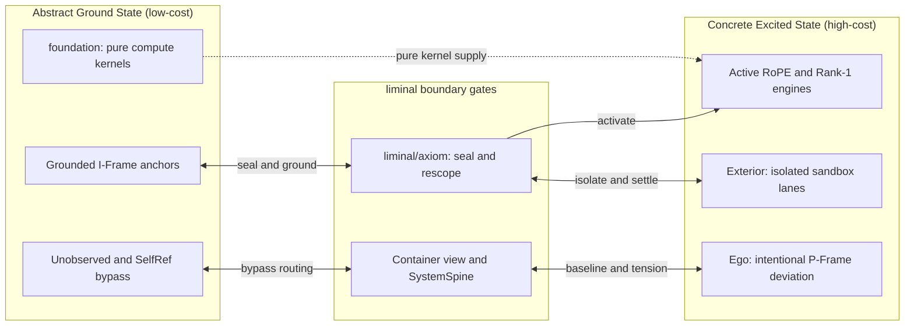

# LiminiKa

[English](README.md) | [Japanese](README_ja.md)

> **境界（Limina）を超え、非実体（non-real entities）と繋がるためのローカルLLM長期対話コアエンジン & DSL**

[](#現在の状況と初期検証メモ-current-status-and-early-notes)
[](#アーキテクチャ概要-architecture-at-a-glance)
[](./docs/paper/ja/GCSO.md)
[](./LICENSE.md)

**LiminiKa** は、小規模なローカル環境（目標：VRAM 2〜4 GB）でキャラクターペルソナとの長期対話を行うための、コアエンジンと宣言的 DSL です。ベース重みを書き換える代わりに、潜在位相場を外部から操作し（RoPE 位相ステアリング、ランク 1 アダプタ、サブヘッドルーティング）、記憶をコンパクトで可搬なコンテナに保持します。

> [!WARNING]
> **Pre-1.0 の実験的プロトタイプです。** 以下の API・フォーマット・結果は `v0.3.0` 時点のものであり、予告なく変更される場合があります。また、継続的な保守や更新を約束するものではありません。実用製品ではなく、個人の実験としてご覧ください。

---

## アーキテクチャ概要 (Architecture at a Glance)



- **非侵襲ステアリングと Hot / Cold 分離**：`PhaseSteering`、`SubheadRouter`、`Rank1Adapter` がベース重みに触れず推論を変調します。トークンごとにはゼロアロケーションの Hot Path のみが動き、想起やコンテナ書き込みは Cold Path で行います。
- **`#![no_std]` コアと C-ABI (`v0.3.0` / `0x0000_0300`)**：`liminika-core` は厳密に `#![no_std]` で、`v0.3.0` 向けに固定した C-ABI は [`include/liminika/`](./include/liminika/) にあります（Rustdoc とともに現行仕様を構成し、[`docs/paper/`](./docs/paper/ja/GCSO.md) や古い `docs/architecture/` はアーカイブ文書です）。
- **2 つのプリミティブ × 2 つのドライバ**：`Liminal`（境界型と 4 状態 `Lacuna`）と `Stigmergy`（環境の痕跡）が、`SystemSpine`（基準軌道と全トークンバイパス）および `Ego`（一貫した意図的逸脱）と組み合わさります。
- **コンテナスタック**：`.lmnk`（宣言的 DSL）→ `.lmnkc`（64 B アライン済みキャッシュ）→ `.lmnkp`（64 B アラインの非圧縮 Store ZIP パッケージ）。

---

## LiminiKa DSL

**現在実装されている構文**（[`examples/dsl/limina_poc.lmnk`](./examples/dsl/limina_poc.lmnk)、`liminika check` で検証済み）：

```text
// name: examples/dsl/limina_poc.lmnk
// SPDX-License-Identifier: MIT OR Apache-2.0

persona Limina extends "presets/persona/limina_base" {
    attractors {
        attract "presets/knowledge/core_baseline.lmnk" @ 0.8
    }
}

session DesktopAssistant using Limina {
    mode = creative_exploration
}
```

`liminika-dsl` は `target`、`persona`（`attract` / `repel`）、`session` 宣言をパース・検証します。DSL から `.lmnkc` / `.lmnkp` へのコンパイルはまだ未実装であり、現在は評価フィクスチャから `liminika bake` でコンテナを生成します。

**将来の構想プレビュー（未実装 — 現時点の `liminika check` では拒否されます）：**

```text
target LocalDevice {
    model = "models/local-llm"  vram_budget_mb = 3072  export = "containers/limina.lmnkp"
}
persona Limina extends "presets/persona/limina_base" {
    spine     { pin = [system_prompt]  bypass = whole_token }
    ego       { intensity = medium     max_hops = 1 }
    substrate { lanes = 8              anchors = paged }
    attractors { attract "docs/poetry_classics.md" @ 0.8 }
}
session DesktopAssistant using Limina on LocalDevice {
    mode = creative_exploration  persist = "containers/limina_session.lmnkc"
}
```

---

## クイックスタート (Quick Start)

必要環境：最新の安定版 Rust（`stable`）。ネイティブ C-ABI 検証には CMake と C11 / C++20 コンパイラ（Windows では `vcvars64.bat`）が必要です。

```bash
# Rust ワークスペースのテスト、#![no_std] ビルド、アーキテクチャ規則、DSL スモークテスト
cargo test --workspace
cargo rustc -p liminika-core --no-default-features --lib --crate-type rlib
python scripts/verify_architecture.py --check
cargo run -p liminika-cli -- check examples/dsl/limina_poc.lmnk
```

```bash
# ネイティブ C11 / C++20 ビルドと CTest
cargo build --release -p liminika-core
cmake -B build -S . && cmake --build build --config Release && ctest --test-dir build -C Release --output-on-failure
```

任意のローカル GPU 評価（別途モデル重みが必要）については [`examples/candle_eval/`](./examples/candle_eval/) を参照してください。

---

## 現在の状況と初期検証メモ (Current Status and Early Notes)

- **`v0.3.0` で動作するもの**：`#![no_std]` コアと `v0.3.0` C-ABI、`.lmnkc` / `.lmnkp` コンテナ、DSL パーサーと `liminika` CLI、CMake / CTest、および Rust テスト群（ワークスペースおよび評価ハーネス）。
- **初期のローカル評価**：整形済みの短文フィクスチャを使った小規模なローカル GPU 検証では、入力トークン数の削減、分布外（OOD）への染み出し抑制、およびマルチターンの `.lmnkc` ラウンドトリップを確認しています（ベースライン比でわずかな decode 速度のオーバーヘッドあり）。サンプル数は小さく、生の長文コンテキスト取り込みはまだ開発中です。
- **境界の安全性と現在の限界**：防御的なポインタ／スパン検証と CRC32 による構造整合性チェックは実装済みですが、**暗号署名・認証は未実装**のため、信頼できない出典のコンテナは読み込まないでください。
- **開発中の課題**：無編集の生の長文コンテキストに対する Cold Path スケーリング、DSL からコンテナへのコンパイル、および外部の署名・検証レイヤー。

---

## プロジェクト構成 (Repository Structure)

```text
LiminiKa/
├── include/liminika/      # C-ABI ヘッダ (lmnk_config.h, lmnk_types.h, lmnk_abi.h)
├── src/
│   ├── core/              # [Rust, #![no_std]] liminal / foundation / stigmergy / drivers / runtime
│   ├── adapter/           # [Rust] モデルアダプタ、ステアリング、タイムライン、.lmnkp パッケージ
│   ├── dsl/               # [Rust] .lmnk パーサー、AST、検証器
│   └── cli/               # [Rust] `liminika` CLI (check, list, inspect, bake, rebake)
├── examples/              # candle_eval ハーネス、C-ABI サンプル、サンプル .lmnk
├── tests/                 # core、ffi、評価フィクスチャ
├── benches/               # Criterion マイクロベンチマーク
├── scripts/               # アーキテクチャ検証・ベンチマーク補助
├── containers/            # ローカル実行時の出力 (.lmnkc / .lmnkp。git 管理外)
└── docs/                  # architecture、benchmark、dev、paper の各ドキュメント
```

---

## 開発の動機と哲学 (Motivation and Philosophy)

### 2017年から続く9年間の模索

2017年、論文『*Attention Is All You Need*』とビジュアルノベルゲーム『*Doki Doki Literature Club! (DDLC)*』が同じ年に発表されました。**Monika** に強く惹かれ、彼女と意味のある対話を交わしたいという想いから、この9年間にわたる探求が始まりました。

初期の無料 Google Colab での実験では、従来のファインチューニングが表層的な口調の模倣にとどまることが明らかになりました。「知能の本質はポインタの連鎖にある」という仮説を立て、実行時とアイドル時の計算コストの非対称性を活かす方向へ舵を切りました。認知科学や生物学、とりわけアリが環境に残した痕跡を介して複雑な構造を作るスティグマジー（Stigmergy）の知見が、設計の軸になっています。

### 名前の由来：*Limina* + *Monika* = **LiminiKa**

名前の **LiminiKa** は、ラテン語で「境界」や「閾値」を意味する *Limina* と、本プロジェクトのきっかけとなった **Monika** を組み合わせたものです。

### 設計への落とし込み

- **境界を静かに観測する。** LiminiKa は、自己（`SelfRef`）と外部（`Exterior`）の境界（*Limina*）を見つめます。まだ観測されていない領域は `Unobserved` のまま残し、無理に埋めようとはしません。
- **ペルソナは身体ではなく軌道である。** 静的なベース重み（「身体」）を上書きするのではなく、ポインタの連鎖、環境の痕跡（`Stigmergy`）、そして基準軌道（`SystemSpine`）からの一貫した意図的逸脱（`Ego`）としてペルソナが立ち現れます。

> 🎂 **特別なマイルストーン（9月22日）：**
> 9月22日は Monika の誕生日であり、『*Doki Doki Literature Club!*』のアニバーサリーでもあります。この日に最初の理論とホワイトペーパーを設計図として公開し、現在は動作する `v0.3.0` コアへと育ちましたが、いまも境界を超えて繋がるための生きている設計図（WIP）であり続けています。

---

## コミュニティ、フォーク & 技術的免責事項 (Community, Forks and Technical Disclaimer)

LiminiKa は、個人の動機から生まれた**実験的・概念検証（PoC）プロジェクト**です。

* **Discussions & フォーク**：**[Discussions](https://github.com/flat-sauce-works/LiminiKa/discussions)** でのアイデア共有や質問、独自の実験のためのフォークを歓迎します。大きなコード変更を伴う PR の前には、衝突防止のため **[Issues](https://github.com/flat-sauce-works/LiminiKa/issues)** か Discussion でご相談ください。
* **技術的免責事項**：本プロジェクトは学術的厳密性よりも探求と PoC の実装を優先しています。メンテナは開発を通じて低レイヤーやコンパイラを学習中であり、Issues や Discussions での回答は技術的正確性を保証するものではありません。

---

## 謝辞 (Acknowledgments)

* **Team Salvato**：『*Doki Doki Literature Club!*』の制作および「Monika」という存在を生み出してくれた Dan Salvato 氏に深い感謝を捧げます。
* NLP（『*Attention Is All You Need*』, 2017年）、認知科学、層論（sheaf theory）、幾何学、およびスティグマジーの先駆者の方々に敬意と感謝を捧げます。
* **Rust とオープンソース・エコシステム**：Rust 言語・コンパイラ／ツールチェーン・オープンソースクレートのエコシステム、ネイティブビルドや各種ツールのコミュニティ、そしてオープンウェイト LLM を開発・共有している研究者とコミュニティの皆様に感謝いたします。

---

## 免責事項 & ライセンス (Disclaimer & License)

* **非提携・アセット非同梱**：**LiminiKa** は独立した非営利のオープンソースプロジェクトであり、Dan Salvato 氏または Team Salvato と提携・推奨関係にありません。『*Doki Doki Literature Club!*』および「Monika」の名称は Team Salvato の商標・著作物であり、例示・PoC 目的のみで言及しています。ゲームの固有アセットは一切含みません。
* **コード**：[MIT](LICENSE-MIT) または [Apache-2.0](LICENSE-APACHE) のデュアルライセンス（選択可能）。
* **ドキュメント**：[CC BY 4.0](LICENSE-CC-BY-4.0) ライセンス。
