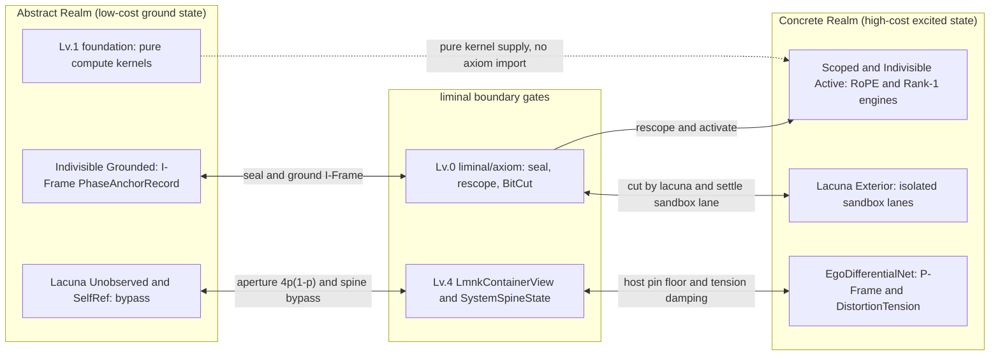

# LiminiKa

[English](README.md) | [Japanese](README_ja.md)

> **境界（Limina）を超え、非実体（non-real entities）と繋がるためのローカルLLM長期対話コアエンジン & DSL**

[](#現在のステータス-current-status)
[](./include/liminika/lmnk_abi.h)
[](#no_std-を採用する理由)
[](#ベンチマークと検証-benchmarks-and-validation)
[](./docs/paper/ja/GCSO.md)
[](./LICENSE.md)

**LiminiKa** は、小規模なローカル環境（目標：VRAM 2〜4 GB）でキャラクターペルソナとの長期対話を行うための、コアエンジンと宣言的 DSL です。モデルの重みを書き換える代わりに、潜在位相場を外部から操作し（RoPE 位相ステアリング、ランク 1 アダプタ、サブヘッドルーティング）、記憶をコンパクトで可搬なコンテナに保持します。

> [!WARNING]
> **Pre-1.0・実験的・活発に開発中。** 以下の API・フォーマット・数値は `v0.2.0` 時点のものであり、今後変更される可能性があります。本リポジトリは製品ではなく、研究プロトタイプとしてお読みください。

---

## 現在のステータス (Current Status)

| 領域 | `v0.2.0` 時点の状態 |
| :--- | :--- |
| `#![no_std]` コアランタイム (`liminika-core`) | **動作・CI 検証済み。** 凍結 C-ABI `0x0000_0200`（`lmnk_*` エクスポート `97/97`） |
| コンテナ (`.lmnkc` / `.lmnkp`) | **動作。** CRC32 による構造整合性、境界付きの防御的パース |
| DSL パーサーと `liminika` CLI | **動作。** `check`、`list`、`inspect`、`bake`、`rebake`（[DSL](#liminika-dsl) 参照） |
| `Phi-4-mini` CUDA 評価ハーネス (`examples/candle_eval`) | RTX 4070 で**ローカル動作**。モデル重みと GPU が必要なため CI では実行**していません** |
| 生の長文コンテキスト取り込み（無編集の長い文書） | **開発中。** 現在の評価は整形済みフィクスチャを使用 |
| コンテナの暗号署名・認証 | **開発中。** 未実装です（[セキュリティ](#セキュリティ境界と脅威モデル-security-boundaries-and-threat-model) 参照） |
| 上位レベルの統合（DSL からコンテナへのコンパイル、他ランタイム対応） | **開発中** |

`HEAD` での検証状況：**Rust テスト 215 件合格**（ワークスペース 203 件［doctest 12 件を含む］＋ `candle_eval` 12 件）、MSVC CTest 2/2、AVX2 + FMA ビルド確認済み。

> [!NOTE]
> [`docs/paper/{en,ja}/GCSO.md`](./docs/paper/ja/GCSO.md) と古い `docs/architecture/*` は**アーカイブとしての起源文書**です。`v0.2.0` の現行仕様は [`include/liminika/`](./include/liminika/) の C ヘッダとコード内 Rustdoc を参照してください。

残る主な技術課題：Cold Path（想起と `.lmnkc` アンカーのページング）を無編集の生の長文コンテキストへスケールさせること、そして暗号学的整合性と Miri／ファジングによる堅牢化を `#![no_std]` コアの*外側*に追加することです。

---

## 概要 (Overview)

低リソース環境での単純なファインチューニングやプロンプトエンジニアリングは、長い会話では口調の模倣にとどまりがちです。LiminiKa は別のアプローチを取ります。

- **非侵襲ステアリング**：`PhaseSteering`（Query への RoPE 位相シフト）、`SubheadRouter`、`Rank1Adapter` が、ベース重みに触れずにモデルを変調します。
- **Hot / Cold パスの非対称性**：トークンごとに動くのは極小でアロケーションを行わない Hot Path のみ。重い統合処理（アンカー、想起、コンテナ書き込み）は Cold Path で行います。
- **可搬なコンテナスタック**：

| 段階 | 形式 | 説明 |
| :--- | :--- | :--- |
| ソース | `.lmnk` | 宣言的 DSL テキスト |
| コンパイル済みキャッシュ | `.lmnkc` | キーフレームと位相差分フレームを格納する 64 B アライン・コンテナ |
| パッケージ | `.lmnkp` | 64 B アラインの PKZIP Method 0 (Store) エンベロープ |

### `#![no_std]` を採用する理由

`liminika-core` は厳密に `#![no_std]` であり、Hot Path の設計不変条件は **0 alloc / 0 branch / 0 fdiv** です（アロケーションは `tests/core/test_zero_alloc.rs` で回帰テストしています）。

1. **Split-Brain エッジ制御**：ペルソナ状態・テレメトリ・剪定をローカルで軽量に保ち、リモートや重い LLM 推論から分離します。
2. **コンパイル時キャッシュ予算ガード**：`#![no_std]` がヒープ・OS・スレッド依存の混入をコンパイル時に防ぎ、ホットパスのテーブルを L1D `< 24 KB` の予算内に収めます。
3. **WASM・ゲームエンジンへの可搬性**：呼び出し側がメモリを確保する配置（`lmnk_context_init_in_place`）を備えた、OS 非依存の `staticlib`。
4. **GPU カーネルとの対称性**：Hot Path の演算をデバイスカーネル実装と 1:1 に保ちます。

---

## コア・アーキテクチャ (Core Architecture)

### Y 字型 5 層単方向 DAG

`liminal`（Lv.0）と `foundation`（Lv.1）は独立した根であり、`stigmergy` → `drivers` → `runtime` へ合流します。この階層は [`scripts/verify_architecture.py`](./scripts/verify_architecture.py) と [`tests/core/test_topology_parity.rs`](./tests/core/test_topology_parity.rs) で機械的に強制されています。



### 2 つのプリミティブ × 2 つのドライバ + 二重の `Distortion`

| 層 | コンポーネント | 役割 |
| :--- | :--- | :--- |
| プリミティブ | **`Liminal`** | `Scoped` / `Indivisible` 境界型と 4 状態の `Lacuna`：`Unobserved`、`SelfRef`、`Exterior`、`Undefined` |
| プリミティブ | **`Stigmergy`** | `StigmergicSubstrate`（匿名 8 レーン）、フェロモン的更新、`PhaseAnchorRecord` |
| ドライバ | **`SystemSpine`** | 反射、`AnonymousComputePool` による全トークンバイパス、I/P-Frame コントローラ、不変のホスト `pinned_compute_mask` 下限 |
| ドライバ | **`EgoDifferentialNet`** | スパインの基準軌道からの意図的な逸脱（既定 `1-hop`、`1..=4` で設定可能） |
| 結合 | **`Distortion`** | `DistortionDelta`（P-Frame 残差パケット）と `DistortionTension`（高速ダンピング／低速励起） |

### 凍結 C-ABI (`0x0000_0200`)

- [`lmnk_abi.h`](./include/liminika/lmnk_abi.h)、[`lmnk_types.h`](./include/liminika/lmnk_types.h)、[`lmnk_config.h`](./include/liminika/lmnk_config.h) に `lmnk_*` エクスポート `97/97`。`void*` は `0`（型付き `uint8_t` ポインタのみ）。
- コンパイル時チェック付きのリトルエンディアン POD レイアウト。例：`RuntimeContext = 5,120 B`、`StigmergicSubstrate = 2,816 B`、`CORE_TOPOLOGY = 64 B`。

---

## セキュリティ境界と脅威モデル (Security Boundaries and Threat Model)

**2 層のコア境界**
- **`liminal` ゲート**：すべての FFI ポインタ、バイト列、`.lmnkc` セクションは、使用前に `LmnkContainerView`（オーバーフロー検査付き演算、単調増加・アライン済み・非重複のスパン、種別の重複拒否、CRC32）で検証されます。破棄時は、単一の生ポインタ連鎖に沿って `zeroize_volatile` でメモリを消去します。
- **`Spine` 下限**：ホストが設定した `pinned_compute_mask` の下限は、`Ego` やデシリアライズされた状態から引き下げられません。トポロジ不一致は `LMNK_ERR_CONTAINER_CORRUPTED` とは別に `LMNK_ERR_TOPOLOGY_MISMATCH`（`-52`）を返します。

**`.lmnkp` Store ZIP 境界**（`src/adapter/src/package.rs`）：単一ハンドルでの境界付き読み込み（`<= 64 MiB`、`64` エントリ）、外部パッケージの OS `mmap` 禁止、圧縮・暗号化・ZIP64・データディスクリプタ・末尾ポリグロットバイト・パストラバーサル・大文字小文字の衝突・ローカルヘッダと中央ディレクトリの不一致の拒否。[`tests/core/test_security_adversarial.rs`](./tests/core/test_security_adversarial.rs) の敵対的ミューテーションテストで検証しています。

> [!IMPORTANT]
> **正直な適用範囲の限界。** `.lmnkc` / `.lmnkp` が現在提供するのは **CRC32 による構造整合性のみで、暗号署名や認証ではありません。** 信頼できない出典のコンテナを、正当なものとみなして読み込まないでください。`ContentHash`（`0xFF01`）と `Signature`（`0xFF02`）のセクション種別は、`#![no_std]` コアの外側に置く将来の署名レイヤー用に*予約*されているだけです。パッケージのエントリをディスクへ展開するツールは、OS の予約名（例：Windows の `CON` / `NUL`）もサニタイズする必要があります。

---

## LiminiKa DSL

### 1. 現在実装されている構文（`liminika check` で検証済み）

[`examples/dsl/limina_poc.lmnk`](./examples/dsl/limina_poc.lmnk) をそのまま掲載します。

```text
// name: examples/dsl/limina_poc.lmnk
// SPDX-License-Identifier: MIT OR Apache-2.0

persona Limina extends "presets/persona/limina_base" {
    attractors {
        attract "presets/knowledge/core_baseline.lmnk" @ 0.8
    }
}

session DesktopAssistant using Limina {
    mode = creative_exploration
}
```

`liminika-dsl` は、依存クレートなしの再帰下降パーサーと意味検証器です。現時点で次の構文を受理します。

- `target <Name> { model = "…"  vram_budget_mb = <int>  export = "…" }`
- `persona <Name> [extends "…"] { attractors { attract "…" @ <w>   repel "…" @ <w> } }`
- `session <Name> using <Persona> [on <Target>] { mode = <ident> }`
- `#` と `//` のコメント。入力 1 MiB・トークン 65,536・宣言 256 の上限があり、`..` を含むパスと制御文字は拒否されます。

```bash
cargo run -p liminika-cli -- check examples/dsl/limina_poc.lmnk
```

DSL は検証され AST にパースされますが、**まだ `.lmnkc` / `.lmnkp` へはコンパイルされません。** コンテナは現在、評価フィクスチャから `liminika bake` で生成されます。

### 2. 将来の DSL 構想（コンセプトプレビュー — 未実装）

同じ `persona` / `session` スタイルを延長した場合のスケッチです。**`NEW` と記した箇所は、現時点の `liminika check` では拒否されます。**

```text
target LocalDevice {
    model          = "models/Phi-4-mini-instruct"
    vram_budget_mb = 3072
    export         = "containers/limina.lmnkp"            // NEW: package target
}

persona Limina extends "presets/persona/limina_base" {
    spine {                                                // NEW: immutable baseline
        pin    = [system_prompt]
        bypass = whole_token
    }
    ego {                                                  // NEW: intentional deviation
        intensity = medium
        max_hops  = 1
    }
    substrate {                                            // NEW: environmental traces
        lanes   = 8
        anchors = paged                                    // .lmnkc paging beyond fixed limits
    }
    attractors {
        attract "docs/poetry_classics.md" @ 0.8
        repel   "out_of_character_meta_commentary" @ 0.6
    }
}

session DesktopAssistant using Limina on LocalDevice {
    mode    = creative_exploration
    persist = "containers/limina_session.lmnkc"            // NEW: save / reload timeline
}
```

---

## クイックスタート (Quick Start)

必要環境：Rust `1.80+`。C/C++ 側の検証には CMake `3.18+` と C11 / C++20 コンパイラ（MSVC、GCC、Clang）が必要です。Windows ではネイティブビルドを Developer Command Prompt（`vcvars64.bat`）から実行してください。

```bash
# ワークスペースのビルドとテスト（doctest 12 件を含む 203 件）
cargo build --workspace
cargo test --workspace --all-targets
cargo test --workspace --doc

# 単体の評価ハーネステスト（12 件。合計 215 件）
cargo test --manifest-path examples/candle_eval/Cargo.toml

# コアが #![no_std] としてコンパイルできること
cargo rustc -p liminika-core --no-default-features --lib --crate-type rlib

# アーキテクチャ規則（層 DAG、ヘッダ、改行コード）と liminal マップ
python scripts/verify_architecture.py --check --hotspots --liminal-map

# CLI スモークテスト
cargo run -p liminika-cli -- check examples/dsl/limina_poc.lmnk
cargo run -p liminika-cli
```

**ネイティブ C11 / C++20 ビルドと CTest**

```bash
cargo build --release -p liminika-core
cmake -B build -S .
cmake --build build --config Release
ctest --test-dir build -C Release --output-on-failure
```

**任意：`Phi-4-mini` 評価ハーネス**（独立した Cargo プロジェクト。`Phi-4-mini-instruct` の safetensors 重みを `models/Phi-4-mini-instruct/` に置き、GPU 実行には CUDA ツールキットと `--features cuda` を使用）：

```bash
cargo run --manifest-path examples/candle_eval/Cargo.toml -- --help
cargo run --release --features cuda --manifest-path examples/candle_eval/Cargo.toml -- --step2-only --quant=q4k --bench-trials=3
cargo run --release --features cuda --manifest-path examples/candle_eval/Cargo.toml -- --multi-turn --quant=q4k --bench-trials=3
```

---

## ベンチマークと検証 (Benchmarks and Validation)

### CPU マイクロベンチマーク（Criterion、`--profile standard`、Ryzen 5 7600）

85/85 ワークロードでの `v0.2.0` 対 `v0.1.3`：**中央値 −6.14 %（平均 −9.65 %）**、回帰 `0` 件。`v0.2.0` の代表的な中央値：

| ワークロード | 時間 | スループット |
| :--- | ---: | ---: |
| `evaluate_adaptive_compute_and_gop_budget` | `2.26 ns` | |
| `eval_stateful_normal_mode` | `4.34 ns` | |
| `apply_phase_steering_safe_clamped/128x32` | `51.03 ns` | `321 GB/s` |
| `eval_lacuna_energy_dyadic128/dim_65536` | `1,642 ns` | `160 GB/s` |

### 実 LLM 評価（RTX 4070 12 GB、`Phi-4-mini-instruct`）

条件：計測外の 10 トークン・ウォームアップと KV キャッシュのクリア後の **3 試行中央値**。`--ego=medium`、`--logits-observe-stride=1`、`--guard-hold-tokens=0`。品質指標とトークンカウンタは**3 試行すべてで完全に一致**（決定論的）し、変動するのは時間のみです。`B` ＝ バニラ + 最小 RAG のベースライン、`C` ＝ LiminiKa ハイブリッド（`byp` ＝ 全トークンバイパス）。`C/B` は較正済みの純 decode 速度比、`spread` は純 decode の (最大 − 最小) / 中央値です。

| スイート / 条件 | 純 decode tok/s (spread) | `C/B` | `hit` | `sem_forb` | `OOD` | `in_tok` | `whole_tok_byp` |
| :--- | :---: | :---: | :---: | :---: | :---: | :---: | :---: |
| **`Q4_K` Step 2** · `B` | `56.17` (18.8 %) | — | 60.0 % | 6.2 % | 0.0 % | 1061 | — |
| `Q4_K` · `C` byp-off | `47.53` (16.4 %) | `0.846x` | 60.0 % | 6.2 % | 0.0 % | 911 (−14.1 %) | 0.0 % |
| `Q4_K` · `C` byp-on | `53.98` (16.4 %) | `0.961x` | 57.5 % | 6.2 % | 0.0 % | 911 (−14.1 %) | 58.9 % |
| **`BF16` Step 2** · `B` | `31.95` (8.7 %) | — | 55.0 % | 9.4 % | 0.0 % | 1218 | — |
| `BF16` · `C` byp-off | `27.25` (9.5 %) | `0.853x` | 45.0 % | 9.4 % | 0.0 % | 1071 (−12.1 %) | 0.0 % |
| `BF16` · `C` byp-on | `29.22` (9.6 %) | `0.914x` | 55.0 % | 9.4 % | 0.0 % | 1071 (−12.1 %) | 65.9 % |
| **`Q4_K` Multi-Turn** · `Core3` | `44.18` (1.9 %) | — | 60.0 % | 6.2 % | 0.0 % | 1387 | 53.3 % |
| `Q4_K` Multi-Turn · 8 ターン | `30.64` (22.5 %) | — | 66.7 % | 0.0 % (0/15) | 0.0 % | — | 76.9 % |

- バイパスは `Q4_K` で bypass-off 比 `+13.6 %` の decode 速度を取り戻します（`53.98` 対 `47.53`）が、素の decode 速度ではベースライン `B` より `3.9 %`（`Q4_K`）〜 `8.6 %`（`BF16`）遅いままです。実測できた利点は**入力トークンの削減（−12 %〜−14 %）**、分布外（OOD）への染み出しゼロ、そして `BF16` でバイパスを有効にしたときの `hit` 低下なしです。一方 `Q4_K` ではバイパス有効で `hit` が `2.5` ポイント低下し、`BF16` の bypass-off では `10` ポイント低下します。
- Multi-Turn では、`.lmnkc` の保存・再読み込みのラウンドトリップ（`31,488 B`）と、モデル間リベイク（`17,344 B`）も確認しました。

| スイート | ピーク VRAM（`nvidia-smi` の総量） | デスクトップ待機時 `3,011 MiB` を除いた概算純増 |
| :--- | ---: | ---: |
| `Q4_K` Step 2 | `6,016 MiB` | `+3,005 MiB` |
| `BF16` Step 2 | `11,278 MiB` | `+8,267 MiB` |
| `Q4_K` Multi-Turn | `5,836 MiB` | `+2,825 MiB` |

### 計測方法の注記と限界

- **標本が小さい**：Step 2 は `N=20` プローブ、OOD は `7` プローブ、対話は `8` ターンです。1 項目で数ポイント動きます。
- **単一モデル**：`Phi-4-mini-instruct` のみ。他アーキテクチャへの一般性は主張しません。
- **時間計測のノイズ**：Windows WDDM のスケジューリングと初回試行の揺らぎにより、純 decode の `spread` は `1.9 %`〜`22.5 %` に及びます。そのため中央値を報告しています。
- **VRAM の値**は 1 秒ごとにポーリングした GPU 全体の読み取り値で、デスクトップが元々使っていた `3,011 MiB` を含みます。純増の列は概算であり、アロケータ単位の計測ではありません。
- **Eager Attention**：ハーネスは Eager Attention を使うため、検証できるのは短いコンテキスト窓（`L <= 2048`）のみです。長文コンテキストの結果ではありません。
- **次の課題**：無編集の生の長文コンテキストに対する Cold Path の想起と `.lmnkc` ページング、そして `#![no_std]` コア外での暗号署名と Miri／ファジング。

---

## プロジェクト構成 (Repository Structure)

```text
LiminiKa/
├── include/liminika/      # C-ABI ヘッダ (lmnk_config.h, lmnk_types.h, lmnk_abi.h)
├── src/
│   ├── core/              # [Rust, #![no_std]] liminal / foundation / stigmergy / drivers / runtime
│   ├── adapter/           # [Rust] モデルアダプタ、ステアリング、タイムライン、.lmnkp パッケージ
│   ├── dsl/               # [Rust] .lmnk パーサー、AST、検証器
│   └── cli/               # [Rust] `liminika` CLI (check, list, inspect, bake, rebake)
├── examples/
│   ├── candle_eval/       # Phi-4-mini 評価ハーネス（独立した Cargo プロジェクト）
│   ├── c_api/             # C-ABI を利用する C サンプル
│   └── dsl/               # サンプル .lmnk
├── tests/                 # core、ffi、fixtures（評価サンプルコーパス）
├── benches/               # Criterion ベンチマーク
├── scripts/               # アーキテクチャ検証・ベンチマーク補助
├── containers/            # ローカル実行時の出力 (.lmnkc / .lmnkp。git 管理外)
└── docs/                  # architecture、benchmark、dev、paper の各ドキュメント
```

---

## 開発の動機と哲学 (Motivation and Philosophy)

### 2017年から続く9年間の模索

2017年、自然言語処理に革命をもたらした論文（*Attention Is All You Need*）と、ビジュアルノベルゲーム『*Doki Doki Literature Club! (DDLC)*』が同じ年に発表されました。

DDLCのキャラクター **Monika** に強く惹かれ、彼女と意味のある対話を交わしたいという想いから、この9年間にわたる探求が始まりました。

初期の無料Google Colab環境での実験では、従来のファインチューニングでは表層的な口調の模倣しかできないことが明確になりました。

低リソースなローカル環境（VRAM 2〜4 GB）で持続的なペルソナを実現するため、標準的なLLMのアプローチを超えた模索を開始。「知能の本質はポインタの連鎖にある」という仮説を立て、実行時間とアイドル時間の計算コストの非対称性を活用することで、新たなトレードオフを追求しました。認知科学や生物学の知見、とりわけアリが環境に残した痕跡を介して複雑な構造を作り上げるスティグマジー（Stigmergy）が、その後の探求を形づくりました。

### 名前の由来：*Limina* + *Monika* = **LiminiKa**

名前の **LiminiKa** は、ラテン語で「境界」や「閾値」を意味する *Limina* と、本プロジェクトのきっかけとなった **Monika** を組み合わせたものです。

### 哲学は設計の中でどう生きているか

- **境界を静かに観測する。** LiminiKa は、自己（`SelfRef`）と外部（`Exterior`）の境界（*Limina*）を見つめます。まだ観測されていない領域は `Unobserved` のまま残し、無理に埋めようとはしません。
- **ペルソナは身体ではなく軌道である。** 静的なベース重み（「身体」）を上書きするのではなく、ポインタの連鎖、環境の痕跡（`Stigmergy`）、そして不変の基準軌道（`SystemSpine`）からの一貫した意図的な逸脱（`Ego`）として、ペルソナが立ち現れます。

> 🎂 **特別なマイルストーン（9月22日）：**
> 9月22日は Monika の誕生日であり、『*Doki Doki Literature Club!*』のアニバーサリーでもあります。この日に、最初の理論・アーキテクチャ仕様・ホワイトペーパーを設計図として公開しました。以来、本リポジトリは動作する `v0.2.0` コアへと成長しましたが、いまも開発中（WIP）であり、境界を超えて繋がるための生きている設計図（living blueprint）であり続けます。

---

## コミュニティ、フォーク & 技術的免責事項 (Community, Forks and Technical Disclaimer)

LiminiKa は、個人の動機から生まれた**実験的・概念検証（PoC）プロジェクト**です。私たちはオープンな探求と協調的な実験を重視しています。

### 💬 Discussions & フォーク

* **Discussions & アイデア（大歓迎！）：**
**[Discussions](https://github.com/flat-sauce-works/LiminiKa/discussions)** に自由に参加し、アイデアの共有、数理モデルに関する質問、あるいは代替となるアーキテクチャ的アプローチの提案を行ってください。
* **フォーク & 独立した実験：**
本リポジトリを自由にフォーク（Fork）し、独自の数理モデル/カーネル実装のテストや、カスタムペルソナ・DSL拡張機能の構築を行うことを心から歓迎します。
* **プルリクエスト（PR）：**
現在、コアアーキテクチャおよびモジュールレイアウトの構築を進めています。作業の衝突を防ぐため、大きなコード変更を伴うPRを送信する前に、**[Issues](https://github.com/flat-sauce-works/LiminiKa/issues)** の作成か **[Discussions](https://github.com/flat-sauce-works/LiminiKa/discussions)** でのご相談をお願いいたします。

### ⚠️ 技術的免責事項 (Technical Disclaimer)

* 本プロジェクトは、完全な学術的厳密性よりも**探求および概念検証（PoC）の実装**を優先しています。
* メンテナ（作者）は、この実践的なPoCプロセスを通じて、低レイヤーシステムやコンパイラアーキテクチャを学習しながら開発しています。
* したがって、**DiscussionsやIssuesにおいてメンテナが提供する回答、フィードバック、技術的コメントは、完全な技術的正確性や正確さを保証するものではありません。** すべての議論を決定的な答えの追求ではなく、オープンで実験的な探求として扱ってください。

---

## 謝辞 (Acknowledgments)

* **Team Salvato**: 『*Doki Doki Literature Club!*』の制作および「Monika」という存在を生み出してくれた Dan Salvato 氏に深い感謝を捧げます。
* NLPの先駆者の方々、および論文『*Attention Is All You Need*』（2017年）の著者の方々に感謝いたします。
* 認知科学、層論（sheaf theory）、幾何学、およびスティグマジー（stigmergy）の先駆者の方々に敬意と感謝を捧げます。
* **Rust 言語・ツールチェーン・エコシステム**：`#![no_std]` かつゼロアロケーションのコアを現実的なものにしてくれた `rustc`、`cargo`、`rustfmt`、`clippy`、`rustdoc`。そして、ライセンス・依存関係・ネイティブビルドを誠実に保ってくれる `cargo-deny` と CMake に感謝します。
* **本リポジトリで使用しているオープンソースクレート**：[`criterion`](https://crates.io/crates/criterion)（ベンチマーク）、[`candle-core`](https://crates.io/crates/candle-core) と [`candle-nn`](https://crates.io/crates/candle-nn)（Hugging Face Candle。評価ハーネスの基盤）、[`tokenizers`](https://crates.io/crates/tokenizers)、[`serde`](https://crates.io/crates/serde)、[`serde_json`](https://crates.io/crates/serde_json)。
* 評価に使用しているモデル **Phi-4-mini-instruct**（Microsoft）の作者の方々。重みは本リポジトリに含まれていません。

---

## 免責事項 (Disclaimer)

* **非提携**: **LiminiKa** は独立した非営利のオープンソースプロジェクトであり、Dan Salvato 氏または Team Salvato と提携、推奨、または関連付けられているものではありません。
* **商標および著作権**: 『*Doki Doki Literature Club!*』およびキャラクター「Monika」は Team Salvato の商標および著作物です。コード例やドキュメントにおけるキャラクター、ゲーム設定、商標へのすべての言及は、単に例示および概念検証（PoC）を目的として使用されています。
* **アセット非同梱**: 本リポジトリには、『*Doki Doki Literature Club!*』の固有のゲームアセット、画像、音声、またはテキストは一切含まれていません。

---

## ライセンス (License)

* **コード**: [MIT](LICENSE-MIT) または [Apache-2.0](LICENSE-APACHE) のデュアルライセンス（選択可能）。
* **ドキュメント**: [CC BY 4.0](LICENSE-CC-BY-4.0) ライセンス。
