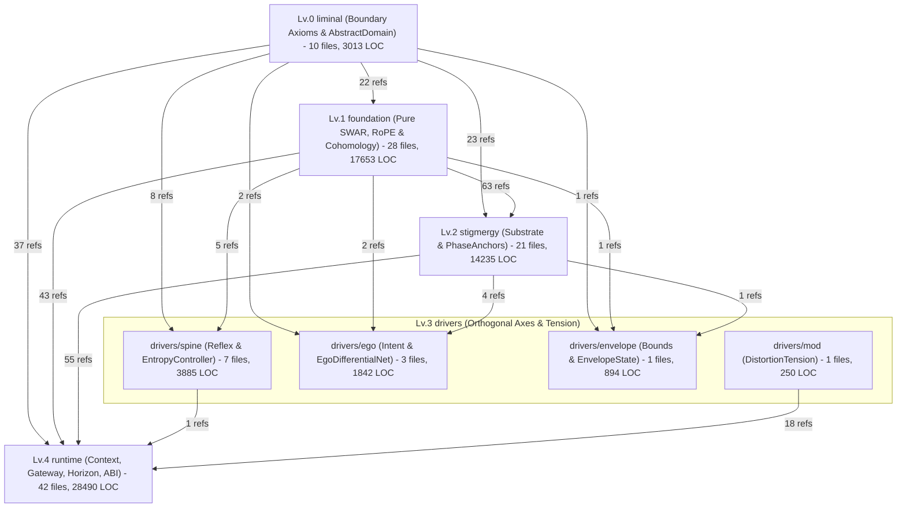
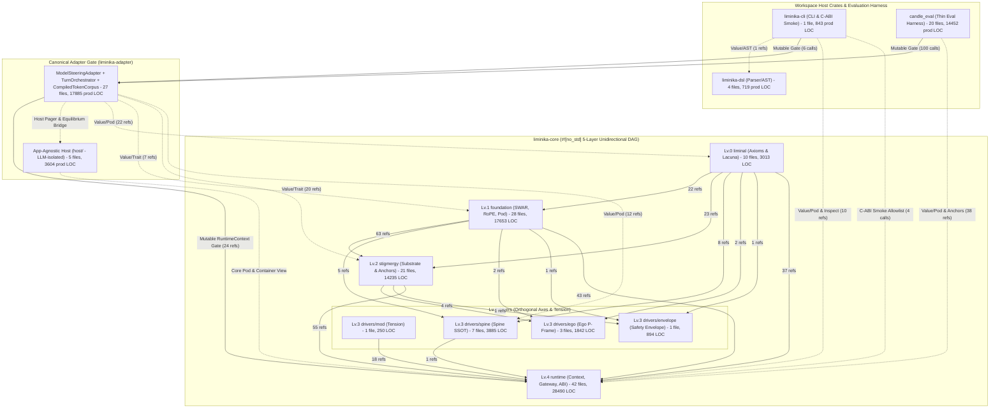
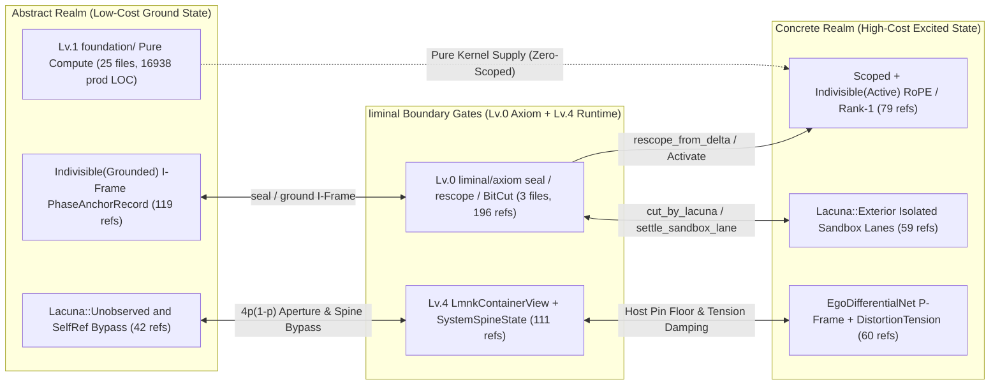

# LiminiKa Architecture Overview (`v0.4.0`)

## 1. Core Architectural Model

LiminiKa separates semantic-free control and steering primitives (`liminika-core`) from host runtime orchestration, persistence, and model-specific adapters (`liminika-adapter`, `liminika-dsl`, `liminika-cli`).

### 1.1 Five-Layer Unidirectional DAG

`liminika-core` is strictly `#![no_std]` with zero hot-path dynamic allocation ($C_{\mathrm{alloc}} = 0$) and enforces a five-layer unidirectional Y-shaped dependency graph rooted at `liminal`:

```text
liminal (Lv.0) || foundation (Lv.1) -> stigmergy (Lv.2) -> drivers (Lv.3) -> runtime (Lv.4)
```

- **Lv.0 `liminal/` (`#![forbid(unsafe_code)]`, `core` only)**: Defines the boundary axioms (`Scoped<O: Cuttable, T>`, `Indivisible<C: IndivisiblePhase, T>`, open `AbstractDomain`), orthogonal cut and 4-state `Lacuna` (`Unobserved`, `SelfRef`, `Exterior`, `Undefined`) definitions, `BitCut{8,32,64}`, `LacunaPartition8`, `BoundarySignal`, and `AttributionTag`.
- **Lv.1 `foundation/` (`core` + non-axiom `liminal` only)**: Pure compute root containing portable SWAR/SIMD kernels, RoPE phase operators, Rank-1 outer-product kernels, sheaf cohomology utilities, CRC32 tables, and centralized `Pod` implementations. Contains zero `Scoped`, `Indivisible`, or `liminal::axiom` imports.
- **Lv.2 `stigmergy/`**: Y-confluence joining `liminal` and `foundation`. Implements the 8-lane `StigmergicSubstrate`, Q0.7 pheromone calculus, `PhaseAnchorRecord` (`"LNKR"`), `PointerTrail`, `PhaseSteeringEngine`, and `ResidualAdapterEngine`.
- **Lv.3 `drivers/`**: Houses three mutually isolated execution drivers (`spine`, `ego`, `envelope`) with strict 6-pair sibling isolation, mediated through `DistortionTension` and Lv.4 orchestration.
- **Lv.4 `runtime/`**: Hosts `RuntimeContext` (`5,184 B`, `align(64)`, `!needs_drop`), `&mut GatewayFrame`, `StandardPhaseKvGopCache`, `LmnkContainerView`, static `CORE_TOPOLOGY` (`64 B`, `topology_crc32 = 0xfcb10184`), and the 27-function C-ABI firewall (`0x0000_0400`).

### 1.2 Two Primitives × Three Isolated Drivers

Every runtime action carries a compact 3-bit `AttributionTag` (`[Driver(2b) | Primitive(1b)]`) partitioning provenance across two geometric primitives and three mutually isolated drivers:

| Axis | Component | Role |
| :--- | :--- | :--- |
| **Primitive 0** | `Liminal` | Boundary thresholds, 4-state `Lacuna` epistemic partitioning, zero-aperture non-observation, and `Exterior` sandbox staging. |
| **Primitive 1** | `Stigmergy` | 8-lane anonymous working substrate, 8-granule quorum, volatile Q0.7 traces, and crystallized `PhaseAnchorRecord` centroids. |
| **Driver 0** | `Spine` (`drivers/spine`) | Deterministic mechanical reflexes, I/P-Frame transition control, whole-token bypass (`AnonymousComputePool`), and dynamic logits observation stride. |
| **Driver 1** | `Ego` (`drivers/ego`) | Active differential exploration (`EgoDifferentialNet`, P-Frame chains) to break basin stagnation under tension bounds. |
| **Driver 2** | `Envelope` (`drivers/envelope`) | Immutable viability bounds (`EnvelopeBounds`, `EnvelopeState`), host pin floors, bounded pressure/chatter/exterior contraction, calm recovery, and online baseline EMA. |

### 1.3 Self-Contained Core Replication & Autonomous Calibration

`liminika-core` contains zero domain or LLM vocabulary and compiles to native static/shared libraries as well as `wasm32-unknown-unknown`. Host applications embed an independent copy of `liminika-core` per session or workload through a layered boundary:

1. **`liminika-core` (`#![no_std]`)**: Semantic-free Tier-1 `Pod` primitives (`LacunaPartition8`, `BoundarySignal`, `EnvelopeState`) and Tier-2 `RuntimeContext` (`5,184 B`).
2. **`liminika-adapter::host` (app-agnostic substrate)**: Anchor pager, cross-restart equilibrium persistence, two-track path sanitizer (`path_guard`), and SHA-256/Ed25519 container integrity (`integrity`), strictly isolated from LLM vocabulary.
3. **`liminika-adapter` (model integration)**: Abstract-receiver traits (`RopeSteeringTarget`, `TokenSequenceEncoder`, `PrefixAliasProbe`, `TurnKvCacheStepping`), `RecallEnvelopeBounds` viability envelope, automatic layer selection (`--layer-mask=auto`), two-fold cross-fitted null calibration, two-tier Guard suppression, and `TurnOrchestrator`.
4. **`liminika-cli` / `examples/candle_eval`**: Thin command-line and local evaluation frontends delegating all mutable core orchestration through `liminika-adapter`.

---

## 2. Live Architecture Diagrams (`cargo xtask`)

All diagrams and tables below are generated directly from the live source tree and `CORE_TOPOLOGY`. To regenerate them after structural changes:

```bash
cargo xtask --mermaid --mermaid-workspace --liminal-map
```

### 2.1 Core Five-Layer Unidirectional DAG (`cargo xtask --mermaid`)



### 2.2 Workspace Crate & Gate Graph (`cargo xtask --mermaid-workspace`)



### 2.3 Abstraction ↔ Concretion Map (`cargo xtask --liminal-map`)



#### Static `liminal` Abstraction ↔ Concretion Correspondence Table

| Abstract Realm (Ground State) | `liminal` Boundary Gate / Op | Concrete Realm (Excited State) | Live `src/core/src` Counts | `CoreTelemetryBank` Counter |
| :--- | :--- | :--- | ---: | :--- |
| Lv.1 `foundation/` non-`Scoped` pure compute | Direct pure kernel call (no `liminal/axiom` import) | Lv.2+ `Indivisible(Active)` RoPE / Rank-1 engines | 25 files / 16938 LOC -> 79 active refs | `stigmergy.decision_counts[0..7]` |
| `Indivisible(Grounded)` I-Frame `PhaseAnchorRecord` | `seal` / `rescope_from_boundary` / `CORE_TOPOLOGY` | `EgoDifferentialNet` P-Frame `DistortionDelta` | 119 grounded refs <-> 60 P-Frame/tension refs | `pframe_chain_evals`, `pframe_total_hops`, `ego.intervention_count` |
| `Lacuna::SelfRef` stationary bypass | `SystemSpineState` + `pinned_compute_mask` | `DistortionTension` damped/excited steering | 42 bypass refs <-> 111 spine/container refs | `whole_token_bypass_events`, `liminal.stationary_shortcut_hits`, `immediate_tension_damps`, `slow_tension_excites` |
| `Lacuna::Unobserved` zero-aperture | `cut_by_lacuna` / `LacunaPartition8` | `Lacuna::Exterior` sandbox (`slot_sandbox_mask`) | 196 axiom gate refs <-> 59 sandbox refs | `unobserved_aperture_zeros`, `exterior_sandbox_stages`, `liminal.slide_in_count`, `liminal.slide_out_count` |

---

## 3. Related Specifications

- [C-ABI Specification (`0x0000_0400`)](./c_abi_spec.md)
- [Container & Package Specification (`.lmnkc` / `.lmnkp`)](./container_spec.md)
- [Declarative DSL Specification (`.lmnk`)](./dsl_spec.md)
- [Benchmarks & Evaluation Results](../benchmark/benchmarks.md)
- [Getting Started](../dev/getting_started.md) & [Testing & Verification](../dev/testing.md)
