# 🚀 LiminiKa (`GCSO`) Non-Invasive LLM Sidecar — Benchmark & Overhead Analysis Report

> **What is LiminiKa (`GCSO`)?**  
> LiminiKa (**Geometric Cellular Sheaf Orchestrator**) is **not** a standalone neural network or a model trained from scratch. It is a **non-invasive, `#![no_std]` zero-allocation C-ABI sidecar** designed to sit alongside an existing local LLM inference engine (such as `llama.cpp`, `vLLM`, `Candle`, or `ONNX Runtime`) in low-VRAM environments (2–4 GB VRAM, co-resident with 60 FPS AAA games). Instead of modifying model weights or expanding KV-cache prompts, LiminiKa steers persona continuity and factual grounding via two ultra-lightweight interception hooks:
> 1. **`EntropyController` (`entropy_control` — 1× per token at Logit/Sampling Boundary)**: Observes token entropy and sheaf cohomology contradiction ($H^1$), synthesizes 2-Origin Gateway signals (System QoS $\times$ Fact / Persona / Contradiction Guard), updates Online Toroidal $k$-Means macro centroids, and rewires $\mathcal{O}(1)$ Stigmergic Pointer-Trails.
> 2. **`PhaseSteeringEngine` (`phase_steering` — 1× per Transformer layer at Attention RoPE Boundary)**: Rotates the host LLM's in-place $Q, K$ (or $Q, K, V$) rotary embedding tensors by a 64-head Q7 phase shift $\boldsymbol{\Delta\theta} \in SO(2)^{64}$ using RIPA soft-clamping, QDPS noise filtering, and PSPM sub-head routing.

*Report generated automatically from Criterion statistical estimates on `2026-11-13 03:28:22 UTC` (with Provisional pre-v1.0 `.gcso` persistence container benchmarks isolated from the Core Sidecar Health Score).*

## 📊 Executive Summary & Core Sidecar Health Index (`PhaseSteering` + `EntropyControl`)

- **GCSO Core System Benchmark Health Score**: **`100.0 / 100.0`** (`A+ (Optimal Performance & O(1) Invariance)`)
- **Estimated 32-Layer LLM Per-Token Sidecar Overhead (`1× EntropyControl + 32× PhaseSteering`)**: **`3.15 µs` / token** (**`0.0210%`** of a `15.0 ms` host LLM token decode · **`0.0189%`** of a `16.67 ms` 60 FPS game frame)
- **Estimated Inertia Layer-Skipped Sidecar Overhead (`1× EntropyControl + 16× PhaseSteering`)**: **`1.67 µs` / token** (**`0.0112%`** of a `15.0 ms` host LLM token decode)
- **Long-Dialogue Reliability Index**: **`100.0 / 100.0`** (🌟 Exceptional (S^1 Geodesic Drift-Free & Dwell-Stabilized Zero-Allocation Invariance))
- **Total Benchmark Groups**: `11`
- **Core (`PhaseSteering` + `EntropyControl`) Workload Variants Evaluated**: `148` (Total incl. Provisional `.gcso`: `148`)
- **Core Stigmergic Micro-Swarm, Toroidal k-Means, Unified-Field, Bayesian Pointer-Trail & Cohomology Workloads**: `38`
- **Provisional `.gcso` Storage Container Workloads (Isolated from Core Score)**: `0`
- **Long-Dialogue Endurance Workloads**: `15`
- **Extreme Boundary & Edge Case Workloads**: `19`
- **Memory Alignment Hierarchy Workloads**: `20`
- **Artifact Source Path**: `target\criterion`
- **🌐 Criterion Interactive HTML Index**: [`target/criterion/report/index.html`](../../target/criterion/report/index.html)
- **⚡ Fastest Core Hot-Path Kernel (Single-Step)**: `entropycontrol_stateful_entropy_evaluation / evaluate_adaptive_compute_and_pprc_gop_budget` (**2.16 ns**)
- **🎯 Real-Time 1-Token Hot-Path Ceiling (Single-Step Decode / Game Coexistence)**: `phasesteering_hotpath_advanced_kernels / apply_phase_steering_fused_qk_256x32` (**557.90 ns** — `0.0033%` of a 16.67 ms 60 FPS frame budget)
- **🏋️ Largest Bulk Stress / Multi-Token Prefill Workload (Batch Scale)**: `phasesteering_extreme_and_edge_cases / ultra_large_context_prefill_tokens_32768` (**741.61 ns/token amortized** · `1.35M tok/s`, **22.09 GB/s**; `24.30 ms` total across `32,768` tokens)

### 🔌 End-to-End Sidecar Overhead Budget (vs. Host LLM Decode & 60 FPS Game Frame)

Because LiminiKa (`GCSO`) operates as an external C-ABI sidecar rather than a standalone neural network, its total runtime cost per generated token is the sum of its **per-token control hook (`EntropyControl`, 1×)** and **per-layer RoPE phase steering hook (`PhaseSteering`, $N_{\text{layers}}$×)**. To contextualize absolute cost, latencies are compared against **(a) a `15.0 ms` (`15,000,000 ns`) typical 7B/8B local LLM 1-token decode**, **(b) a `16.67 ms` (`16,666,667 ns`) 60 FPS game frame budget**, and **(c) a `48 GB/s` single-core L1d/L2 memory bandwidth roofline**:

| Component | Owner | Responsibility | Invocation Cadence |
|:----------|:------|:---------------|:-------------------|
| **Host LLM Engine** (`llama.cpp`, `Candle`, etc.) | Host Process (2–4 GB VRAM) | Quantized transformer weights, MatMul, KV-cache storage, and token sampling | Base decode (`~15.0 ms / token`) |
| **LiminiKa `EntropyControl` Sidecar Hook** | `liminika-core` (CPU / RAM) | Entropy monitoring, 2-Origin Gateway synthesis, Toroidal $k$-Means, and pointer rewiring | **1× per token** (Sampling boundary) |
| **LiminiKa `PhaseSteering` Sidecar Hook** | `liminika-core` (CPU / SIMD) | In-place $SO(2)$ RIPA / QDPS / Subhead phase rotation on $Q, K$ rotary embeddings | **1× per active Transformer layer** |

- **Sidecar Overhead Target Status**: ✅ **Within `< 15 µs/token` Design Target** (Synthesized 32-layer sidecar overhead is `< 0.10%` of a `15.0 ms` host LLM decode)

| Sidecar Interception Hook Stage | Invocation Frequency | Measured Latency | % of 15.0 ms Host LLM Token | % of 16.67 ms (60 FPS) Frame | Hardware Roofline / Execution Regime |
|:--------------------------------|:---------------------|-----------------:|----------------------------:|-----------------------------:|:-------------------------------------|
| **1. EntropyControl Minimal Entropy Gate (`eval_stateful`)** (`eval_stateful_normal_mode`) | 1× / token (Logit Hook) | **4.31 ns** | `0.00003%` | `0.00003%` | O(1) Moving Z-Score & Hysteresis Gate |
| **2. EntropyControl Full Closed-Loop Hook (Gateway + Macro k-Means + Bayes Tunneling)** (`coarse_to_fine_route_and_entropy_bayesian_tunneling_64h`) | 1× / token (Sampling Boundary) | **198.20 ns** | `0.00132%` | `0.00119%` | O(K + M_local) Coarse-to-Fine + Cohomology |
| **3. PhaseSteering Single-Layer RIPA RoPE Hook (`128x32` Q Tensor)** (`apply_phase_steering_safe_ripa_128x32`) | 1× / layer (Attention Hook) | **44.56 ns** | `0.00030%` | `0.00027%` | 367.66 GB/s (100% of L1d/L2 Roofline) |
| **4. PhaseSteering Single-Layer Geodesic Fused QK Hook (`128x32` Q+K)** (`apply_phase_steering_geodesic_fused_qk_128x32`) | 1× / layer (Attention Q+K Hook) | **92.23 ns** | `0.00061%` | `0.00055%` | 355.27 GB/s (100% of L1d/L2 Roofline) |
| **5. PhaseSteering Macro-to-Micro Trail Route + RIPA Steer (64H)** (`coarse_to_fine_macro_to_micro_routing_and_steer_64h`) | 1× / token or block | **188.97 ns** | `0.00126%` | `0.00113%` | 173.41 GB/s (100% of L1d/L2 Roofline) |
| **Estimated 24-Layer Edge LLM (`1.5B–3B`, `1× EntropyControl + 24× PhaseSteering`)** | **Per Token (Low-Spec Target)** | **2.41 µs** | **`0.0161%`** | **`0.0145%`** | 🎯 **2–4 GB VRAM / Entry-PC Coexistence** |
| **Estimated 32-Layer Standard LLM (`7B–8B`, `1× EntropyControl + 32× PhaseSteering`)** | **Per Token (Full Layers)** | **3.15 µs** | **`0.0210%`** | **`0.0189%`** | 🎯 **Negligible Sidecar Overhead (`< 0.1%` of LLM)** |
| **Estimated 32-Layer with `ACTION_MODE_LAYER_SKIP` (`1× EntropyControl + 16× PhaseSteering`)** | **Per Token (QoS Skip)** | **1.67 µs** | **`0.0112%`** | **`0.0100%`** | ⚡ **2× Layer-Skip QoS Coexistence Mode** |
| **Estimated 80-Layer Large LLM (`70B`, `1× EntropyControl + 80× PhaseSteering`)** | **Per Token (Scale Upper Bound)** | **7.58 µs** | **`0.0505%`** | **`0.0455%`** | 📐 **Linear Layer Scaling ($\mathcal{O}(L)$)** |

> **Measurement Scope Note**: The per-token totals above are analytical compositions (`T_EntropyControl + N_layers * T_PhaseSteering`) derived from isolated Criterion microbenchmarks with warm L1d/L2 caches. End-to-end host LLM integration additionally includes host-to-FFI call boundaries and L2/L3 cache sharing with the inference runtime.

### 🧭 Operational Domain & Latency Distribution Breakdown

| Operational Domain | Scope | Workloads | Fastest Latency | Median Workload Latency | Max Latency | Mean MAD (%) | Mean MoE (95% CI) | Peak Bandwidth / Rate |
|:-------------------|:------|----------:|----------------:|------------------------:|------------:|-------------:|------------------:|:----------------------|
| **⚡ Micro Hot-Path Kernels** | Core (`PhaseSteering`/`EntropyControl`) | `44` | **4.31 ns** | 89.93 ns | 7.75 µs | `0.45%` | `±0.59%` | **412.42 GB/s** |
| **🐝 Stigmergic Swarm, Toroidal k-Means & Pointer-Trails** | Core (`PhaseSteering`/`EntropyControl`) | `38` | **2.16 ns** | 117.62 ns | 376.39 ns | `0.40%` | `±0.54%` | **472.92 GB/s** |
| **💾 Memory Alignment Hierarchy** | Core (`PhaseSteering`) | `20` | **19.09 ns** | 126.66 ns | 266.85 ns | `0.33%` | `±0.95%` | **130.12 GB/s** |
| **📦 Multi-Token Batch & Prefill Scaling** | Core (`PhaseSteering`/`EntropyControl`) | `12` | **126.41 ns** | 6.21 µs | 156.48 µs | `0.37%` | `±0.39%` | **129.61 GB/s** |
| **🛡️ Long-Dialogue Endurance (1K–1M Tokens)** | Core (`PhaseSteering`/`EntropyControl`) | `15` | **2.30 ns** | 6.92 µs | 7.01 ms | `0.31%` | `±0.45%` | **291.79 GB/s** |
| **🔥 Extreme Boundary & Singularity Guards** | Core (`PhaseSteering`/`EntropyControl`) | `19` | **3.17 ns** | 113.48 ns | 24.30 ms | `0.61%` | `±0.56%` | **356.20 GB/s** |

### 🧮 How the `100.0`-Point Health Score is Calculated (Methodology & Deduction Breakdown)

Unlike the **Sidecar Overhead Budget** above (which measures absolute wall-clock nanoseconds against the host LLM), the **Core Health Score (`0.0 – 100.0`)** verifies **algorithmic complexity invariance ($\mathcal{O}(1)$ / $\mathcal{O}(N)$) and statistical repeatability** across all core workloads:

$$\text{Health Score} = \max\bigl(0,\; 100.0 - P_{\text{bottleneck}} - P_{\text{variance}} - P_{\text{dispersion}} - P_{\text{dialogue}} - P_{\text{jitter}}\bigr)$$

| Score Component | Weight / Cap | Mathematical Rule | Current Run Metric | Penalty Deducted |
|:----------------|:-------------|:------------------|:-------------------|-----------------:|
| **1. Complexity Scaling ($P_{\text{bottleneck}}$)** | Max `-25.0 pts` | `(superlinear_families / total_core) * 25.0` where OLS slope $\alpha > 1.15$ (`1.25` across L1d$\to$DRAM) | `0` super-linear / `148` core | **`-0.00 pts`** |
| **2. High-Variance Outliers ($P_{\text{variance}}$)** | Max `-30.0 pts` | `(unbounded_noisy_benches / total_core) * 30.0` (`MoE > 3.5%` or `CoV > 10%` beyond RDTSC/OS floor) | `0` noisy / `148` core | **`-0.00 pts`** |
| **3. Global Dispersion ($P_{\text{dispersion}}$)** | Max `-20.0 pts` | `min(20.0, max(0, mean_MAD - 4.5%) * 1.5 + max(0, mean_MoE - 1.8%) * 2.0)` | `mean_MAD = 0.42%`, `mean_MoE = ±0.59%` | **`-0.00 pts`** |
| **4. Long-Dialogue Drift ($P_{\text{dialogue}}$)** | Max `-20.0 pts` | `(100.0 - dialogue_score) * 0.20` across 1K–1M token endurance & anti-chattering streams | `Dialogue Score = 100.0 / 100.0` | **`-0.00 pts`** |
| **5. OS Scheduler Jitter ($P_{\text{jitter}}$)** | Max `-2.0 pts` | `(elevated_os_jitter_benches / total_core) * 2.0` (`MAD > 4.5%` or `MoE > 2.5%` within OS floor) | `0` jitter-bounded / `148` core | **`-0.00 pts`** |
| **Final Core Health Score** | **`100.0 pts` Base** | **Grade `A+ (Optimal Performance & O(1) Invariance)`** (`>= 95.0` = `A+` Graduation Threshold) | — | **`100.0 / 100.0`** |

### 🗂️ Criterion HTML Index & Interactive Report Navigation

- **Root Criterion HTML Dashboard**: [`target/criterion/report/index.html`](../../target/criterion/report/index.html)

| Benchmark Group | Scope | Workloads | Fastest Workload | Group HTML Index |
|:----------------|:------|----------:|:-----------------|:-----------------|
| `entropycontrol_continuous_stream_simulation` | 🎯 Core (`PhaseSteering`/`EntropyControl`) | `4` | `simulate_token_stream_seq_100` (**662.01 ns**) | [`entropycontrol_continuous_stream_simulation/report/index.html`](../../target/criterion/entropycontrol_continuous_stream_simulation/report/index.html) |
| `entropycontrol_cvoid_dyadic_vector_alignment` | 🎯 Core (`PhaseSteering`/`EntropyControl`) | `10` | `eval_cvoid_dyadic128_dim_128` (**5.23 ns**) | [`entropycontrol_cvoid_dyadic_vector_alignment/report/index.html`](../../target/criterion/entropycontrol_cvoid_dyadic_vector_alignment/report/index.html) |
| `entropycontrol_extreme_and_edge_cases` | 🎯 Core (`PhaseSteering`/`EntropyControl`) | `7` | `eval_barrier_pitchfork_lemma3_1` (**3.17 ns**) | [`entropycontrol_extreme_and_edge_cases/report/index.html`](../../target/criterion/entropycontrol_extreme_and_edge_cases/report/index.html) |
| `entropycontrol_long_dialogue_reliability` | 🎯 Core (`PhaseSteering`/`EntropyControl`) | `4` | `chattering_dwell_inertia_stabilized_50k_tokens` (**306.09 µs**) | [`entropycontrol_long_dialogue_reliability/report/index.html`](../../target/criterion/entropycontrol_long_dialogue_reliability/report/index.html) |
| `entropycontrol_pointer_tunneling_and_cohomology` | 🎯 Core (`PhaseSteering`/`EntropyControl`) | `14` | `resolve_dyadic_qdpt_and_cascade_tagged_ptr` (**9.08 ns**) | [`entropycontrol_pointer_tunneling_and_cohomology/report/index.html`](../../target/criterion/entropycontrol_pointer_tunneling_and_cohomology/report/index.html) |
| `entropycontrol_stateful_entropy_evaluation` | 🎯 Core (`PhaseSteering`/`EntropyControl`) | `8` | `evaluate_adaptive_compute_and_pprc_gop_budget` (**2.16 ns**) | [`entropycontrol_stateful_entropy_evaluation/report/index.html`](../../target/criterion/entropycontrol_stateful_entropy_evaluation/report/index.html) |
| `phasesteering_batch_sequence_scaling` | 🎯 Core (`PhaseSteering`/`EntropyControl`) | `12` | `batch_steering_heterogeneous_heads_tokens_1` (**126.41 ns**) | [`phasesteering_batch_sequence_scaling/report/index.html`](../../target/criterion/phasesteering_batch_sequence_scaling/report/index.html) |
| `phasesteering_extreme_and_edge_cases` | 🎯 Core (`PhaseSteering`/`EntropyControl`) | `16` | `extreme_head_dim_dim_128_heads_8` (**33.88 ns**) | [`phasesteering_extreme_and_edge_cases/report/index.html`](../../target/criterion/phasesteering_extreme_and_edge_cases/report/index.html) |
| `phasesteering_hotpath_advanced_kernels` | 🎯 Core (`PhaseSteering`/`EntropyControl`) | `45` | `apply_phase_steering_safe_ripa_64x8` (**14.80 ns**) | [`phasesteering_hotpath_advanced_kernels/report/index.html`](../../target/criterion/phasesteering_hotpath_advanced_kernels/report/index.html) |
| `phasesteering_long_context_and_procrustes` | 🎯 Core (`PhaseSteering`/`EntropyControl`) | `7` | `circular_context_accum_swar_q7` (**2.30 ns**) | [`phasesteering_long_context_and_procrustes/report/index.html`](../../target/criterion/phasesteering_long_context_and_procrustes/report/index.html) |
| `phasesteering_swarm_subhead_and_visual_cowatching` | 🎯 Core (`PhaseSteering`/`EntropyControl`) | `21` | `phase_coherence_and_circular_resultant_64h` (**25.37 ns**) | [`phasesteering_swarm_subhead_and_visual_cowatching/report/index.html`](../../target/criterion/phasesteering_swarm_subhead_and_visual_cowatching/report/index.html) |

### 📈 Visual Execution Latency Overview

```mermaid
gantt
    title GCSO Core Hot-Path & Micro-Swarm Single-Step / Per-Token Latency Overview (ns scale)
    dateFormat X
    axisFormat %s
    EC_stateful_entropy_evaluation_evaluate_adaptive_compute_and_pprc_gop_budget (2.16 ns) :active, 0, 2
    PS_extreme_and_edge_cases_long_horizon_1m_seam_crossing_cascade (2.25 ns/tok) :active, 0, 2
    PS_long_context_and_procrustes_circular_context_accum_swar_q7 (2.30 ns) :active, 0, 2
    EC_extreme_and_edge_cases_eval_barrier_pitchfork_lemma3_1 (3.17 ns) :active, 0, 3
    EC_extreme_and_edge_cases_eval_barrier_epsilon_singularity_boundary (3.19 ns) :active, 0, 3
    EC_stateful_entropy_evaluation_eval_stateful_normal_mode (4.31 ns) :active, 0, 4
    PS_long_context_and_procrustes_qdps_quantization_step_filter_high_frequency (4.62 ns) :active, 0, 5
    EC_cvoid_dyadic_vector_alignment_eval_cvoid_dyadic128_dim_128 (5.23 ns) :active, 0, 5
    EC_long_dialogue_reliability_chattering_dwell_inertia_stabilized_50k_tokens (6.12 ns/tok) :active, 0, 6
    EC_long_dialogue_reliability_chattering_rapid_oscillation_50k_tokens (6.14 ns/tok) :active, 0, 6
    EC_continuous_stream_simulation_simulate_token_stream_seq_100 (6.62 ns/tok) :active, 0, 7
    EC_continuous_stream_simulation_simulate_token_stream_seq_1000 (6.92 ns/tok) :active, 0, 7
    EC_pointer_tunneling_and_cohomology_modulate_candidate_trails_with_entropy_temperature_8cand (8.49 ns/tok) :active, 0, 8
    EC_pointer_tunneling_and_cohomology_resolve_dyadic_qdpt_and_cascade_tagged_ptr (9.08 ns) :active, 0, 9
    PS_swarm_subhead_and_visual_cowatching_modulate_candidate_trail_attention_scores_zero_copy_8cand (11.72 ns/tok) :active, 0, 12
    PS_hotpath_advanced_kernels_apply_phase_steering_safe_ripa_64x8 (14.80 ns) :active, 0, 15
```

## 🔬 Core Long-Horizon Drift, Toroidal k-Means, Unified-Field & Edge-Case Diagnostics

Directly compares short-horizon vs million-token endurance, $S^1$ geodesic lazy unwrapping vs cumulative float unwrapping, Single Unified Manifold (1-anchor & 4-anchor) vs 8-Slot Bank Swarm, Online Toroidal $k$-Means / DP-Means & Coarse-to-Fine Routing (8 candidates across 4 centroids), Bayes-Attention Pointer-Trail rewiring, Procrustes closed-loop feedback, Q7 bit-saturation parity, and L1D $\to$ DRAM prefill scaling:

| Diagnostic Domain | Reference / Short-Horizon | Extreme / Long-Horizon | Scaling / Ratio | Bottleneck & Invariance Verdict |
|:------------------|:--------------------------|:-----------------------|----------------:|:--------------------------------|
| **EntropyControl Long-Horizon Stream Drift (1K → 1M Tokens)** | 6.92 ns/tok (1K) | 7.01 ns/tok (1M + Spikes) | `1.01x` | 🚀 Zero Horizon Degradation (1.01x per-token ratio) |
| **500K-Token Lazy Phase Unwrap (Geodesic Q7 vs Legacy f32)** | 238.88 ns (68.59 GB/s) | 56.15 ns (291.79 GB/s) | `4.25x` | 🚀 4.25x Faster + Zero Wrap-Around Drift |
| **Single Unified Manifold (1-Anchor) vs 8-Slot Bank Swarm (64H)** | 135.74 ns (8-Slot Bank) | 129.99 ns (Unified 1-Anchor Fast-Path) | `1.04x` | 🌌 Zero-Hyperparameter Speedup (1.04x vs 8-Slot Bank) |
| **Dynamic 4-Anchor Unified Manifold Fold + Swarm + RIPA Steer (64H)** | 135.74 ns (Static 8-Slot Bank) | 197.07 ns (~15.33 ns/anchor fold) | `0.69x` | 🌌 Dynamic 4-Anchor Fold + 32-Bit ID (15.33 ns/anchor) |
| **Online Toroidal k-Means E+M Step vs Coarse-to-Fine Routing + RIPA Steer (64H)** | 324.44 ns (E+M Step + Gateway Steer) | 188.97 ns (Coarse-to-Fine Route + RIPA) | `1.72x` | 🧭 Coarse-to-Fine Routing 1.72x Faster than Full Gateway E+M |
| **EntropyControl Toroidal k-Means Gateway vs Coarse-to-Fine Bayesian Tunneling (4 Centroids, 8 Candidates)** | 114.08 ns (Toroidal k-Means + EntropyControl) | 198.20 ns (Coarse-to-Fine + Bayes Tunneling) | `1.74x` | 🎯 $\mathcal{O}(K + M_{\mathrm{local}})$ Macro-to-Micro Closed Loop Active (114.08 ns) |
| **Top-2 Liminal Bifurcation Route vs Single-Winner Coarse-to-Fine Route (64H)** | 188.97 ns (Single-Winner Route) | 229.40 ns (Top-2 Liminal Midpoint + Dual Basin) | `1.21x` | 🌗 Liminal Dual-Basin Bifurcation Routing (1.21x vs Single-Winner) |
| **Online Toroidal Centroid Consolidation (8 Centroids) & EntropyControl Top-2 Liminal Tunneling** | 246.29 ns (8-Centroid Merge & Prune) | 263.49 ns (EntropyControl Top-2 Liminal Tunneling) | `1.07x` | 🪐 Autonomous Basin Merge (30.79 ns/centroid) |
| **Bayes-Attention Pointer Rewiring (PhaseSteering vs EntropyControl Tunneling)** | 165.52 ns (EntropyControl + Tunneling + Rewire) | 154.34 ns (Rewire + Limina + RIPA Steer) | `0.93x` | 🧠 Closed-Loop Bayes-Attention × Pointer-Trail Active ($C_{\mathrm{alloc}} = 0$) |
| **Procrustes Closed-Loop Feedback (Extract + SWAR Trail + Geodesic RIPA)** | 360.62 ns (Separate Extract + RIPA) | 376.39 ns (87.06 GB/s) | `0.96x` | 🚀 0.96x Fused Closed-Loop Efficiency |
| **Q7 Boundary Saturation (+127/-128 vs 0 Pass)** | 113.48 ns (Zero) | 118.07 ns (Max Saturation) | `1.04x` | 🎯 Branchless Invariance (1.04x parity) |
| **Prefill L1D → DRAM Bandwidth (1 vs 32,768 Tokens = 512 MB)** | 129.52 GB/s (L1D Resident) | 22.09 GB/s (512 MB DRAM Stream) | `0.17x` | ✅ DRAM Bandwidth Saturated (22.09 GB/s, 17% of L1D) |
| **Odd-Remainder SIMD Tail Handling (dim 65,537 vs 65,536)** | 1.62 µs (162.32 GB/s) | 1.61 µs (162.53 GB/s) | `1.00x` | 🎯 Zero Tail Penalty (1.00x latency ratio) |
| **Autonomous Swarm Frequency Aperture + Non-Unit PSPM vs Uniform Safe RIPA (64H)** | 87.62 ns (Uniform Safe RIPA 128x64) | 92.54 ns (Dynamic Aperture + 3-Group PSPM) | `1.06x` | 🦋 Zero-Hyperparameter Aperture (1.06x vs Uniform RIPA) |

## ⚡ RIPA Low-Frequency vs Full-Channel RoPE Speedup Diagnostics

Compares `apply_phase_steering_safe_ripa` (upper $d_{\mathrm{head}}/4$ channels + $\mathcal{O}(1)$ direct 256-entry LUT `Q7_GEODESIC_DEFAULT_RIPA_SINCOS_LUT_256`) against full-channel `apply_phase_steering_32b` across each tensor shape:

| Tensor Shape (`head_dim x num_heads`) | Full-Channel 32B Latency | RIPA Safe Latency ($d_{\mathrm{head}}/4$) | RIPA Effective Bandwidth | Speedup Ratio |
|:--------------------------------------|-------------------------:|-------------------------------------------:|-------------------------:|:--------------|
| `64x8` | 19.09 ns | **14.80 ns** | 138.42 GB/s | 🚀 1.29x faster than Full RoPE |
| `128x16` | 63.94 ns | **27.45 ns** | 298.48 GB/s | 🚀 2.33x faster than Full RoPE |
| `128x32` | 126.92 ns | **44.56 ns** | 367.66 GB/s | 🚀 2.85x faster than Full RoPE |
| `128x64` | 266.85 ns | **87.62 ns** | 373.98 GB/s | 🚀 3.05x faster than Full RoPE |
| `256x32` | 263.18 ns | **83.77 ns** | 391.17 GB/s | 🚀 3.14x faster than Full RoPE |

## 🔗 Lockstep Fused QK, Geodesic Fused QK & Fused QKV Steering Efficiency Diagnostics

Evaluates register-shared lockstep SIMD execution for `apply_phase_steering_fused_qk` (2 tensors), `apply_phase_steering_geodesic_fused_qk` (2 tensors with RIPA $d_{\mathrm{head}}/4$), and `apply_phase_steering_fused_qkv` (3 tensors) versus standalone single-tensor execution:

| Tensor Shape | Single Q Latency | Fused QK Latency (Bandwidth) | QK Gain vs $2\times$ Q | Geodesic Fused QK (Bandwidth) | Geodesic QK Gain vs $2\times$ RIPA | Fused QKV Latency (Bandwidth) | QKV Gain vs $3\times$ Q |
|:-------------|-----------------:|-----------------------------:|:-----------------------|------------------------------:|:-----------------------------------|------------------------------:|:------------------------|
| `64x8` | 19.09 ns | **39.02 ns** (104.96 GB/s) | 🟢 0.98x | **29.30 ns** (139.80 GB/s) | 🟢 1.01x | **59.02 ns** (104.10 GB/s) | 🟢 0.97x |
| `128x16` | 63.94 ns | **127.78 ns** (128.22 GB/s) | 🟢 1.00x | **51.44 ns** (318.51 GB/s) | 🚀 1.07x | **195.61 ns** (125.64 GB/s) | 🟢 0.98x |
| `128x32` | 126.92 ns | **257.20 ns** (127.41 GB/s) | 🟢 0.99x | **92.23 ns** (355.27 GB/s) | 🟢 0.97x | **417.46 ns** (117.74 GB/s) | 🟢 0.91x |
| `128x64` | 266.85 ns | **557.40 ns** (117.57 GB/s) | 🟢 0.96x | **169.77 ns** (386.03 GB/s) | 🚀 1.03x | **834.83 ns** (117.75 GB/s) | 🟢 0.96x |
| `256x32` | 263.18 ns | **557.90 ns** (117.47 GB/s) | 🟢 0.94x | **158.90 ns** (412.42 GB/s) | 🚀 1.05x | **828.14 ns** (118.70 GB/s) | 🟢 0.95x |

## 🐝 Core Stigmergic Micro-Swarm, Toroidal k-Means, Unified-Field, Bayesian Pointer-Trail & Cohomology Diagnostics

Evaluates 8-Cell SWAR Micro-Swarm quorum resolution, Single Unified Attractor Manifold Swarm steering, Classical Online Toroidal $k$-Means / DP-Means & Coarse-to-Fine Routing (8 candidates across 4 centroids), Bayes-Attention Pointer-Trail selection & Limina bridging, 8-slot Attractor Bank lateral recruitment, $S^1$ geodesic Slerp steering, Procrustes closed-loop feedback, PSPM Sub-Head Pseudo-MoE (with non-unit per-group phase gains), 256-patch 2D/3D bitmask-gated Visual Co-Watching, metastable tunneling perturbation, and matrix-free Chebyshev sheaf cohomology:

| Group | Core Stigmergic / Swarm / Routing Workload | Mean Latency | MAD (%) | CoV (%) | Throughput / Bandwidth | Architectural Guarantee |
|:------|:-------------------------------------------|-------------:|--------:|--------:|-----------------------:|:------------------------|
| `entropycontrol_stateful_entropy_evaluation` | `evaluate_adaptive_compute_and_pprc_gop_budget` | **2.16 ns** | 0.10% | 1.73% | 463.16 MElem/s | 🎯 $\mathcal{O}(1)$ Matrix-Free |
| `entropycontrol_pointer_tunneling_and_cohomology` | `resolve_dyadic_qdpt_and_cascade_tagged_ptr` | **9.08 ns** | 0.47% | 2.39% | 110.13 MElem/s | 🎯 $\mathcal{O}(1)$ Matrix-Free |
| `entropycontrol_pointer_tunneling_and_cohomology` | `hodge_obstruction_and_dual_homology_pairing_64` | **14.11 ns** | 0.66% | 4.45% | 54.43 GB/s | 🎯 $\mathcal{O}(1)$ Matrix-Free |
| `entropycontrol_pointer_tunneling_and_cohomology` | `eval_stateful_with_cvoid_and_pointer_evolution` | **18.69 ns** | 0.68% | 10.04% | 53.50 MElem/s | 🎯 $\mathcal{O}(1)$ Matrix-Free |
| `entropycontrol_pointer_tunneling_and_cohomology` | `resolve_dyadic_tree_and_step_entropy_closed_loop` | **24.86 ns** | 0.27% | 6.87% | 40.22 MElem/s | 🎯 $\mathcal{O}(1)$ Matrix-Free |
| `phasesteering_swarm_subhead_and_visual_cowatching` | `phase_coherence_and_circular_resultant_64h` | **25.37 ns** | 0.98% | 3.32% | 2.52 GElem/s | 🎯 $\mathcal{O}(1)$ Matrix-Free |
| `entropycontrol_pointer_tunneling_and_cohomology` | `step_with_cohomology_and_bloom_guard_64` | **50.56 ns** | 0.39% | 0.63% | 15.19 GB/s | 🎯 $\mathcal{O}(1)$ Matrix-Free |
| `entropycontrol_pointer_tunneling_and_cohomology` | `step_and_inject_metastable_tunneling_perturbation` | **55.28 ns** | 0.11% | 1.52% | 18.09 MElem/s | ⚡ Langevin Pitchfork Tunneling |
| `entropycontrol_pointer_tunneling_and_cohomology` | `step_with_liminal_trail_chain_and_bloom_guard_4hop` | **57.97 ns** | 0.28% | 0.72% | 69.00 MElem/s | 🔗 Limina Joint-Prob Chain |
| `entropycontrol_pointer_tunneling_and_cohomology` | `modulate_candidate_trails_with_entropy_temperature_8cand` | **67.94 ns** | 0.27% | 2.87% | 117.75 MElem/s | 🧠 Bayes-Attention Pointer Rewire |
| `entropycontrol_pointer_tunneling_and_cohomology` | `step_with_unified_field_and_pointer_64h` | **74.83 ns** | 0.22% | 0.74% | 13.36 MElem/s | 🌌 Single Unified Manifold |
| `phasesteering_swarm_subhead_and_visual_cowatching` | `swarm_quorum_full_consensus_fastpath_64h` | **89.67 ns** | 0.94% | 8.55% | 365.42 GB/s | 🐝 8-Cell SWAR Quorum |
| `phasesteering_swarm_subhead_and_visual_cowatching` | `apply_autonomous_swarm_aperture_steering_64h` | **92.54 ns** | 1.13% | 4.07% | 354.08 GB/s | 🦋 Autonomous Swarm Frequency Aperture |
| `phasesteering_swarm_subhead_and_visual_cowatching` | `modulate_candidate_trail_attention_scores_zero_copy_8cand` | **93.80 ns** | 0.28% | 2.07% | 85.29 MElem/s | 🧠 Bayes-Attention Pointer Rewire |
| `phasesteering_swarm_subhead_and_visual_cowatching` | `swarm_quorum_gated_steering_safe_64h` | **95.29 ns** | 1.72% | 2.00% | 343.87 GB/s | 🐝 8-Cell SWAR Quorum |
| `phasesteering_swarm_subhead_and_visual_cowatching` | `slerp_geodesic_s1_and_steer_safe_64h` | **102.54 ns** | 0.59% | 2.58% | 319.57 GB/s | 🎯 $\mathcal{O}(1)$ Matrix-Free |
| `phasesteering_swarm_subhead_and_visual_cowatching` | `subhead_8slot_pseudo_moe_ensemble` | **105.41 ns** | 0.36% | 1.87% | 310.87 GB/s | 🎭 Sub-Head Pseudo-MoE |
| `phasesteering_swarm_subhead_and_visual_cowatching` | `subhead_8slot_geodesic_moe_ensemble` | **113.42 ns** | 0.29% | 1.17% | 288.92 GB/s | 🎭 Sub-Head Pseudo-MoE |
| `entropycontrol_pointer_tunneling_and_cohomology` | `toroidal_kmeans_dp_means_and_entropy_gateway_step_4centroids` | **114.08 ns** | 0.29% | 1.02% | 35.06 MElem/s | 🪐 Online Toroidal k-Means / DP-Means |
| `phasesteering_swarm_subhead_and_visual_cowatching` | `liminal_trail_bridge_and_attention_score_modulate_64h` | **121.16 ns** | 0.21% | 6.67% | 270.44 GB/s | 🔗 Limina Joint-Prob Chain |
| `phasesteering_swarm_subhead_and_visual_cowatching` | `closed_loop_swarm_resolve_and_steer_64h` | **125.20 ns** | 0.15% | 1.28% | 261.73 GB/s | 🐝 8-Cell SWAR Quorum |
| `phasesteering_swarm_subhead_and_visual_cowatching` | `unified_field_swarm_single_anchor_fastpath_64h` | **129.99 ns** | 0.22% | 0.90% | 252.08 GB/s | 🌌 Single Unified Manifold |
| `phasesteering_swarm_subhead_and_visual_cowatching` | `slot_bank_swarm_lateral_recruit_and_steer_64h` | **135.74 ns** | 0.26% | 1.93% | 241.39 GB/s | 🐝 8-Cell SWAR Quorum |
| `phasesteering_swarm_subhead_and_visual_cowatching` | `visual_grid_2d_bitmask_gated_256patches` | **138.58 ns** | 0.27% | 1.15% | 472.92 GB/s | 👁️ 256-Bit Delta Gate |
| `phasesteering_swarm_subhead_and_visual_cowatching` | `bayesian_pointer_trail_select_rewire_and_steer_64h` | **154.34 ns** | 0.17% | 2.65% | 212.30 GB/s | 🧠 Bayes-Attention Pointer Rewire |
| `phasesteering_swarm_subhead_and_visual_cowatching` | `visual_grid_3d_txy_bitmask_gated_256patches` | **162.68 ns** | 1.25% | 1.73% | 453.21 GB/s | 👁️ 256-Bit Delta Gate |
| `entropycontrol_pointer_tunneling_and_cohomology` | `step_with_bayesian_pointer_selection_and_tunneling_64h` | **165.52 ns** | 0.20% | 1.19% | 6.04 MElem/s | 🧠 Bayes-Attention Pointer Rewire |
| `entropycontrol_pointer_tunneling_and_cohomology` | `matrix_free_stigmergic_block_degrees_and_chebyshev_deg3` | **169.81 ns** | 0.20% | 8.18% | 94.22 MElem/s | 🎯 $\mathcal{O}(1)$ Matrix-Free |
| `phasesteering_swarm_subhead_and_visual_cowatching` | `coarse_to_fine_macro_to_micro_routing_and_steer_64h` | **188.97 ns** | 0.27% | 1.02% | 173.41 GB/s | 🧭 Coarse-to-Fine Macro-to-Micro Route |
| `phasesteering_swarm_subhead_and_visual_cowatching` | `unified_field_swarm_resolve_and_steer_64h` | **197.07 ns** | 0.20% | 1.88% | 166.28 GB/s | 🌌 Single Unified Manifold |
| `entropycontrol_pointer_tunneling_and_cohomology` | `coarse_to_fine_route_and_entropy_bayesian_tunneling_64h` | **198.20 ns** | 0.20% | 0.84% | 40.36 MElem/s | 🧭 Coarse-to-Fine Macro-to-Micro Route |
| `entropycontrol_cvoid_dyadic_vector_alignment` | `eval_surrogate_with_cvoid_and_pointer_fused_dim_4096` | **226.62 ns** | 0.09% | 2.01% | 72.30 GB/s | 🎯 $\mathcal{O}(1)$ Matrix-Free |
| `phasesteering_swarm_subhead_and_visual_cowatching` | `top2_liminal_bifurcation_route_and_steer_64h` | **229.40 ns** | 0.19% | 1.56% | 142.84 GB/s | 🌗 Top-2 Liminal Bifurcation Route |
| `phasesteering_swarm_subhead_and_visual_cowatching` | `unified_field_subhead_and_inv_temp_logit_sharpen_64h` | **235.44 ns** | 0.16% | 7.60% | 139.18 GB/s | 🌌 Single Unified Manifold |
| `phasesteering_swarm_subhead_and_visual_cowatching` | `online_toroidal_centroid_merge_and_prune_8centroids_64h` | **246.29 ns** | 0.33% | 0.97% | 32.48 MElem/s | 🪐 Online Centroid Consolidation |
| `entropycontrol_pointer_tunneling_and_cohomology` | `top2_liminal_route_and_entropy_bayesian_tunneling_64h` | **263.49 ns** | 0.44% | 3.78% | 30.36 MElem/s | 🌗 Top-2 Liminal Bifurcation Route |
| `phasesteering_swarm_subhead_and_visual_cowatching` | `online_toroidal_kmeans_gateway_steer_4centroids_64h` | **324.44 ns** | 0.17% | 1.02% | 101.00 GB/s | 🪐 Online Toroidal k-Means / DP-Means |
| `phasesteering_long_context_and_procrustes` | `steer_trail_with_procrustes_feedback_closed_loop` | **376.39 ns** | 0.21% | 3.11% | 87.06 GB/s | 🧭 Procrustes Closed-Loop |

## 🛡️ Long-Dialogue Reliability & Consistency Diagnostics

Evaluates GCSO runtime stability across long multi-turn sessions (up to 1,000,000 tokens), $S^1$ geodesic circular phase unwrapping, dwell-step anti-chattering hysteresis, and 100K repulsive Bloom self-normalization:

| Group | Dialogue Workload | Total Latency | Amortized / Token | Throughput / Rate | CoV (%) | Stability Assessment |
|:------|:------------------|--------------:|------------------:|------------------:|--------:|:---------------------|
| `phasesteering_long_context_and_procrustes` | `circular_context_accum_swar_q7` | **2.30 ns** | Single-Step O(1) | 13.90 GElem/s | 4.51% | 🎯 $\mathcal{O}(1)$ Single-Step Kernel |
| `phasesteering_long_context_and_procrustes` | `seam_free_circular_lazy_unwrap_q7_500k` | **56.15 ns** | Single-Step O(1) | 291.79 GB/s | 2.38% | 🎯 $\mathcal{O}(1)$ Single-Step Kernel |
| `phasesteering_long_context_and_procrustes` | `ultra_long_context_cumulative_unwrap_500k` | **238.88 ns** | Single-Step O(1) | 68.59 GB/s | 2.03% | 🎯 $\mathcal{O}(1)$ Single-Step Kernel |
| `entropycontrol_continuous_stream_simulation` | `simulate_token_stream_seq_100` | **662.01 ns** | 6.62 ns/tok | 151.05 MElem/s | 2.59% | ✅ High Endurance Stream |
| `phasesteering_extreme_and_edge_cases` | `long_horizon_1m_seam_crossing_cascade` | **2.31 µs** | 2.25 ns/tok | 443.91 MElem/s | 3.88% | ✅ High Endurance Stream |
| `entropycontrol_extreme_and_edge_cases` | `outlier_and_nonfinite_spike_recovery_stream` | **6.08 µs** | 5.94 ns/tok | 168.32 MElem/s | 1.09% | ✅ High Endurance Stream |
| `entropycontrol_extreme_and_edge_cases` | `chattering_hysteresis_boundary_oscillation` | **6.12 µs** | 6.12 ns/tok | 163.30 MElem/s | 0.63% | ✅ High Endurance Stream |
| `entropycontrol_continuous_stream_simulation` | `simulate_token_stream_seq_1000` | **6.92 µs** | 6.92 ns/tok | 144.45 MElem/s | 1.44% | ✅ High Endurance Stream |
| `entropycontrol_continuous_stream_simulation` | `simulate_token_stream_seq_10000` | **69.89 µs** | 6.99 ns/tok | 143.08 MElem/s | 1.73% | ✅ High Endurance Stream |
| `entropycontrol_long_dialogue_reliability` | `chattering_dwell_inertia_stabilized_50k_tokens` | **306.09 µs** | 6.12 ns/tok | 163.35 MElem/s | 0.80% | ✅ High Endurance Stream |
| `entropycontrol_long_dialogue_reliability` | `chattering_rapid_oscillation_50k_tokens` | **306.77 µs** | 6.14 ns/tok | 162.99 MElem/s | 1.18% | ✅ High Endurance Stream |
| `entropycontrol_continuous_stream_simulation` | `simulate_token_stream_seq_100000` | **702.82 µs** | 7.03 ns/tok | 142.28 MElem/s | 2.66% | ✅ High Endurance Stream |
| `entropycontrol_long_dialogue_reliability` | `long_horizon_bloom_self_normalization_100k` | **1.40 ms** | 14.02 ns/tok | 71.34 MElem/s | 2.66% | ✅ High Endurance Stream |
| `entropycontrol_long_dialogue_reliability` | `simulate_ultra_long_stream_500k` | **3.39 ms** | 6.77 ns/tok | 147.68 MElem/s | 1.33% | ✅ High Endurance Stream |
| `entropycontrol_extreme_and_edge_cases` | `simulate_ultra_long_stream_1m` | **7.01 ms** | 7.01 ns/tok | 142.64 MElem/s | 0.16% | ✅ High Endurance Stream |

## 💾 Memory Hierarchy & Alignment Boundary Diagnostics

Evaluates hardware-level memory boundary performance across 32B (SIMD AVX2), 128B (Cacheline Pair), 256B (Tensor Tile), and 512B (Direct DMA) matched by tensor shape:

| Group | Memory Boundary | Tensor Shape | Latency | Bandwidth / Throughput | Per-Shape Speedup vs 32B |
|:------|:----------------|:-------------|--------:|-----------------------:|:-------------------------|
| `phasesteering_hotpath_advanced_kernels` | `apply_phase_steering_32b_64x8` | `64x8` | **19.09 ns** | 107.27 GB/s | Baseline 32B (64x8: 1.00x) |
| `phasesteering_hotpath_advanced_kernels` | `apply_phase_steering_128b_cacheline_64x8` | `64x8` | **19.82 ns** | 103.35 GB/s | 🟢 0.96x vs 32B (64x8) |
| `phasesteering_hotpath_advanced_kernels` | `apply_phase_steering_256b_tensor_tile_64x8` | `64x8` | **19.64 ns** | 104.26 GB/s | 🟢 0.97x vs 32B (64x8) |
| `phasesteering_hotpath_advanced_kernels` | `apply_phase_steering_512b_dma_64x8` | `64x8` | **19.72 ns** | 103.83 GB/s | 🟢 0.97x vs 32B (64x8) |
| `phasesteering_hotpath_advanced_kernels` | `apply_phase_steering_32b_128x16` | `128x16` | **63.94 ns** | 128.12 GB/s | Baseline 32B (128x16: 1.00x) |
| `phasesteering_hotpath_advanced_kernels` | `apply_phase_steering_128b_cacheline_128x16` | `128x16` | **64.10 ns** | 127.80 GB/s | 🟢 1.00x vs 32B (128x16) |
| `phasesteering_hotpath_advanced_kernels` | `apply_phase_steering_256b_tensor_tile_128x16` | `128x16` | **64.42 ns** | 127.16 GB/s | 🟢 0.99x vs 32B (128x16) |
| `phasesteering_hotpath_advanced_kernels` | `apply_phase_steering_512b_dma_128x16` | `128x16` | **64.63 ns** | 126.75 GB/s | 🟢 0.99x vs 32B (128x16) |
| `phasesteering_hotpath_advanced_kernels` | `apply_phase_steering_32b_128x32` | `128x32` | **126.92 ns** | 129.09 GB/s | Baseline 32B (128x32: 1.00x) |
| `phasesteering_hotpath_advanced_kernels` | `apply_phase_steering_128b_cacheline_128x32` | `128x32` | **127.51 ns** | 128.49 GB/s | 🟢 1.00x vs 32B (128x32) |
| `phasesteering_hotpath_advanced_kernels` | `apply_phase_steering_256b_tensor_tile_128x32` | `128x32` | **126.40 ns** | 129.62 GB/s | 🟢 1.00x vs 32B (128x32) |
| `phasesteering_hotpath_advanced_kernels` | `apply_phase_steering_512b_dma_128x32` | `128x32` | **125.91 ns** | 130.12 GB/s | 🟢 1.01x vs 32B (128x32) |
| `phasesteering_hotpath_advanced_kernels` | `apply_phase_steering_32b_128x64` | `128x64` | **266.85 ns** | 122.80 GB/s | Baseline 32B (128x64: 1.00x) |
| `phasesteering_hotpath_advanced_kernels` | `apply_phase_steering_128b_cacheline_128x64` | `128x64` | **261.34 ns** | 125.38 GB/s | 🚀 1.02x vs 32B (128x64) |
| `phasesteering_hotpath_advanced_kernels` | `apply_phase_steering_256b_tensor_tile_128x64` | `128x64` | **261.41 ns** | 125.35 GB/s | 🚀 1.02x vs 32B (128x64) |
| `phasesteering_hotpath_advanced_kernels` | `apply_phase_steering_512b_dma_128x64` | `128x64` | **261.08 ns** | 125.51 GB/s | 🚀 1.02x vs 32B (128x64) |
| `phasesteering_hotpath_advanced_kernels` | `apply_phase_steering_32b_256x32` | `256x32` | **263.18 ns** | 124.51 GB/s | Baseline 32B (256x32: 1.00x) |
| `phasesteering_hotpath_advanced_kernels` | `apply_phase_steering_128b_cacheline_256x32` | `256x32` | **264.94 ns** | 123.68 GB/s | 🟢 0.99x vs 32B (256x32) |
| `phasesteering_hotpath_advanced_kernels` | `apply_phase_steering_256b_tensor_tile_256x32` | `256x32` | **261.37 ns** | 125.37 GB/s | 🟢 1.01x vs 32B (256x32) |
| `phasesteering_hotpath_advanced_kernels` | `apply_phase_steering_512b_dma_256x32` | `256x32` | **261.01 ns** | 125.54 GB/s | 🟢 1.01x vs 32B (256x32) |

## ⚡ Complexity Scaling & Log-Log Power-Law Auto-Detection

Evaluates latency scaling ratio and Ordinary Least-Squares (OLS) power-law slope $\alpha$ ($\ln T = \alpha \ln N + \beta$) to verify $\mathcal{O}(1)$ and $\mathcal{O}(N)$ invariants:

| Family / Group | Min Param → Max Param | Min Time | Max Time | Time Ratio | Identified Complexity ($\alpha, R^2$) |
|:---------------|:----------------------|---------:|---------:|-----------:|:---------------------------------------|
| `entropycontrol_continuous_stream_simulation::simulate_token_stream_seq` | `100` → `100000` | 662.01 ns | 702.82 µs | **1061.6x** | ⚡ $\mathcal{O}(N)$ Linear ($\alpha=1.01, R^2=1.00$) |
| `entropycontrol_cvoid_dyadic_vector_alignment::eval_cvoid_dyadic128_dim` | `128` → `262144` | 5.23 ns | 7.75 µs | **1483.7x** | ⚡ $\mathcal{O}(N)$ Linear ($\alpha=0.95, R^2=0.99$) |
| `entropycontrol_extreme_and_edge_cases::cvoid_dyadic_odd_remainder_dim` | `65537` → `131073` | 1.61 µs | 3.23 µs | **2.0x** | ⚡ $\mathcal{O}(N)$ Linear ($\alpha=1.00, R^2=1.00$) |
| `phasesteering_batch_sequence_scaling::batch_steering_heterogeneous_heads_tokens` | `1` → `1024` | 126.41 ns | 156.08 µs | **1234.7x** | ⚡ $\mathcal{O}(N)$ Linear ($\alpha=1.03, R^2=1.00$) |
| `phasesteering_batch_sequence_scaling::batch_steering_query_only_tokens` | `1` → `1024` | 126.50 ns | 156.48 µs | **1237.0x** | ⚡ $\mathcal{O}(N)$ Linear ($\alpha=1.03, R^2=1.00$) |
| `phasesteering_extreme_and_edge_cases::extreme_head_dim_head_dim` | `16` → `512` | 44.71 ns | 34.25 ns | **0.8x** | 🎯 $\mathcal{O}(1)$ Constant ($\alpha=-0.08$) |
| `phasesteering_extreme_and_edge_cases::ultra_large_context_prefill_tokens` | `4096` → `32768` | 2.41 ms | 24.30 ms | **10.1x** | ⚡ $\mathcal{O}(N)$ Linear ($\alpha=1.11, R^2=1.00$) |

## 🔥 Extreme Boundary & Edge Case Diagnostics

Evaluates mathematical behavior under bit-level Q7 saturation, noise spikes, two-scale subnormal underflows ($10^{-44}$), and singularity limits:

| Group | Stress Case Identifier | Latency | Throughput | Convergence / Boundary Guard |
|:------|:-----------------------|--------:|-----------:|:-----------------------------|
| `entropycontrol_extreme_and_edge_cases` | `eval_barrier_pitchfork_lemma3_1` | **3.17 ns** | 315.50 MElem/s | ✅ Numerical Guard Robust |
| `entropycontrol_extreme_and_edge_cases` | `eval_barrier_epsilon_singularity_boundary` | **3.19 ns** | 313.01 MElem/s | ✅ Numerical Guard Robust |
| `phasesteering_extreme_and_edge_cases` | `extreme_head_dim_dim_128_heads_8` | **33.88 ns** | 120.89 GB/s | ✅ Numerical Guard Robust |
| `phasesteering_extreme_and_edge_cases` | `extreme_head_dim_dim_256_heads_4` | **34.10 ns** | 120.11 GB/s | ✅ Numerical Guard Robust |
| `phasesteering_extreme_and_edge_cases` | `extreme_head_dim_dim_512_heads_2` | **34.25 ns** | 119.59 GB/s | ✅ Numerical Guard Robust |
| `phasesteering_extreme_and_edge_cases` | `extreme_head_dim_dim_64_heads_16` | **35.19 ns** | 116.41 GB/s | ✅ Numerical Guard Robust |
| `phasesteering_extreme_and_edge_cases` | `extreme_head_dim_dim_32_heads_32` | **41.91 ns** | 97.73 GB/s | ✅ Numerical Guard Robust |
| `phasesteering_extreme_and_edge_cases` | `extreme_head_dim_dim_16_heads_64` | **44.71 ns** | 91.62 GB/s | ✅ Numerical Guard Robust |
| `phasesteering_extreme_and_edge_cases` | `ripa_extreme_phase_spike_clamp_branchless` | **46.00 ns** | 356.20 GB/s | 🛡️ Geodesic RIPA Clamp Active |
| `phasesteering_extreme_and_edge_cases` | `q7_boundary_all_zero_pass` | **113.48 ns** | 144.37 GB/s | ✅ Numerical Guard Robust |
| `phasesteering_extreme_and_edge_cases` | `q7_boundary_saturation_extreme` | **118.07 ns** | 138.77 GB/s | ✅ Numerical Guard Robust |
| `phasesteering_extreme_and_edge_cases` | `long_horizon_subnormal_damping_guard` | **120.84 ns** | 135.58 GB/s | ✅ Numerical Guard Robust |
| `phasesteering_extreme_and_edge_cases` | `slerp_norm_guard_near_zero_underflow` | **259.84 ns** | 63.05 GB/s | ✅ Numerical Guard Robust |
| `entropycontrol_extreme_and_edge_cases` | `cvoid_dyadic_odd_remainder_dim_65537` | **1.61 µs** | 162.53 GB/s | ✅ Numerical Guard Robust |
| `entropycontrol_extreme_and_edge_cases` | `cvoid_dyadic_odd_remainder_dim_131073` | **3.23 µs** | 162.47 GB/s | ✅ Numerical Guard Robust |
| `phasesteering_extreme_and_edge_cases` | `ultra_large_context_prefill_tokens_4096` | **2.41 ms** | 27.82 GB/s | ✅ Numerical Guard Robust |
| `phasesteering_extreme_and_edge_cases` | `ultra_large_context_prefill_tokens_8192` | **5.48 ms** | 24.51 GB/s | ✅ Numerical Guard Robust |
| `phasesteering_extreme_and_edge_cases` | `ultra_large_context_prefill_tokens_16384` | **11.70 ms** | 22.95 GB/s | ✅ Numerical Guard Robust |
| `phasesteering_extreme_and_edge_cases` | `ultra_large_context_prefill_tokens_32768` | **24.30 ms** | 22.09 GB/s | ✅ Numerical Guard Robust |

## ⚠️ Measurement Noise, Timer Quantum & OS Scheduler Jitter Diagnostics

Separates sub-30ns RDTSC timer quantization (`std_dev <= 4.0 ns` or `mad <= 2.5 ns`, `MoE <= 3.5%`) and right-skewed OS scheduler interrupts (`MoE <= 3.5%` and `MAD <= 6.5%`) from genuine variance anomalies, reporting both Parametric Mean and Robust Median:

| Group | Benchmark Identifier | Mean (Parametric) | Median (Robust) | Std Dev | MAD (%) | MoE (95% CI) | CoV (%) | Diagnostic Status |
|:------|:---------------------|------------------:|----------------:|--------:|--------:|-------------:|--------:|:------------------|
| `phasesteering_hotpath_advanced_kernels` | `apply_phase_steering_128b_cacheline_128x32` | 127.51 ns | 124.44 ns | 17.18 ns | 0.49% | ±2.33% | 13.47% | 🟢 OS Scheduler Jitter Floor (CI & MAD Tight) |
| `phasesteering_hotpath_advanced_kernels` | `apply_phase_steering_geodesic_fused_qk_64x8` | 29.30 ns | 28.65 ns | 3.76 ns | 0.30% | ±2.33% | 12.83% | ⏱️ RDTSC Quantum Floor (Nominal) |
| `phasesteering_extreme_and_edge_cases` | `extreme_head_dim_dim_16_heads_64` | 44.71 ns | 43.77 ns | 5.52 ns | 1.05% | ±2.42% | 12.35% | 🟢 OS Scheduler Jitter Floor (CI & MAD Tight) |
| `phasesteering_hotpath_advanced_kernels` | `apply_phase_steering_safe_ripa_128x64` | 87.62 ns | 86.08 ns | 9.26 ns | 0.55% | ±1.93% | 10.57% | 🟢 OS Scheduler Jitter Floor (CI & MAD Tight) |
| `entropycontrol_pointer_tunneling_and_cohomology` | `eval_stateful_with_cvoid_and_pointer_evolution` | 18.69 ns | 18.29 ns | 1.88 ns | 0.68% | ±1.92% | 10.04% | ⏱️ RDTSC Quantum Floor (Nominal) |

## 💡 Actionable Engineering Recommendations

- **All Core Systems Nominal**: Hot-path RIPA LUT (`1.29x–3.14x` speedup), 32B..512B aligned SIMD kernels, lockstep Fused QK/QKV, Single Unified Attractor Manifold Swarm, Classical Online Toroidal $k$-Means / DP-Means & Coarse-to-Fine Routing, Bayes-Attention Pointer-Trail Rewiring, Procrustes closed-loop feedback, and SIMD CVoid reductions (`100+ GB/s`) operate strictly within $\mathcal{O}(1)$ or $\mathcal{O}(N)$ bounds with deterministic low variance ($C_{\mathrm{alloc}} = 0$). Provisional `.gcso` storage container benchmarks are cleanly isolated from the Core Health Score pending v1.0 PPRC video-stream memory integration.

---

## 📈 Comprehensive Benchmark Metrics by Group

### 📂 Benchmark Group: `entropycontrol_continuous_stream_simulation` ([HTML Report](../../target/criterion/entropycontrol_continuous_stream_simulation/report/index.html))

| Benchmark Identifier | Mean Execution Time | Std Dev | MAD (%) | MoE (95% CI) | CoV (%) | Throughput / Rate | HTML |
|:---------------------|--------------------:|--------:|--------:|-------------:|--------:|------------------:|:----:|
| `simulate_token_stream_seq_100` | **662.01 ns** | 17.13 ns | 0.21% | ±0.50% | 2.59% | 151.05 MElem/s | [📊](../../target/criterion/entropycontrol_continuous_stream_simulation/simulate_token_stream/seq_100/report/index.html) |
| `simulate_token_stream_seq_1000` | **6.92 µs** | 99.72 ns | 0.15% | ±0.28% | 1.44% | 144.45 MElem/s | [📊](../../target/criterion/entropycontrol_continuous_stream_simulation/simulate_token_stream/seq_1000/report/index.html) |
| `simulate_token_stream_seq_10000` | **69.89 µs** | 1.21 µs | 0.10% | ±0.42% | 1.73% | 143.08 MElem/s | [📊](../../target/criterion/entropycontrol_continuous_stream_simulation/simulate_token_stream/seq_10000/report/index.html) |
| `simulate_token_stream_seq_100000` | **702.82 µs** | 18.73 µs | 0.14% | ±0.73% | 2.66% | 142.28 MElem/s | [📊](../../target/criterion/entropycontrol_continuous_stream_simulation/simulate_token_stream/seq_100000/report/index.html) |

### 📂 Benchmark Group: `entropycontrol_cvoid_dyadic_vector_alignment` ([HTML Report](../../target/criterion/entropycontrol_cvoid_dyadic_vector_alignment/report/index.html))

| Benchmark Identifier | Mean Execution Time | Std Dev | MAD (%) | MoE (95% CI) | CoV (%) | Throughput / Rate | HTML |
|:---------------------|--------------------:|--------:|--------:|-------------:|--------:|------------------:|:----:|
| `eval_cvoid_dyadic128_dim_128` | **5.23 ns** | 186.21 ps | 0.38% | ±0.63% | 3.56% | 97.98 GB/s | [📊](../../target/criterion/entropycontrol_cvoid_dyadic_vector_alignment/eval_cvoid_dyadic128/dim_128/report/index.html) |
| `eval_cvoid_dyadic128_dim_512` | **18.77 ns** | 1.13 ns | 1.07% | ±1.18% | 6.04% | 109.14 GB/s | [📊](../../target/criterion/entropycontrol_cvoid_dyadic_vector_alignment/eval_cvoid_dyadic128/dim_512/report/index.html) |
| `eval_cvoid_dyadic128_dim_2048` | **48.16 ns** | 2.60 ns | 0.42% | ±1.04% | 5.39% | 170.09 GB/s | [📊](../../target/criterion/entropycontrol_cvoid_dyadic_vector_alignment/eval_cvoid_dyadic128/dim_2048/report/index.html) |
| `eval_cvoid_with_l1_l2_coherence_ratio_dim_4096` | **172.91 ns** | 5.82 ns | 0.12% | ±0.64% | 3.36% | 94.76 GB/s | [📊](../../target/criterion/entropycontrol_cvoid_dyadic_vector_alignment/eval_cvoid_with_l1_l2_coherence_ratio_dim_4096/report/index.html) |
| `eval_cvoid_dyadic128_dim_8192` | **173.49 ns** | 11.69 ns | 2.27% | ±1.31% | 6.74% | 188.87 GB/s | [📊](../../target/criterion/entropycontrol_cvoid_dyadic_vector_alignment/eval_cvoid_dyadic128/dim_8192/report/index.html) |
| `eval_surrogate_with_cvoid_and_pointer_fused_dim_4096` | **226.62 ns** | 4.55 ns | 0.09% | ±0.39% | 2.01% | 72.30 GB/s | [📊](../../target/criterion/entropycontrol_cvoid_dyadic_vector_alignment/eval_surrogate_with_cvoid_and_pointer_fused_dim_4096/report/index.html) |
| `eval_cvoid_dyadic128_dim_32768` | **808.82 ns** | 5.44 ns | 0.16% | ±0.13% | 0.67% | 162.05 GB/s | [📊](../../target/criterion/entropycontrol_cvoid_dyadic_vector_alignment/eval_cvoid_dyadic128/dim_32768/report/index.html) |
| `eval_cvoid_dyadic128_dim_65536` | **1.62 µs** | 31.94 ns | 0.14% | ±0.38% | 1.98% | 162.32 GB/s | [📊](../../target/criterion/entropycontrol_cvoid_dyadic_vector_alignment/eval_cvoid_dyadic128/dim_65536/report/index.html) |
| `eval_cvoid_dyadic128_dim_131072` | **3.22 µs** | 18.93 ns | 0.13% | ±0.11% | 0.59% | 163.05 GB/s | [📊](../../target/criterion/entropycontrol_cvoid_dyadic_vector_alignment/eval_cvoid_dyadic128/dim_131072/report/index.html) |
| `eval_cvoid_dyadic128_dim_262144` | **7.75 µs** | 205.15 ns | 1.39% | ±0.52% | 2.65% | 135.25 GB/s | [📊](../../target/criterion/entropycontrol_cvoid_dyadic_vector_alignment/eval_cvoid_dyadic128/dim_262144/report/index.html) |

### 📂 Benchmark Group: `entropycontrol_extreme_and_edge_cases` ([HTML Report](../../target/criterion/entropycontrol_extreme_and_edge_cases/report/index.html))

| Benchmark Identifier | Mean Execution Time | Std Dev | MAD (%) | MoE (95% CI) | CoV (%) | Throughput / Rate | HTML |
|:---------------------|--------------------:|--------:|--------:|-------------:|--------:|------------------:|:----:|
| `eval_barrier_pitchfork_lemma3_1` | **3.17 ns** | 16.05 ps | 0.16% | ±0.10% | 0.51% | 315.50 MElem/s | [📊](../../target/criterion/entropycontrol_extreme_and_edge_cases/eval_barrier_pitchfork_lemma3_1/report/index.html) |
| `eval_barrier_epsilon_singularity_boundary` | **3.19 ns** | 24.55 ps | 0.56% | ±0.15% | 0.77% | 313.01 MElem/s | [📊](../../target/criterion/entropycontrol_extreme_and_edge_cases/eval_barrier_epsilon_singularity_boundary/report/index.html) |
| `cvoid_dyadic_odd_remainder_dim_65537` | **1.61 µs** | 12.39 ns | 0.07% | ±0.15% | 0.77% | 162.53 GB/s | [📊](../../target/criterion/entropycontrol_extreme_and_edge_cases/cvoid_dyadic_odd_remainder/dim_65537/report/index.html) |
| `cvoid_dyadic_odd_remainder_dim_131073` | **3.23 µs** | 68.23 ns | 0.09% | ±0.41% | 2.11% | 162.47 GB/s | [📊](../../target/criterion/entropycontrol_extreme_and_edge_cases/cvoid_dyadic_odd_remainder/dim_131073/report/index.html) |
| `outlier_and_nonfinite_spike_recovery_stream` | **6.08 µs** | 66.12 ns | 0.07% | ±0.21% | 1.09% | 168.32 MElem/s | [📊](../../target/criterion/entropycontrol_extreme_and_edge_cases/outlier_and_nonfinite_spike_recovery_stream/report/index.html) |
| `chattering_hysteresis_boundary_oscillation` | **6.12 µs** | 38.31 ns | 0.11% | ±0.12% | 0.63% | 163.30 MElem/s | [📊](../../target/criterion/entropycontrol_extreme_and_edge_cases/chattering_hysteresis_boundary_oscillation/report/index.html) |
| `simulate_ultra_long_stream_1m` | **7.01 ms** | 10.93 µs | 0.08% | ±0.05% | 0.16% | 142.64 MElem/s | [📊](../../target/criterion/entropycontrol_extreme_and_edge_cases/simulate_ultra_long_stream_1m/report/index.html) |

### 📂 Benchmark Group: `entropycontrol_long_dialogue_reliability` ([HTML Report](../../target/criterion/entropycontrol_long_dialogue_reliability/report/index.html))

| Benchmark Identifier | Mean Execution Time | Std Dev | MAD (%) | MoE (95% CI) | CoV (%) | Throughput / Rate | HTML |
|:---------------------|--------------------:|--------:|--------:|-------------:|--------:|------------------:|:----:|
| `chattering_dwell_inertia_stabilized_50k_tokens` | **306.09 µs** | 2.44 µs | 0.07% | ±0.19% | 0.80% | 163.35 MElem/s | [📊](../../target/criterion/entropycontrol_long_dialogue_reliability/chattering_dwell_inertia_stabilized_50k_tokens/report/index.html) |
| `chattering_rapid_oscillation_50k_tokens` | **306.77 µs** | 3.62 µs | 0.08% | ±0.29% | 1.18% | 162.99 MElem/s | [📊](../../target/criterion/entropycontrol_long_dialogue_reliability/chattering_rapid_oscillation_50k_tokens/report/index.html) |
| `long_horizon_bloom_self_normalization_100k` | **1.40 ms** | 37.34 µs | 1.63% | ±0.94% | 2.66% | 71.34 MElem/s | [📊](../../target/criterion/entropycontrol_long_dialogue_reliability/long_horizon_bloom_self_normalization_100k/report/index.html) |
| `simulate_ultra_long_stream_500k` | **3.39 ms** | 45.08 µs | 0.14% | ±0.45% | 1.33% | 147.68 MElem/s | [📊](../../target/criterion/entropycontrol_long_dialogue_reliability/simulate_ultra_long_stream_500k/report/index.html) |

### 📂 Benchmark Group: `entropycontrol_pointer_tunneling_and_cohomology` ([HTML Report](../../target/criterion/entropycontrol_pointer_tunneling_and_cohomology/report/index.html))

| Benchmark Identifier | Mean Execution Time | Std Dev | MAD (%) | MoE (95% CI) | CoV (%) | Throughput / Rate | HTML |
|:---------------------|--------------------:|--------:|--------:|-------------:|--------:|------------------:|:----:|
| `resolve_dyadic_qdpt_and_cascade_tagged_ptr` | **9.08 ns** | 217.06 ps | 0.47% | ±0.45% | 2.39% | 110.13 MElem/s | [📊](../../target/criterion/entropycontrol_pointer_tunneling_and_cohomology/resolve_dyadic_qdpt_and_cascade_tagged_ptr/report/index.html) |
| `hodge_obstruction_and_dual_homology_pairing_64` | **14.11 ns** | 627.61 ps | 0.66% | ±0.84% | 4.45% | 54.43 GB/s | [📊](../../target/criterion/entropycontrol_pointer_tunneling_and_cohomology/hodge_obstruction_and_dual_homology_pairing_64/report/index.html) |
| `eval_stateful_with_cvoid_and_pointer_evolution` | **18.69 ns** | 1.88 ns | 0.68% | ±1.92% | 10.04% | 53.50 MElem/s | [📊](../../target/criterion/entropycontrol_pointer_tunneling_and_cohomology/eval_stateful_with_cvoid_and_pointer_evolution/report/index.html) |
| `resolve_dyadic_tree_and_step_entropy_closed_loop` | **24.86 ns** | 1.71 ns | 0.27% | ±1.33% | 6.87% | 40.22 MElem/s | [📊](../../target/criterion/entropycontrol_pointer_tunneling_and_cohomology/resolve_dyadic_tree_and_step_entropy_closed_loop/report/index.html) |
| `step_with_cohomology_and_bloom_guard_64` | **50.56 ns** | 320.05 ps | 0.39% | ±0.12% | 0.63% | 15.19 GB/s | [📊](../../target/criterion/entropycontrol_pointer_tunneling_and_cohomology/step_with_cohomology_and_bloom_guard_64/report/index.html) |
| `step_and_inject_metastable_tunneling_perturbation` | **55.28 ns** | 839.81 ps | 0.11% | ±0.29% | 1.52% | 18.09 MElem/s | [📊](../../target/criterion/entropycontrol_pointer_tunneling_and_cohomology/step_and_inject_metastable_tunneling_perturbation/report/index.html) |
| `step_with_liminal_trail_chain_and_bloom_guard_4hop` | **57.97 ns** | 416.03 ps | 0.28% | ±0.14% | 0.72% | 69.00 MElem/s | [📊](../../target/criterion/entropycontrol_pointer_tunneling_and_cohomology/step_with_liminal_trail_chain_and_bloom_guard_4hop/report/index.html) |
| `modulate_candidate_trails_with_entropy_temperature_8cand` | **67.94 ns** | 1.95 ns | 0.27% | ±0.54% | 2.87% | 117.75 MElem/s | [📊](../../target/criterion/entropycontrol_pointer_tunneling_and_cohomology/modulate_candidate_trails_with_entropy_temperature_8cand/report/index.html) |
| `step_with_unified_field_and_pointer_64h` | **74.83 ns** | 555.21 ps | 0.22% | ±0.14% | 0.74% | 13.36 MElem/s | [📊](../../target/criterion/entropycontrol_pointer_tunneling_and_cohomology/step_with_unified_field_and_pointer_64h/report/index.html) |
| `toroidal_kmeans_dp_means_and_entropy_gateway_step_4centroids` | **114.08 ns** | 1.16 ns | 0.29% | ±0.20% | 1.02% | 35.06 MElem/s | [📊](../../target/criterion/entropycontrol_pointer_tunneling_and_cohomology/toroidal_kmeans_dp_means_and_entropy_gateway_step_4centroids/report/index.html) |
| `step_with_bayesian_pointer_selection_and_tunneling_64h` | **165.52 ns** | 1.96 ns | 0.20% | ±0.22% | 1.19% | 6.04 MElem/s | [📊](../../target/criterion/entropycontrol_pointer_tunneling_and_cohomology/step_with_bayesian_pointer_selection_and_tunneling_64h/report/index.html) |
| `matrix_free_stigmergic_block_degrees_and_chebyshev_deg3` | **169.81 ns** | 13.89 ns | 0.20% | ±1.57% | 8.18% | 94.22 MElem/s | [📊](../../target/criterion/entropycontrol_pointer_tunneling_and_cohomology/matrix_free_stigmergic_block_degrees_and_chebyshev_deg3/report/index.html) |
| `coarse_to_fine_route_and_entropy_bayesian_tunneling_64h` | **198.20 ns** | 1.66 ns | 0.20% | ±0.16% | 0.84% | 40.36 MElem/s | [📊](../../target/criterion/entropycontrol_pointer_tunneling_and_cohomology/coarse_to_fine_route_and_entropy_bayesian_tunneling_64h/report/index.html) |
| `top2_liminal_route_and_entropy_bayesian_tunneling_64h` | **263.49 ns** | 9.95 ns | 0.44% | ±0.72% | 3.78% | 30.36 MElem/s | [📊](../../target/criterion/entropycontrol_pointer_tunneling_and_cohomology/top2_liminal_route_and_entropy_bayesian_tunneling_64h/report/index.html) |

### 📂 Benchmark Group: `entropycontrol_stateful_entropy_evaluation` ([HTML Report](../../target/criterion/entropycontrol_stateful_entropy_evaluation/report/index.html))

| Benchmark Identifier | Mean Execution Time | Std Dev | MAD (%) | MoE (95% CI) | CoV (%) | Throughput / Rate | HTML |
|:---------------------|--------------------:|--------:|--------:|-------------:|--------:|------------------:|:----:|
| `evaluate_adaptive_compute_and_pprc_gop_budget` | **2.16 ns** | 37.41 ps | 0.10% | ±0.33% | 1.73% | 463.16 MElem/s | [📊](../../target/criterion/entropycontrol_stateful_entropy_evaluation/evaluate_adaptive_compute_and_pprc_gop_budget/report/index.html) |
| `eval_stateful_normal_mode` | **4.31 ns** | 271.01 ps | 0.35% | ±1.22% | 6.28% | 231.84 MElem/s | [📊](../../target/criterion/entropycontrol_stateful_entropy_evaluation/eval_stateful_normal_mode/report/index.html) |
| `eval_stateful_bifurcation_mode_transition` | **7.52 ns** | 91.70 ps | 0.31% | ±0.24% | 1.22% | 132.89 MElem/s | [📊](../../target/criterion/entropycontrol_stateful_entropy_evaluation/eval_stateful_bifurcation_mode_transition/report/index.html) |
| `eval_stateful_repulsion_mode_transition` | **8.44 ns** | 93.36 ps | 0.67% | ±0.22% | 1.11% | 118.48 MElem/s | [📊](../../target/criterion/entropycontrol_stateful_entropy_evaluation/eval_stateful_repulsion_mode_transition/report/index.html) |
| `compute_sparse_surrogate_deterministic_fastpath` | **16.93 ns** | 1.31 ns | 1.45% | ±1.52% | 7.77% | 59.07 MElem/s | [📊](../../target/criterion/entropycontrol_stateful_entropy_evaluation/compute_sparse_surrogate_deterministic_fastpath/report/index.html) |
| `compute_sparse_surrogate_taylor_horner_0ln` | **21.76 ns** | 657.19 ps | 1.74% | ±0.59% | 3.02% | 45.95 MElem/s | [📊](../../target/criterion/entropycontrol_stateful_entropy_evaluation/compute_sparse_surrogate_taylor_horner_0ln/report/index.html) |
| `eval_surrogate_and_step_fused` | **22.93 ns** | 665.73 ps | 0.39% | ±0.56% | 2.90% | 43.61 MElem/s | [📊](../../target/criterion/entropycontrol_stateful_entropy_evaluation/eval_surrogate_and_step_fused/report/index.html) |
| `compute_sparse_surrogate_and_moving_z_entropy` | **30.12 ns** | 588.70 ps | 0.16% | ±0.38% | 1.95% | 33.20 MElem/s | [📊](../../target/criterion/entropycontrol_stateful_entropy_evaluation/compute_sparse_surrogate_and_moving_z_entropy/report/index.html) |

### 📂 Benchmark Group: `phasesteering_batch_sequence_scaling` ([HTML Report](../../target/criterion/phasesteering_batch_sequence_scaling/report/index.html))

| Benchmark Identifier | Mean Execution Time | Std Dev | MAD (%) | MoE (95% CI) | CoV (%) | Throughput / Rate | HTML |
|:---------------------|--------------------:|--------:|--------:|-------------:|--------:|------------------:|:----:|
| `batch_steering_heterogeneous_heads_tokens_1` | **126.41 ns** | 2.98 ns | 0.83% | ±0.46% | 2.36% | 129.61 GB/s | [📊](../../target/criterion/phasesteering_batch_sequence_scaling/batch_steering_heterogeneous_heads/tokens_1/report/index.html) |
| `batch_steering_query_only_tokens_1` | **126.50 ns** | 3.34 ns | 0.80% | ±0.51% | 2.64% | 129.52 GB/s | [📊](../../target/criterion/phasesteering_batch_sequence_scaling/batch_steering_query_only/tokens_1/report/index.html) |
| `batch_steering_query_only_tokens_4` | **555.96 ns** | 5.27 ns | 0.13% | ±0.18% | 0.95% | 117.88 GB/s | [📊](../../target/criterion/phasesteering_batch_sequence_scaling/batch_steering_query_only/tokens_4/report/index.html) |
| `batch_steering_heterogeneous_heads_tokens_4` | **556.26 ns** | 10.88 ns | 0.14% | ±0.36% | 1.96% | 117.81 GB/s | [📊](../../target/criterion/phasesteering_batch_sequence_scaling/batch_steering_heterogeneous_heads/tokens_4/report/index.html) |
| `batch_steering_heterogeneous_heads_tokens_16` | **2.17 µs** | 20.69 ns | 0.14% | ±0.18% | 0.95% | 120.89 GB/s | [📊](../../target/criterion/phasesteering_batch_sequence_scaling/batch_steering_heterogeneous_heads/tokens_16/report/index.html) |
| `batch_steering_query_only_tokens_16` | **2.17 µs** | 23.68 ns | 0.19% | ±0.21% | 1.09% | 120.64 GB/s | [📊](../../target/criterion/phasesteering_batch_sequence_scaling/batch_steering_query_only/tokens_16/report/index.html) |
| `batch_steering_query_only_tokens_64` | **10.24 µs** | 247.30 ns | 0.35% | ±0.47% | 2.42% | 102.42 GB/s | [📊](../../target/criterion/phasesteering_batch_sequence_scaling/batch_steering_query_only/tokens_64/report/index.html) |
| `batch_steering_heterogeneous_heads_tokens_64` | **10.26 µs** | 249.17 ns | 0.40% | ±0.47% | 2.43% | 102.19 GB/s | [📊](../../target/criterion/phasesteering_batch_sequence_scaling/batch_steering_heterogeneous_heads/tokens_64/report/index.html) |
| `batch_steering_heterogeneous_heads_tokens_256` | **39.58 µs** | 1.11 µs | 0.24% | ±0.67% | 2.81% | 105.97 GB/s | [📊](../../target/criterion/phasesteering_batch_sequence_scaling/batch_steering_heterogeneous_heads/tokens_256/report/index.html) |
| `batch_steering_query_only_tokens_256` | **39.70 µs** | 1.17 µs | 0.41% | ±0.73% | 2.95% | 105.66 GB/s | [📊](../../target/criterion/phasesteering_batch_sequence_scaling/batch_steering_query_only/tokens_256/report/index.html) |
| `batch_steering_heterogeneous_heads_tokens_1024` | **156.08 µs** | 1.02 µs | 0.39% | ±0.16% | 0.65% | 107.49 GB/s | [📊](../../target/criterion/phasesteering_batch_sequence_scaling/batch_steering_heterogeneous_heads/tokens_1024/report/index.html) |
| `batch_steering_query_only_tokens_1024` | **156.48 µs** | 1.84 µs | 0.41% | ±0.30% | 1.17% | 107.22 GB/s | [📊](../../target/criterion/phasesteering_batch_sequence_scaling/batch_steering_query_only/tokens_1024/report/index.html) |

### 📂 Benchmark Group: `phasesteering_extreme_and_edge_cases` ([HTML Report](../../target/criterion/phasesteering_extreme_and_edge_cases/report/index.html))

| Benchmark Identifier | Mean Execution Time | Std Dev | MAD (%) | MoE (95% CI) | CoV (%) | Throughput / Rate | HTML |
|:---------------------|--------------------:|--------:|--------:|-------------:|--------:|------------------:|:----:|
| `extreme_head_dim_dim_128_heads_8` | **33.88 ns** | 691.82 ps | 0.40% | ±0.39% | 2.04% | 120.89 GB/s | [📊](../../target/criterion/phasesteering_extreme_and_edge_cases/extreme_head_dim/dim_128_heads_8/report/index.html) |
| `extreme_head_dim_dim_256_heads_4` | **34.10 ns** | 359.69 ps | 0.65% | ±0.21% | 1.05% | 120.11 GB/s | [📊](../../target/criterion/phasesteering_extreme_and_edge_cases/extreme_head_dim/dim_256_heads_4/report/index.html) |
| `extreme_head_dim_dim_512_heads_2` | **34.25 ns** | 1.18 ns | 0.47% | ±0.66% | 3.45% | 119.59 GB/s | [📊](../../target/criterion/phasesteering_extreme_and_edge_cases/extreme_head_dim/dim_512_heads_2/report/index.html) |
| `extreme_head_dim_dim_64_heads_16` | **35.19 ns** | 856.14 ps | 0.28% | ±0.47% | 2.43% | 116.41 GB/s | [📊](../../target/criterion/phasesteering_extreme_and_edge_cases/extreme_head_dim/dim_64_heads_16/report/index.html) |
| `extreme_head_dim_dim_32_heads_32` | **41.91 ns** | 1.17 ns | 1.45% | ±0.54% | 2.79% | 97.73 GB/s | [📊](../../target/criterion/phasesteering_extreme_and_edge_cases/extreme_head_dim/dim_32_heads_32/report/index.html) |
| `extreme_head_dim_dim_16_heads_64` | **44.71 ns** | 5.52 ns | 1.05% | ±2.42% | 12.35% | 91.62 GB/s | [📊](../../target/criterion/phasesteering_extreme_and_edge_cases/extreme_head_dim/dim_16_heads_64/report/index.html) |
| `ripa_extreme_phase_spike_clamp_branchless` | **46.00 ns** | 2.03 ns | 0.53% | ±0.86% | 4.42% | 356.20 GB/s | [📊](../../target/criterion/phasesteering_extreme_and_edge_cases/ripa_extreme_phase_spike_clamp_branchless/report/index.html) |
| `q7_boundary_all_zero_pass` | **113.48 ns** | 2.78 ns | 0.34% | ±0.48% | 2.45% | 144.37 GB/s | [📊](../../target/criterion/phasesteering_extreme_and_edge_cases/q7_boundary_all_zero_pass/report/index.html) |
| `q7_boundary_saturation_extreme` | **118.07 ns** | 3.48 ns | 0.50% | ±0.57% | 2.95% | 138.77 GB/s | [📊](../../target/criterion/phasesteering_extreme_and_edge_cases/q7_boundary_saturation_extreme/report/index.html) |
| `long_horizon_subnormal_damping_guard` | **120.84 ns** | 1.29 ns | 0.11% | ±0.20% | 1.06% | 135.58 GB/s | [📊](../../target/criterion/phasesteering_extreme_and_edge_cases/long_horizon_subnormal_damping_guard/report/index.html) |
| `slerp_norm_guard_near_zero_underflow` | **259.84 ns** | 4.89 ns | 0.19% | ±0.37% | 1.88% | 63.05 GB/s | [📊](../../target/criterion/phasesteering_extreme_and_edge_cases/slerp_norm_guard_near_zero_underflow/report/index.html) |
| `long_horizon_1m_seam_crossing_cascade` | **2.31 µs** | 89.58 ns | 0.22% | ±0.76% | 3.88% | 443.91 MElem/s | [📊](../../target/criterion/phasesteering_extreme_and_edge_cases/long_horizon_1m_seam_crossing_cascade/report/index.html) |
| `ultra_large_context_prefill_tokens_4096` | **2.41 ms** | 75.77 µs | 1.82% | ±1.10% | 3.14% | 27.82 GB/s | [📊](../../target/criterion/phasesteering_extreme_and_edge_cases/ultra_large_context_prefill/tokens_4096/report/index.html) |
| `ultra_large_context_prefill_tokens_8192` | **5.48 ms** | 97.30 µs | 1.19% | ±0.62% | 1.78% | 24.51 GB/s | [📊](../../target/criterion/phasesteering_extreme_and_edge_cases/ultra_large_context_prefill/tokens_8192/report/index.html) |
| `ultra_large_context_prefill_tokens_16384` | **11.70 ms** | 198.04 µs | 1.11% | ±0.60% | 1.69% | 22.95 GB/s | [📊](../../target/criterion/phasesteering_extreme_and_edge_cases/ultra_large_context_prefill/tokens_16384/report/index.html) |
| `ultra_large_context_prefill_tokens_32768` | **24.30 ms** | 260.29 µs | 0.67% | ±0.38% | 1.07% | 22.09 GB/s | [📊](../../target/criterion/phasesteering_extreme_and_edge_cases/ultra_large_context_prefill/tokens_32768/report/index.html) |

### 📂 Benchmark Group: `phasesteering_hotpath_advanced_kernels` ([HTML Report](../../target/criterion/phasesteering_hotpath_advanced_kernels/report/index.html))

| Benchmark Identifier | Mean Execution Time | Std Dev | MAD (%) | MoE (95% CI) | CoV (%) | Throughput / Rate | HTML |
|:---------------------|--------------------:|--------:|--------:|-------------:|--------:|------------------:|:----:|
| `apply_phase_steering_safe_ripa_64x8` | **14.80 ns** | 442.49 ps | 0.32% | ±0.58% | 2.99% | 138.42 GB/s | [📊](../../target/criterion/phasesteering_hotpath_advanced_kernels/apply_phase_steering_safe_ripa/64x8/report/index.html) |
| `apply_phase_steering_32b_64x8` | **19.09 ns** | 1.08 ns | 0.58% | ±0.97% | 5.67% | 107.27 GB/s | [📊](../../target/criterion/phasesteering_hotpath_advanced_kernels/apply_phase_steering_32b/64x8/report/index.html) |
| `apply_phase_steering_256b_tensor_tile_64x8` | **19.64 ns** | 1.37 ns | 0.59% | ±1.30% | 6.97% | 104.26 GB/s | [📊](../../target/criterion/phasesteering_hotpath_advanced_kernels/apply_phase_steering_256b_tensor_tile/64x8/report/index.html) |
| `apply_phase_steering_512b_dma_64x8` | **19.72 ns** | 1.52 ns | 0.61% | ±1.47% | 7.69% | 103.83 GB/s | [📊](../../target/criterion/phasesteering_hotpath_advanced_kernels/apply_phase_steering_512b_dma/64x8/report/index.html) |
| `apply_phase_steering_128b_cacheline_64x8` | **19.82 ns** | 1.87 ns | 0.49% | ±1.80% | 9.45% | 103.35 GB/s | [📊](../../target/criterion/phasesteering_hotpath_advanced_kernels/apply_phase_steering_128b_cacheline/64x8/report/index.html) |
| `apply_soft_phase_damping_64x8` | **22.03 ns** | 275.17 ps | 0.20% | ±0.24% | 1.25% | 92.97 GB/s | [📊](../../target/criterion/phasesteering_hotpath_advanced_kernels/apply_soft_phase_damping/64x8/report/index.html) |
| `apply_phase_steering_safe_ripa_128x16` | **27.45 ns** | 960.60 ps | 0.70% | ±0.68% | 3.50% | 298.48 GB/s | [📊](../../target/criterion/phasesteering_hotpath_advanced_kernels/apply_phase_steering_safe_ripa/128x16/report/index.html) |
| `apply_phase_steering_geodesic_fused_qk_64x8` | **29.30 ns** | 3.76 ns | 0.30% | ±2.33% | 12.83% | 139.80 GB/s | [📊](../../target/criterion/phasesteering_hotpath_advanced_kernels/apply_phase_steering_geodesic_fused_qk/64x8/report/index.html) |
| `apply_phase_steering_fused_qk_64x8` | **39.02 ns** | 235.18 ps | 0.29% | ±0.12% | 0.60% | 104.96 GB/s | [📊](../../target/criterion/phasesteering_hotpath_advanced_kernels/apply_phase_steering_fused_qk/64x8/report/index.html) |
| `apply_phase_steering_safe_ripa_128x32` | **44.56 ns** | 3.50 ns | 0.43% | ±1.52% | 7.85% | 367.66 GB/s | [📊](../../target/criterion/phasesteering_hotpath_advanced_kernels/apply_phase_steering_safe_ripa/128x32/report/index.html) |
| `apply_phase_steering_geodesic_fused_qk_128x16` | **51.44 ns** | 344.10 ps | 0.19% | ±0.13% | 0.67% | 318.51 GB/s | [📊](../../target/criterion/phasesteering_hotpath_advanced_kernels/apply_phase_steering_geodesic_fused_qk/128x16/report/index.html) |
| `apply_phase_steering_fused_qkv_64x8` | **59.02 ns** | 1.25 ns | 0.31% | ±0.41% | 2.12% | 104.10 GB/s | [📊](../../target/criterion/phasesteering_hotpath_advanced_kernels/apply_phase_steering_fused_qkv/64x8/report/index.html) |
| `apply_phase_steering_32b_128x16` | **63.94 ns** | 646.19 ps | 0.29% | ±0.20% | 1.01% | 128.12 GB/s | [📊](../../target/criterion/phasesteering_hotpath_advanced_kernels/apply_phase_steering_32b/128x16/report/index.html) |
| `apply_soft_phase_damping_128x16` | **64.07 ns** | 828.34 ps | 0.30% | ±0.25% | 1.29% | 127.86 GB/s | [📊](../../target/criterion/phasesteering_hotpath_advanced_kernels/apply_soft_phase_damping/128x16/report/index.html) |
| `apply_phase_steering_128b_cacheline_128x16` | **64.10 ns** | 1.35 ns | 0.30% | ±0.40% | 2.11% | 127.80 GB/s | [📊](../../target/criterion/phasesteering_hotpath_advanced_kernels/apply_phase_steering_128b_cacheline/128x16/report/index.html) |
| `apply_phase_steering_256b_tensor_tile_128x16` | **64.42 ns** | 1.97 ns | 0.38% | ±0.59% | 3.05% | 127.16 GB/s | [📊](../../target/criterion/phasesteering_hotpath_advanced_kernels/apply_phase_steering_256b_tensor_tile/128x16/report/index.html) |
| `apply_phase_steering_512b_dma_128x16` | **64.63 ns** | 2.47 ns | 0.30% | ±0.74% | 3.83% | 126.75 GB/s | [📊](../../target/criterion/phasesteering_hotpath_advanced_kernels/apply_phase_steering_512b_dma/128x16/report/index.html) |
| `apply_phase_steering_safe_ripa_256x32` | **83.77 ns** | 569.16 ps | 0.15% | ±0.13% | 0.68% | 391.17 GB/s | [📊](../../target/criterion/phasesteering_hotpath_advanced_kernels/apply_phase_steering_safe_ripa/256x32/report/index.html) |
| `apply_phase_steering_safe_ripa_128x64` | **87.62 ns** | 9.26 ns | 0.55% | ±1.93% | 10.57% | 373.98 GB/s | [📊](../../target/criterion/phasesteering_hotpath_advanced_kernels/apply_phase_steering_safe_ripa/128x64/report/index.html) |
| `apply_phase_steering_geodesic_fused_qk_128x32` | **92.23 ns** | 5.45 ns | 0.24% | ±1.11% | 5.91% | 355.27 GB/s | [📊](../../target/criterion/phasesteering_hotpath_advanced_kernels/apply_phase_steering_geodesic_fused_qk/128x32/report/index.html) |
| `apply_soft_phase_damping_128x32` | **119.69 ns** | 1.11 ns | 0.21% | ±0.18% | 0.93% | 136.89 GB/s | [📊](../../target/criterion/phasesteering_hotpath_advanced_kernels/apply_soft_phase_damping/128x32/report/index.html) |
| `apply_phase_steering_512b_dma_128x32` | **125.91 ns** | 11.53 ns | 0.24% | ±1.59% | 9.16% | 130.12 GB/s | [📊](../../target/criterion/phasesteering_hotpath_advanced_kernels/apply_phase_steering_512b_dma/128x32/report/index.html) |
| `apply_phase_steering_256b_tensor_tile_128x32` | **126.40 ns** | 7.86 ns | 0.38% | ±1.18% | 6.22% | 129.62 GB/s | [📊](../../target/criterion/phasesteering_hotpath_advanced_kernels/apply_phase_steering_256b_tensor_tile/128x32/report/index.html) |
| `apply_phase_steering_32b_128x32` | **126.92 ns** | 9.43 ns | 0.31% | ±1.42% | 7.43% | 129.09 GB/s | [📊](../../target/criterion/phasesteering_hotpath_advanced_kernels/apply_phase_steering_32b/128x32/report/index.html) |
| `apply_phase_steering_128b_cacheline_128x32` | **127.51 ns** | 17.18 ns | 0.49% | ±2.33% | 13.47% | 128.49 GB/s | [📊](../../target/criterion/phasesteering_hotpath_advanced_kernels/apply_phase_steering_128b_cacheline/128x32/report/index.html) |
| `apply_phase_steering_fused_qk_128x16` | **127.78 ns** | 833.67 ps | 0.22% | ±0.13% | 0.65% | 128.22 GB/s | [📊](../../target/criterion/phasesteering_hotpath_advanced_kernels/apply_phase_steering_fused_qk/128x16/report/index.html) |
| `apply_phase_steering_geodesic_fused_qk_256x32` | **158.90 ns** | 8.67 ns | 0.54% | ±1.06% | 5.46% | 412.42 GB/s | [📊](../../target/criterion/phasesteering_hotpath_advanced_kernels/apply_phase_steering_geodesic_fused_qk/256x32/report/index.html) |
| `apply_phase_steering_geodesic_fused_qk_128x64` | **169.77 ns** | 5.02 ns | 0.72% | ±0.57% | 2.95% | 386.03 GB/s | [📊](../../target/criterion/phasesteering_hotpath_advanced_kernels/apply_phase_steering_geodesic_fused_qk/128x64/report/index.html) |
| `apply_phase_steering_fused_qkv_128x16` | **195.61 ns** | 1.72 ns | 0.20% | ±0.17% | 0.88% | 125.64 GB/s | [📊](../../target/criterion/phasesteering_hotpath_advanced_kernels/apply_phase_steering_fused_qkv/128x16/report/index.html) |
| `apply_soft_phase_damping_128x64` | **234.33 ns** | 2.34 ns | 0.31% | ±0.20% | 1.00% | 139.84 GB/s | [📊](../../target/criterion/phasesteering_hotpath_advanced_kernels/apply_soft_phase_damping/128x64/report/index.html) |
| `apply_soft_phase_damping_256x32` | **234.76 ns** | 2.90 ns | 0.34% | ±0.24% | 1.24% | 139.58 GB/s | [📊](../../target/criterion/phasesteering_hotpath_advanced_kernels/apply_soft_phase_damping/256x32/report/index.html) |
| `apply_phase_steering_fused_qk_128x32` | **257.20 ns** | 2.21 ns | 0.26% | ±0.17% | 0.86% | 127.41 GB/s | [📊](../../target/criterion/phasesteering_hotpath_advanced_kernels/apply_phase_steering_fused_qk/128x32/report/index.html) |
| `apply_phase_steering_512b_dma_256x32` | **261.01 ns** | 2.28 ns | 0.14% | ±0.17% | 0.87% | 125.54 GB/s | [📊](../../target/criterion/phasesteering_hotpath_advanced_kernels/apply_phase_steering_512b_dma/256x32/report/index.html) |
| `apply_phase_steering_512b_dma_128x64` | **261.08 ns** | 2.24 ns | 0.19% | ±0.17% | 0.86% | 125.51 GB/s | [📊](../../target/criterion/phasesteering_hotpath_advanced_kernels/apply_phase_steering_512b_dma/128x64/report/index.html) |
| `apply_phase_steering_128b_cacheline_128x64` | **261.34 ns** | 3.35 ns | 0.22% | ±0.25% | 1.28% | 125.38 GB/s | [📊](../../target/criterion/phasesteering_hotpath_advanced_kernels/apply_phase_steering_128b_cacheline/128x64/report/index.html) |
| `apply_phase_steering_256b_tensor_tile_256x32` | **261.37 ns** | 3.86 ns | 0.13% | ±0.29% | 1.48% | 125.37 GB/s | [📊](../../target/criterion/phasesteering_hotpath_advanced_kernels/apply_phase_steering_256b_tensor_tile/256x32/report/index.html) |
| `apply_phase_steering_256b_tensor_tile_128x64` | **261.41 ns** | 4.04 ns | 0.24% | ±0.30% | 1.55% | 125.35 GB/s | [📊](../../target/criterion/phasesteering_hotpath_advanced_kernels/apply_phase_steering_256b_tensor_tile/128x64/report/index.html) |
| `apply_phase_steering_32b_256x32` | **263.18 ns** | 9.56 ns | 0.17% | ±0.70% | 3.63% | 124.51 GB/s | [📊](../../target/criterion/phasesteering_hotpath_advanced_kernels/apply_phase_steering_32b/256x32/report/index.html) |
| `apply_phase_steering_128b_cacheline_256x32` | **264.94 ns** | 17.04 ns | 0.13% | ±1.24% | 6.43% | 123.68 GB/s | [📊](../../target/criterion/phasesteering_hotpath_advanced_kernels/apply_phase_steering_128b_cacheline/256x32/report/index.html) |
| `apply_phase_steering_32b_128x64` | **266.85 ns** | 25.44 ns | 0.35% | ±1.84% | 9.53% | 122.80 GB/s | [📊](../../target/criterion/phasesteering_hotpath_advanced_kernels/apply_phase_steering_32b/128x64/report/index.html) |
| `apply_phase_steering_fused_qkv_128x32` | **417.46 ns** | 3.61 ns | 0.21% | ±0.17% | 0.87% | 117.74 GB/s | [📊](../../target/criterion/phasesteering_hotpath_advanced_kernels/apply_phase_steering_fused_qkv/128x32/report/index.html) |
| `apply_phase_steering_fused_qk_128x64` | **557.40 ns** | 9.80 ns | 0.36% | ±0.34% | 1.76% | 117.57 GB/s | [📊](../../target/criterion/phasesteering_hotpath_advanced_kernels/apply_phase_steering_fused_qk/128x64/report/index.html) |
| `apply_phase_steering_fused_qk_256x32` | **557.90 ns** | 3.59 ns | 0.32% | ±0.13% | 0.64% | 117.47 GB/s | [📊](../../target/criterion/phasesteering_hotpath_advanced_kernels/apply_phase_steering_fused_qk/256x32/report/index.html) |
| `apply_phase_steering_fused_qkv_256x32` | **828.14 ns** | 5.88 ns | 0.13% | ±0.14% | 0.71% | 118.70 GB/s | [📊](../../target/criterion/phasesteering_hotpath_advanced_kernels/apply_phase_steering_fused_qkv/256x32/report/index.html) |
| `apply_phase_steering_fused_qkv_128x64` | **834.83 ns** | 68.25 ns | 0.13% | ±1.52% | 8.18% | 117.75 GB/s | [📊](../../target/criterion/phasesteering_hotpath_advanced_kernels/apply_phase_steering_fused_qkv/128x64/report/index.html) |

### 📂 Benchmark Group: `phasesteering_long_context_and_procrustes` ([HTML Report](../../target/criterion/phasesteering_long_context_and_procrustes/report/index.html))

| Benchmark Identifier | Mean Execution Time | Std Dev | MAD (%) | MoE (95% CI) | CoV (%) | Throughput / Rate | HTML |
|:---------------------|--------------------:|--------:|--------:|-------------:|--------:|------------------:|:----:|
| `circular_context_accum_swar_q7` | **2.30 ns** | 103.83 ps | 0.52% | ±0.88% | 4.51% | 13.90 GElem/s | [📊](../../target/criterion/phasesteering_long_context_and_procrustes/circular_context_accum_swar_q7/report/index.html) |
| `qdps_quantization_step_filter_high_frequency` | **4.62 ns** | 52.55 ps | 0.28% | ±0.22% | 1.14% | 6.93 GElem/s | [📊](../../target/criterion/phasesteering_long_context_and_procrustes/qdps_quantization_step_filter_high_frequency/report/index.html) |
| `seam_free_circular_lazy_unwrap_q7_500k` | **56.15 ns** | 1.34 ns | 0.86% | ±0.46% | 2.38% | 291.79 GB/s | [📊](../../target/criterion/phasesteering_long_context_and_procrustes/seam_free_circular_lazy_unwrap_q7_500k/report/index.html) |
| `ultra_long_context_cumulative_unwrap_500k` | **238.88 ns** | 4.86 ns | 0.31% | ±0.39% | 2.03% | 68.59 GB/s | [📊](../../target/criterion/phasesteering_long_context_and_procrustes/ultra_long_context_cumulative_unwrap_500k/report/index.html) |
| `compute_procrustes_phase_delta_alignment` | **316.06 ns** | 5.21 ns | 0.23% | ±0.32% | 1.65% | 103.68 GB/s | [📊](../../target/criterion/phasesteering_long_context_and_procrustes/compute_procrustes_phase_delta_alignment/report/index.html) |
| `steer_trail_with_procrustes_feedback_closed_loop` | **376.39 ns** | 11.72 ns | 0.21% | ±0.56% | 3.11% | 87.06 GB/s | [📊](../../target/criterion/phasesteering_long_context_and_procrustes/steer_trail_with_procrustes_feedback_closed_loop/report/index.html) |
| `fused_logit_shift_large_vocab_32k` | **830.43 ns** | 18.43 ns | 0.11% | ±0.42% | 2.22% | 157.84 GB/s | [📊](../../target/criterion/phasesteering_long_context_and_procrustes/fused_logit_shift_large_vocab_32k/report/index.html) |

### 📂 Benchmark Group: `phasesteering_swarm_subhead_and_visual_cowatching` ([HTML Report](../../target/criterion/phasesteering_swarm_subhead_and_visual_cowatching/report/index.html))

| Benchmark Identifier | Mean Execution Time | Std Dev | MAD (%) | MoE (95% CI) | CoV (%) | Throughput / Rate | HTML |
|:---------------------|--------------------:|--------:|--------:|-------------:|--------:|------------------:|:----:|
| `phase_coherence_and_circular_resultant_64h` | **25.37 ns** | 842.41 ps | 0.98% | ±0.65% | 3.32% | 2.52 GElem/s | [📊](../../target/criterion/phasesteering_swarm_subhead_and_visual_cowatching/phase_coherence_and_circular_resultant_64h/report/index.html) |
| `swarm_quorum_full_consensus_fastpath_64h` | **89.67 ns** | 7.66 ns | 0.94% | ±1.55% | 8.55% | 365.42 GB/s | [📊](../../target/criterion/phasesteering_swarm_subhead_and_visual_cowatching/swarm_quorum_full_consensus_fastpath_64h/report/index.html) |
| `apply_autonomous_swarm_aperture_steering_64h` | **92.54 ns** | 3.77 ns | 1.13% | ±0.78% | 4.07% | 354.08 GB/s | [📊](../../target/criterion/phasesteering_swarm_subhead_and_visual_cowatching/apply_autonomous_swarm_aperture_steering_64h/report/index.html) |
| `modulate_candidate_trail_attention_scores_zero_copy_8cand` | **93.80 ns** | 1.94 ns | 0.28% | ±0.40% | 2.07% | 85.29 MElem/s | [📊](../../target/criterion/phasesteering_swarm_subhead_and_visual_cowatching/modulate_candidate_trail_attention_scores_zero_copy_8cand/report/index.html) |
| `swarm_quorum_gated_steering_safe_64h` | **95.29 ns** | 1.91 ns | 1.72% | ±0.39% | 2.00% | 343.87 GB/s | [📊](../../target/criterion/phasesteering_swarm_subhead_and_visual_cowatching/swarm_quorum_gated_steering_safe_64h/report/index.html) |
| `slerp_geodesic_s1_and_steer_safe_64h` | **102.54 ns** | 2.65 ns | 0.59% | ±0.49% | 2.58% | 319.57 GB/s | [📊](../../target/criterion/phasesteering_swarm_subhead_and_visual_cowatching/slerp_geodesic_s1_and_steer_safe_64h/report/index.html) |
| `subhead_8slot_pseudo_moe_ensemble` | **105.41 ns** | 1.97 ns | 0.36% | ±0.36% | 1.87% | 310.87 GB/s | [📊](../../target/criterion/phasesteering_swarm_subhead_and_visual_cowatching/subhead_8slot_pseudo_moe_ensemble/report/index.html) |
| `subhead_8slot_geodesic_moe_ensemble` | **113.42 ns** | 1.33 ns | 0.29% | ±0.23% | 1.17% | 288.92 GB/s | [📊](../../target/criterion/phasesteering_swarm_subhead_and_visual_cowatching/subhead_8slot_geodesic_moe_ensemble/report/index.html) |
| `liminal_trail_bridge_and_attention_score_modulate_64h` | **121.16 ns** | 8.08 ns | 0.21% | ±1.27% | 6.67% | 270.44 GB/s | [📊](../../target/criterion/phasesteering_swarm_subhead_and_visual_cowatching/liminal_trail_bridge_and_attention_score_modulate_64h/report/index.html) |
| `closed_loop_swarm_resolve_and_steer_64h` | **125.20 ns** | 1.61 ns | 0.15% | ±0.25% | 1.28% | 261.73 GB/s | [📊](../../target/criterion/phasesteering_swarm_subhead_and_visual_cowatching/closed_loop_swarm_resolve_and_steer_64h/report/index.html) |
| `unified_field_swarm_single_anchor_fastpath_64h` | **129.99 ns** | 1.17 ns | 0.22% | ±0.18% | 0.90% | 252.08 GB/s | [📊](../../target/criterion/phasesteering_swarm_subhead_and_visual_cowatching/unified_field_swarm_single_anchor_fastpath_64h/report/index.html) |
| `slot_bank_swarm_lateral_recruit_and_steer_64h` | **135.74 ns** | 2.62 ns | 0.26% | ±0.37% | 1.93% | 241.39 GB/s | [📊](../../target/criterion/phasesteering_swarm_subhead_and_visual_cowatching/slot_bank_swarm_lateral_recruit_and_steer_64h/report/index.html) |
| `visual_grid_2d_bitmask_gated_256patches` | **138.58 ns** | 1.59 ns | 0.27% | ±0.22% | 1.15% | 472.92 GB/s | [📊](../../target/criterion/phasesteering_swarm_subhead_and_visual_cowatching/visual_grid_2d_bitmask_gated_256patches/report/index.html) |
| `bayesian_pointer_trail_select_rewire_and_steer_64h` | **154.34 ns** | 4.09 ns | 0.17% | ±0.51% | 2.65% | 212.30 GB/s | [📊](../../target/criterion/phasesteering_swarm_subhead_and_visual_cowatching/bayesian_pointer_trail_select_rewire_and_steer_64h/report/index.html) |
| `visual_grid_3d_txy_bitmask_gated_256patches` | **162.68 ns** | 2.82 ns | 1.25% | ±0.34% | 1.73% | 453.21 GB/s | [📊](../../target/criterion/phasesteering_swarm_subhead_and_visual_cowatching/visual_grid_3d_txy_bitmask_gated_256patches/report/index.html) |
| `coarse_to_fine_macro_to_micro_routing_and_steer_64h` | **188.97 ns** | 1.93 ns | 0.27% | ±0.20% | 1.02% | 173.41 GB/s | [📊](../../target/criterion/phasesteering_swarm_subhead_and_visual_cowatching/coarse_to_fine_macro_to_micro_routing_and_steer_64h/report/index.html) |
| `unified_field_swarm_resolve_and_steer_64h` | **197.07 ns** | 3.71 ns | 0.20% | ±0.36% | 1.88% | 166.28 GB/s | [📊](../../target/criterion/phasesteering_swarm_subhead_and_visual_cowatching/unified_field_swarm_resolve_and_steer_64h/report/index.html) |
| `top2_liminal_bifurcation_route_and_steer_64h` | **229.40 ns** | 3.57 ns | 0.19% | ±0.30% | 1.56% | 142.84 GB/s | [📊](../../target/criterion/phasesteering_swarm_subhead_and_visual_cowatching/top2_liminal_bifurcation_route_and_steer_64h/report/index.html) |
| `unified_field_subhead_and_inv_temp_logit_sharpen_64h` | **235.44 ns** | 17.89 ns | 0.16% | ±1.46% | 7.60% | 139.18 GB/s | [📊](../../target/criterion/phasesteering_swarm_subhead_and_visual_cowatching/unified_field_subhead_and_inv_temp_logit_sharpen_64h/report/index.html) |
| `online_toroidal_centroid_merge_and_prune_8centroids_64h` | **246.29 ns** | 2.40 ns | 0.33% | ±0.19% | 0.97% | 32.48 MElem/s | [📊](../../target/criterion/phasesteering_swarm_subhead_and_visual_cowatching/online_toroidal_centroid_merge_and_prune_8centroids_64h/report/index.html) |
| `online_toroidal_kmeans_gateway_steer_4centroids_64h` | **324.44 ns** | 3.32 ns | 0.17% | ±0.20% | 1.02% | 101.00 GB/s | [📊](../../target/criterion/phasesteering_swarm_subhead_and_visual_cowatching/online_toroidal_kmeans_gateway_steer_4centroids_64h/report/index.html) |
