# 🚀 LiminiKa GCSO Core Benchmark & Performance Analysis Report

Automated benchmark evaluation, long-dialogue stability diagnostic, 2-Origin Composite Manifold Gateway, Register-Resident Zero-Copy Ensemble, Classical Online Toroidal $k$-Means / DP-Means & Coarse-to-Fine Routing, 4-Section `.gcso` ZIMMS Zero-Copy Persistence analysis, Single Unified Attractor Manifold & Bayes-Attention Pointer-Trail analysis, and Log-Log OLS scaling report generated on `2026-11-10 17:21:22 UTC`.

## 📊 Executive Summary & Health Index

- **GCSO System Benchmark Health Score**: **`98.0 / 100.0`** (`A+ (Optimal Performance & O(1) Invariance)`)
- **Long-Dialogue Reliability Index**: **`100.0 / 100.0`** (🌟 Exceptional (S^1 Geodesic Drift-Free & Dwell-Stabilized Zero-Allocation Invariance))
- **Total Benchmark Groups**: `11`
- **Total Workload Variants Evaluated**: `157`
- **Stigmergic Micro-Swarm, 2-Origin Gateway, Toroidal k-Means, 4-Section .gcso Zero-Copy, Unified-Field, Bayesian Pointer-Trail & Cohomology Workloads**: `47`
- **Long-Dialogue Endurance Workloads**: `15`
- **Extreme Boundary & Edge Case Workloads**: `19`
- **Memory Alignment Hierarchy Workloads**: `20`
- **Artifact Source Path**: `target\criterion`
- **🌐 Criterion Interactive HTML Index**: [`target/criterion/report/index.html`](../../target/criterion/report/index.html)
- **⚡ Fastest Hot-Path Kernel**: `edbc_stateful_entropy_evaluation / evaluate_adaptive_compute_and_pprc_gop_budget` (**2.27 ns**)
- **🐢 Slowest / Maximum Scale Workload**: `dpsr_extreme_and_edge_cases / ultra_large_context_prefill_tokens_32768` (**25.20 ms**)

### 🗂️ Criterion HTML Index & Interactive Report Navigation

- **Root Criterion HTML Dashboard**: [`target/criterion/report/index.html`](../../target/criterion/report/index.html)

| Benchmark Group | Workloads | Fastest Workload | Group HTML Index |
|:----------------|----------:|:-----------------|:-----------------|
| `dpsr_batch_sequence_scaling` | `12` | `batch_steering_query_only_tokens_1` (**128.09 ns**) | [`dpsr_batch_sequence_scaling/report/index.html`](../../target/criterion/dpsr_batch_sequence_scaling/report/index.html) |
| `dpsr_extreme_and_edge_cases` | `16` | `extreme_head_dim_dim_512_heads_2` (**36.63 ns**) | [`dpsr_extreme_and_edge_cases/report/index.html`](../../target/criterion/dpsr_extreme_and_edge_cases/report/index.html) |
| `dpsr_hotpath_advanced_kernels` | `45` | `apply_phase_steering_safe_ripa_64x8` (**13.93 ns**) | [`dpsr_hotpath_advanced_kernels/report/index.html`](../../target/criterion/dpsr_hotpath_advanced_kernels/report/index.html) |
| `dpsr_long_context_and_procrustes` | `7` | `circular_context_accum_swar_q7` (**2.39 ns**) | [`dpsr_long_context_and_procrustes/report/index.html`](../../target/criterion/dpsr_long_context_and_procrustes/report/index.html) |
| `dpsr_swarm_pspm_and_visual_cowatching` | `25` | `phase_coherence_and_circular_resultant_64h` (**28.80 ns**) | [`dpsr_swarm_pspm_and_visual_cowatching/report/index.html`](../../target/criterion/dpsr_swarm_pspm_and_visual_cowatching/report/index.html) |
| `edbc_continuous_stream_simulation` | `4` | `simulate_token_stream_seq_100` (**682.08 ns**) | [`edbc_continuous_stream_simulation/report/index.html`](../../target/criterion/edbc_continuous_stream_simulation/report/index.html) |
| `edbc_cvoid_dyadic_vector_alignment` | `10` | `eval_cvoid_dyadic128_dim_128` (**5.85 ns**) | [`edbc_cvoid_dyadic_vector_alignment/report/index.html`](../../target/criterion/edbc_cvoid_dyadic_vector_alignment/report/index.html) |
| `edbc_extreme_and_edge_cases` | `7` | `eval_barrier_pitchfork_lemma3_1` (**3.43 ns**) | [`edbc_extreme_and_edge_cases/report/index.html`](../../target/criterion/edbc_extreme_and_edge_cases/report/index.html) |
| `edbc_long_dialogue_reliability` | `4` | `chattering_rapid_oscillation_50k_tokens` (**318.12 µs**) | [`edbc_long_dialogue_reliability/report/index.html`](../../target/criterion/edbc_long_dialogue_reliability/report/index.html) |
| `edbc_pointer_tunneling_and_cohomology` | `19` | `resolve_dyadic_qdpt_and_cascade_tagged_ptr` (**9.70 ns**) | [`edbc_pointer_tunneling_and_cohomology/report/index.html`](../../target/criterion/edbc_pointer_tunneling_and_cohomology/report/index.html) |
| `edbc_stateful_entropy_evaluation` | `8` | `evaluate_adaptive_compute_and_pprc_gop_budget` (**2.27 ns**) | [`edbc_stateful_entropy_evaluation/report/index.html`](../../target/criterion/edbc_stateful_entropy_evaluation/report/index.html) |

### 📈 Visual Execution Latency Overview

```mermaid
gantt
    title GCSO Hot-Path, Gateway & Micro-Swarm Single-Step / Per-Token Latency Overview (ns scale)
    dateFormat X
    axisFormat %s
    edbc_stateful_entropy_evaluation_evaluate_adaptive_compute_and_pprc_gop_budget (2.27 ns) :active, 0, 2
    dpsr_long_context_and_procrustes_circular_context_accum_swar_q7 (2.39 ns) :active, 0, 2
    dpsr_extreme_and_edge_cases_long_horizon_1m_seam_crossing_cascade (2.42 ns/tok) :active, 0, 2
    edbc_extreme_and_edge_cases_eval_barrier_pitchfork_lemma3_1 (3.43 ns) :active, 0, 3
    edbc_extreme_and_edge_cases_eval_barrier_epsilon_singularity_boundary (3.58 ns) :active, 0, 4
    dpsr_long_context_and_procrustes_qdps_quantization_step_filter_high_frequency (4.17 ns) :active, 0, 4
    edbc_stateful_entropy_evaluation_eval_stateful_normal_mode (4.71 ns) :active, 0, 5
    edbc_cvoid_dyadic_vector_alignment_eval_cvoid_dyadic128_dim_128 (5.85 ns) :active, 0, 6
    edbc_long_dialogue_reliability_chattering_rapid_oscillation_50k_tokens (6.36 ns/tok) :active, 0, 6
    edbc_long_dialogue_reliability_chattering_dwell_inertia_stabilized_50k_tokens (6.38 ns/tok) :active, 0, 6
    edbc_continuous_stream_simulation_simulate_token_stream_seq_100 (6.82 ns/tok) :active, 0, 7
    edbc_continuous_stream_simulation_simulate_token_stream_seq_1000 (7.02 ns/tok) :active, 0, 7
    dpsr_swarm_pspm_and_visual_cowatching_modulate_candidate_trail_attention_scores_zero_copy_8cand (7.15 ns/tok) :active, 0, 7
    edbc_pointer_tunneling_and_cohomology_modulate_candidate_trails_with_edbc_temperature_8cand (8.64 ns/tok) :active, 0, 9
    edbc_pointer_tunneling_and_cohomology_resolve_dyadic_qdpt_and_cascade_tagged_ptr (9.70 ns) :active, 0, 10
    dpsr_hotpath_advanced_kernels_apply_phase_steering_safe_ripa_64x8 (13.93 ns) :active, 0, 14
```

## 🔬 Long-Horizon Drift, 2-Origin Gateway, Toroidal k-Means, 4-Section .gcso Zero-Copy, Unified-Field & Edge-Case Diagnostics

Directly compares short-horizon vs million-token endurance, $S^1$ geodesic lazy unwrapping vs cumulative float unwrapping, Single Unified Manifold (1-anchor & 4-anchor) vs 8-Slot Bank Swarm, 2-Origin Gateway + `.gcso` Crystallization, Register-Resident Zero-Copy Ensemble, Online Toroidal $k$-Means / DP-Means & Coarse-to-Fine Routing, 4-Section `.gcso` ZIMMS zero-copy deserialization, Bayes-Attention Pointer-Trail rewiring, Procrustes closed-loop feedback, Q7 bit-saturation parity, and L1D $\to$ DRAM prefill scaling:

| Diagnostic Domain | Reference / Short-Horizon | Extreme / Long-Horizon | Scaling / Ratio | Bottleneck & Invariance Verdict |
|:------------------|:--------------------------|:-----------------------|----------------:|:--------------------------------|
| **EDBC Long-Horizon Stream Drift (1K → 1M Tokens)** | 7.02 ns/tok (1K) | 7.30 ns/tok (1M + Spikes) | `1.04x` | 🚀 Zero Horizon Degradation (1.04x per-token ratio) |
| **500K-Token Lazy Phase Unwrap (Geodesic Q7 vs Legacy f32)** | 193.81 ns (84.53 GB/s) | 49.41 ns (331.57 GB/s) | `3.92x` | 🚀 3.92x Faster + Zero Wrap-Around Drift |
| **Single Unified Manifold (1-Anchor) vs 8-Slot Bank Swarm (64H)** | 140.77 ns (8-Slot Bank) | 122.75 ns (Unified 1-Anchor Fast-Path) | `1.15x` | 🌌 Zero-Hyperparameter Speedup (1.15x vs 8-Slot Bank) |
| **Dynamic 4-Anchor Unified Manifold Fold + Swarm + RIPA Steer (64H)** | 140.77 ns (Static 8-Slot Bank) | 173.99 ns (~8.30 ns/anchor fold) | `0.81x` | 🌌 Dynamic 4-Anchor Fold + 32-Bit ID (8.30 ns/anchor) |
| **2-Origin Gateway + .gcso Crystallization (EDBC + DPSR/PSPM)** | 112.29 ns (EDBC Gateway + Crystal) | 194.08 ns (DPSR/PSPM + Crystal) | `1.73x` | 💎 Full Gateway + .gcso Crystal in 306.37 ns ($C_{\mathrm{alloc}} = 0$) |
| **4-Axis Causal Provenance & Contradiction Guard vs 2-Tuple Gateway (64H)** | 112.29 ns (2-Tuple Fact × Persona) | 132.84 ns (+20.55 ns 4-Axis Guard) | `1.18x` | 🔍 4-Axis Causal Provenance & Bloom Guard (+20.55 ns) |
| **End-to-End Gateway → Swarm → Bayesian Rewire → PSPM → .gcso Crystal (64H)** | 194.08 ns (Direct Gateway + Crystal) | 251.89 ns (Full Swarm + Bayesian + Crystal) | `1.30x` | 🚀 Complete Closed-Loop Pipeline in 251.89 ns ($C_{\mathrm{alloc}} = 0$) |
| **.gcso ZIMMS Zero-Copy Load + CRC32 + Gravity Fold (4 Records)** | 96.63 ns (In-Memory 4 Records) | 174.45 ns (+77.83 ns CRC32/Zero-Copy) | `1.81x` | 📦 Zero-Copy .gcso Deserialization Verified (19.46 ns/record CRC32) |
| **Register-Resident Zero-Copy Ensemble Steer vs Gateway Ensemble (64H)** | 235.31 ns (Gateway Frame Ensemble) | 179.32 ns (Direct SWAR Register Fold) | `1.31x` | ⚡ 1.31x Faster via Register-Resident Zero-Copy Fold |
| **Online Toroidal k-Means E+M Step vs Coarse-to-Fine Routing + RIPA Steer (64H)** | 216.63 ns (E+M Step + Gateway Steer) | 154.68 ns (Coarse-to-Fine Route + RIPA) | `1.40x` | 🧭 Coarse-to-Fine Routing 1.40x Faster than Full Gateway E+M |
| **EDBC Toroidal k-Means Gateway vs Coarse-to-Fine Bayesian Tunneling (4 Centroids)** | 95.27 ns (Toroidal k-Means + EDBC) | 144.32 ns (Coarse-to-Fine + Bayes Tunneling) | `1.51x` | 🎯 $\mathcal{O}(K)$ Macro-to-Micro Closed Loop Active (95.27 ns) |
| **Top-2 Liminal Bifurcation Route vs Single-Winner Coarse-to-Fine Route (64H)** | 154.68 ns (Single-Winner Route) | 190.00 ns (Top-2 Liminal Midpoint + Dual Basin) | `1.23x` | 🌗 Liminal Dual-Basin Bifurcation Routing (1.23x vs Single-Winner) |
| **Online Toroidal Centroid Consolidation (8 Centroids) & EDBC Top-2 Liminal Tunneling** | 147.80 ns (8-Centroid Merge & Prune) | 183.16 ns (EDBC Top-2 Liminal Tunneling) | `1.24x` | 🪐 Autonomous Basin Merge (18.48 ns/centroid) |
| **4-Section .gcso Container Zero-Copy Write/Verify + Register Ensemble Steer** | 189.96 ns (Write + CRC32 Verify + EDBC Step) | 193.22 ns (Zero-Copy Map + Register Steer) | `1.02x` | 📦 4-Section .gcso Zero-Copy Persistence Verified ($C_{\mathrm{alloc}} = 0$) |
| **Bayes-Attention Pointer Rewiring (DPSR Steer vs EDBC Tunneling)** | 112.76 ns (EDBC + Tunneling + Rewire) | 139.26 ns (Rewire + Limina + RIPA Steer) | `1.24x` | 🧠 Closed-Loop Hypothesis 1 × Hypothesis 2 Active ($C_{\mathrm{alloc}} = 0$) |
| **Procrustes Closed-Loop Feedback (Extract + SWAR Trail + Geodesic RIPA)** | 416.64 ns (Separate Extract + RIPA) | 420.71 ns (77.89 GB/s) | `0.99x` | 🚀 0.99x Fused Closed-Loop Efficiency |
| **Q7 Boundary Saturation (+127/-128 vs 0 Pass)** | 119.57 ns (Zero) | 126.11 ns (Max Saturation) | `1.05x` | 🎯 Branchless Invariance (1.05x parity) |
| **Prefill L1D → DRAM Bandwidth (1 vs 32,768 Tokens = 512 MB)** | 127.91 GB/s (L1D Resident) | 21.30 GB/s (512 MB DRAM Stream) | `0.17x` | ✅ DRAM Bandwidth Saturated (21.30 GB/s, 17% of L1D) |
| **Odd-Remainder SIMD Tail Handling (dim 65,537 vs 65,536)** | 2.52 µs (103.92 GB/s) | 2.56 µs (102.29 GB/s) | `1.02x` | 🎯 Zero Tail Penalty (1.02x latency ratio) |

## ⚡ RIPA Low-Frequency vs Full-Channel RoPE Speedup Diagnostics

Compares `apply_phase_steering_safe_ripa` (upper $d_{\mathrm{head}}/4$ channels + $\mathcal{O}(1)$ direct 256-entry LUT `Q7_GEODESIC_DEFAULT_RIPA_SINCOS_LUT_256`) against full-channel `apply_phase_steering_32b` across each tensor shape:

| Tensor Shape (`head_dim x num_heads`) | Full-Channel 32B Latency | RIPA Safe Latency ($d_{\mathrm{head}}/4$) | RIPA Effective Bandwidth | Speedup Ratio |
|:--------------------------------------|-------------------------:|-------------------------------------------:|-------------------------:|:--------------|
| `64x8` | 21.17 ns | **13.93 ns** | 147.01 GB/s | 🚀 1.52x faster than Full RoPE |
| `128x16` | 68.92 ns | **25.18 ns** | 325.33 GB/s | 🚀 2.74x faster than Full RoPE |
| `128x32` | 134.16 ns | **42.73 ns** | 383.40 GB/s | 🚀 3.14x faster than Full RoPE |
| `128x64` | 272.54 ns | **78.18 ns** | 419.15 GB/s | 🚀 3.49x faster than Full RoPE |
| `256x32` | 271.09 ns | **77.85 ns** | 420.93 GB/s | 🚀 3.48x faster than Full RoPE |

## 🔗 Lockstep Fused QK, Geodesic Fused QK & Fused QKV Steering Efficiency Diagnostics

Evaluates register-shared lockstep SIMD execution for `apply_phase_steering_fused_qk` (2 tensors), `apply_phase_steering_geodesic_fused_qk` (2 tensors with RIPA $d_{\mathrm{head}}/4$), and `apply_phase_steering_fused_qkv` (3 tensors) versus standalone single-tensor execution:

| Tensor Shape | Single Q Latency | Fused QK Latency (Bandwidth) | QK Gain vs $2\times$ Q | Geodesic Fused QK (Bandwidth) | Geodesic QK Gain vs $2\times$ RIPA | Fused QKV Latency (Bandwidth) | QKV Gain vs $3\times$ Q |
|:-------------|-----------------:|-----------------------------:|:-----------------------|------------------------------:|:-----------------------------------|------------------------------:|:------------------------|
| `64x8` | 21.17 ns | **35.80 ns** (114.41 GB/s) | 🚀 1.18x | **15.94 ns** (256.96 GB/s) | 🚀 1.75x | **54.26 ns** (113.22 GB/s) | 🚀 1.17x |
| `128x16` | 68.92 ns | **129.75 ns** (126.27 GB/s) | 🚀 1.06x | **38.80 ns** (422.25 GB/s) | 🚀 1.30x | **197.04 ns** (124.73 GB/s) | 🚀 1.05x |
| `128x32` | 134.16 ns | **265.07 ns** (123.62 GB/s) | 🟢 1.01x | **82.48 ns** (397.30 GB/s) | 🚀 1.04x | **405.91 ns** (121.09 GB/s) | 🟢 0.99x |
| `128x64` | 272.54 ns | **540.76 ns** (121.19 GB/s) | 🟢 1.01x | **161.79 ns** (405.07 GB/s) | 🟢 0.97x | **791.33 ns** (124.23 GB/s) | 🚀 1.03x |
| `256x32` | 271.09 ns | **528.85 ns** (123.92 GB/s) | 🟢 1.03x | **150.41 ns** (435.71 GB/s) | 🚀 1.04x | **762.51 ns** (128.92 GB/s) | 🚀 1.07x |

## 🐝 Stigmergic Micro-Swarm, 2-Origin Gateway, Toroidal k-Means, 4-Section .gcso Zero-Copy, Unified-Field, Bayesian Pointer-Trail & Cohomology Diagnostics

Evaluates 8-Cell SWAR Micro-Swarm quorum resolution, Single Unified Attractor Manifold Swarm steering, 2-Origin Composite Manifold Gateway, Register-Resident Zero-Copy Crystallized Ensemble, Classical Online Toroidal $k$-Means / DP-Means & Coarse-to-Fine Routing, 4-Section `.gcso` ZIMMS Zero-Copy Persistence, Bayes-Attention Pointer-Trail selection & Limina bridging (Hypothesis 1 × Hypothesis 2), 8-slot Attractor Bank lateral recruitment, $S^1$ geodesic Slerp steering, Procrustes closed-loop feedback, PSPM Sub-Head Pseudo-MoE, 256-patch 2D/3D bitmask-gated Visual Co-Watching, metastable tunneling perturbation, and matrix-free Chebyshev sheaf cohomology:

| Group | Stigmergic / Swarm / Gateway Workload | Mean Latency | MAD (%) | CoV (%) | Throughput / Bandwidth | Architectural Guarantee |
|:------|:--------------------------------------|-------------:|--------:|--------:|-----------------------:|:------------------------|
| `edbc_stateful_entropy_evaluation` | `evaluate_adaptive_compute_and_pprc_gop_budget` | **2.27 ns** | 3.43% | 4.72% | 440.84 MElem/s | 🎯 $\mathcal{O}(1)$ Matrix-Free |
| `edbc_pointer_tunneling_and_cohomology` | `resolve_dyadic_qdpt_and_cascade_tagged_ptr` | **9.70 ns** | 3.65% | 8.09% | 103.11 MElem/s | 🎯 $\mathcal{O}(1)$ Matrix-Free |
| `edbc_pointer_tunneling_and_cohomology` | `eval_stateful_with_cvoid_and_pointer_evolution` | **11.70 ns** | 2.42% | 7.20% | 85.49 MElem/s | 🎯 $\mathcal{O}(1)$ Matrix-Free |
| `edbc_pointer_tunneling_and_cohomology` | `hodge_obstruction_and_dual_homology_pairing_64` | **15.44 ns** | 4.16% | 7.09% | 49.74 GB/s | 🎯 $\mathcal{O}(1)$ Matrix-Free |
| `edbc_pointer_tunneling_and_cohomology` | `resolve_dyadic_tree_and_step_edbc_closed_loop` | **23.98 ns** | 2.81% | 4.17% | 41.70 MElem/s | 🎯 $\mathcal{O}(1)$ Matrix-Free |
| `dpsr_swarm_pspm_and_visual_cowatching` | `phase_coherence_and_circular_resultant_64h` | **28.80 ns** | 6.06% | 7.31% | 2.22 GElem/s | 🎯 $\mathcal{O}(1)$ Matrix-Free |
| `edbc_pointer_tunneling_and_cohomology` | `step_with_cohomology_and_bloom_guard_64` | **34.93 ns** | 4.04% | 5.88% | 21.98 GB/s | 🎯 $\mathcal{O}(1)$ Matrix-Free |
| `edbc_pointer_tunneling_and_cohomology` | `step_and_inject_metastable_tunneling_perturbation` | **47.31 ns** | 4.28% | 7.09% | 21.14 MElem/s | ⚡ Langevin Pitchfork Tunneling |
| `edbc_pointer_tunneling_and_cohomology` | `step_with_liminal_trail_chain_and_bloom_guard_4hop` | **51.40 ns** | 2.70% | 5.94% | 77.82 MElem/s | 🔗 Limina Joint-Prob Chain |
| `dpsr_swarm_pspm_and_visual_cowatching` | `modulate_candidate_trail_attention_scores_zero_copy_8cand` | **57.20 ns** | 3.44% | 6.78% | 139.87 MElem/s | 🧠 Bayes-Attention Pointer Rewire |
| `edbc_pointer_tunneling_and_cohomology` | `modulate_candidate_trails_with_edbc_temperature_8cand` | **69.10 ns** | 3.94% | 6.85% | 115.78 MElem/s | 🧠 Bayes-Attention Pointer Rewire |
| `edbc_pointer_tunneling_and_cohomology` | `step_with_unified_field_and_pointer_64h` | **69.23 ns** | 3.27% | 5.78% | 14.44 MElem/s | 🌌 Single Unified Manifold |
| `dpsr_swarm_pspm_and_visual_cowatching` | `swarm_quorum_full_consensus_fastpath_64h` | **88.69 ns** | 5.12% | 8.85% | 369.47 GB/s | 🐝 8-Cell SWAR Quorum |
| `dpsr_swarm_pspm_and_visual_cowatching` | `slerp_geodesic_s1_and_steer_safe_64h` | **93.24 ns** | 3.85% | 4.49% | 351.42 GB/s | 🎯 $\mathcal{O}(1)$ Matrix-Free |
| `edbc_pointer_tunneling_and_cohomology` | `toroidal_kmeans_dp_means_and_edbc_gateway_step_4centroids` | **95.27 ns** | 2.92% | 5.28% | 41.99 MElem/s | 🪐 Online Toroidal k-Means / DP-Means |
| `edbc_pointer_tunneling_and_cohomology` | `step_crystallized_ensemble_gravity_fold_4records` | **96.63 ns** | 4.72% | 6.50% | 41.40 MElem/s | 💎 2-Origin Gateway & .gcso Crystal |
| `dpsr_swarm_pspm_and_visual_cowatching` | `swarm_quorum_gated_steering_safe_64h` | **100.93 ns** | 5.40% | 7.18% | 324.67 GB/s | 🐝 8-Cell SWAR Quorum |
| `dpsr_swarm_pspm_and_visual_cowatching` | `liminal_trail_bridge_and_attention_score_modulate_64h` | **109.57 ns** | 2.63% | 4.41% | 299.05 GB/s | 🔗 Limina Joint-Prob Chain |
| `edbc_pointer_tunneling_and_cohomology` | `step_gateway_signal_and_crystallize_attractor_64h` | **112.29 ns** | 3.15% | 5.73% | 8.91 MElem/s | 💎 2-Origin Gateway & .gcso Crystal |
| `edbc_pointer_tunneling_and_cohomology` | `step_with_bayesian_pointer_selection_and_tunneling_64h` | **112.76 ns** | 3.45% | 6.87% | 8.87 MElem/s | 🧠 Bayes-Attention Pointer Rewire |
| `dpsr_swarm_pspm_and_visual_cowatching` | `pspm_subhead_8slot_geodesic_moe_ensemble` | **113.15 ns** | 3.66% | 8.77% | 289.59 GB/s | 🎭 Sub-Head Pseudo-MoE |
| `dpsr_swarm_pspm_and_visual_cowatching` | `closed_loop_swarm_resolve_and_steer_64h` | **117.09 ns** | 2.76% | 5.45% | 279.86 GB/s | 🐝 8-Cell SWAR Quorum |
| `dpsr_swarm_pspm_and_visual_cowatching` | `pspm_subhead_8slot_pseudo_moe_ensemble` | **117.16 ns** | 2.82% | 6.71% | 279.69 GB/s | 🎭 Sub-Head Pseudo-MoE |
| `dpsr_swarm_pspm_and_visual_cowatching` | `unified_field_swarm_single_anchor_fastpath_64h` | **122.75 ns** | 3.14% | 8.14% | 266.95 GB/s | 🌌 Single Unified Manifold |
| `edbc_pointer_tunneling_and_cohomology` | `step_gateway_4axis_contradiction_guard_and_provenance_64h` | **132.84 ns** | 3.87% | 9.59% | 7.53 MElem/s | 🔍 4-Axis Causal Provenance |
| `dpsr_swarm_pspm_and_visual_cowatching` | `bayesian_pointer_trail_select_rewire_and_steer_64h` | **139.26 ns** | 4.85% | 11.70% | 235.30 GB/s | 🧠 Bayes-Attention Pointer Rewire |
| `dpsr_swarm_pspm_and_visual_cowatching` | `slot_bank_swarm_lateral_recruit_and_steer_64h` | **140.77 ns** | 2.55% | 3.99% | 232.78 GB/s | 🐝 8-Cell SWAR Quorum |
| `edbc_pointer_tunneling_and_cohomology` | `coarse_to_fine_route_and_edbc_bayesian_tunneling_64h` | **144.32 ns** | 3.36% | 5.71% | 27.72 MElem/s | 🧭 Coarse-to-Fine Macro-to-Micro Route |
| `dpsr_swarm_pspm_and_visual_cowatching` | `online_toroidal_centroid_merge_and_prune_8centroids_64h` | **147.80 ns** | 2.53% | 10.82% | 54.13 MElem/s | 🪐 Online Centroid Consolidation |
| `dpsr_swarm_pspm_and_visual_cowatching` | `coarse_to_fine_macro_to_micro_routing_and_steer_64h` | **154.68 ns** | 2.85% | 2.80% | 211.84 GB/s | 🧭 Coarse-to-Fine Macro-to-Micro Route |
| `dpsr_swarm_pspm_and_visual_cowatching` | `visual_grid_2d_bitmask_gated_256patches` | **161.36 ns** | 6.34% | 8.43% | 406.14 GB/s | 👁️ 256-Bit Delta Gate |
| `edbc_pointer_tunneling_and_cohomology` | `matrix_free_stigmergic_block_degrees_and_chebyshev_deg3` | **168.39 ns** | 4.66% | 8.89% | 95.02 MElem/s | 🎯 $\mathcal{O}(1)$ Matrix-Free |
| `dpsr_swarm_pspm_and_visual_cowatching` | `unified_field_swarm_resolve_and_steer_64h` | **173.99 ns** | 2.83% | 8.87% | 188.34 GB/s | 🌌 Single Unified Manifold |
| `edbc_pointer_tunneling_and_cohomology` | `zimms_zero_copy_crystallized_ensemble_step_4records` | **174.45 ns** | 2.37% | 4.48% | 22.93 MElem/s | 📦 .gcso Zero-Copy ZIMMS & Gravity |
| `dpsr_swarm_pspm_and_visual_cowatching` | `visual_grid_3d_txy_bitmask_gated_256patches` | **177.26 ns** | 3.61% | 8.69% | 415.93 GB/s | 👁️ 256-Bit Delta Gate |
| `dpsr_swarm_pspm_and_visual_cowatching` | `zero_copy_register_crystallized_ensemble_steer_64h` | **179.32 ns** | 4.31% | 5.86% | 182.73 GB/s | ⚡ Register-Resident Zero-Copy Ensemble |
| `edbc_pointer_tunneling_and_cohomology` | `top2_liminal_route_and_edbc_bayesian_tunneling_64h` | **183.16 ns** | 2.80% | 3.93% | 21.84 MElem/s | 🌗 Top-2 Liminal Bifurcation Route |
| `edbc_pointer_tunneling_and_cohomology` | `four_section_gcso_zero_copy_write_verify_and_step_4records` | **189.96 ns** | 2.57% | 6.28% | 21.06 MElem/s | 📦 4-Section .gcso Zero-Copy View |
| `dpsr_swarm_pspm_and_visual_cowatching` | `top2_liminal_bifurcation_route_and_steer_64h` | **190.00 ns** | 2.66% | 4.53% | 172.46 GB/s | 🌗 Top-2 Liminal Bifurcation Route |
| `dpsr_swarm_pspm_and_visual_cowatching` | `four_section_gcso_zero_copy_map_and_register_steer_64h` | **193.22 ns** | 3.78% | 9.25% | 169.59 GB/s | 📦 4-Section .gcso Zero-Copy View |
| `dpsr_swarm_pspm_and_visual_cowatching` | `gateway_signal_steer_and_crystallize_attractor_64h` | **194.08 ns** | 2.77% | 4.66% | 168.84 GB/s | 💎 2-Origin Gateway & .gcso Crystal |
| `dpsr_swarm_pspm_and_visual_cowatching` | `unified_field_pspm_and_inv_temp_logit_sharpen_64h` | **203.28 ns** | 3.37% | 5.19% | 161.20 GB/s | 🌌 Single Unified Manifold |
| `edbc_cvoid_dyadic_vector_alignment` | `eval_surrogate_with_cvoid_and_pointer_fused_dim_4096` | **208.79 ns** | 8.49% | 7.62% | 78.47 GB/s | 🎯 $\mathcal{O}(1)$ Matrix-Free |
| `dpsr_swarm_pspm_and_visual_cowatching` | `online_toroidal_kmeans_gateway_steer_4centroids_64h` | **216.63 ns** | 2.75% | 5.91% | 151.26 GB/s | 🪐 Online Toroidal k-Means / DP-Means |
| `dpsr_swarm_pspm_and_visual_cowatching` | `zimms_zero_copy_crystallized_ensemble_gateway_steer_64h` | **235.31 ns** | 3.38% | 9.45% | 139.25 GB/s | 📦 .gcso Zero-Copy ZIMMS & Gravity |
| `dpsr_swarm_pspm_and_visual_cowatching` | `gateway_swarm_bayesian_pspm_and_crystallize_full_64h` | **251.89 ns** | 3.22% | 4.85% | 130.09 GB/s | 💎 2-Origin Gateway & .gcso Crystal |
| `dpsr_long_context_and_procrustes` | `steer_trail_with_procrustes_feedback_closed_loop` | **420.71 ns** | 6.44% | 8.02% | 77.89 GB/s | 🧭 Procrustes Closed-Loop |

## 🛡️ Long-Dialogue Reliability & Consistency Diagnostics

Evaluates GCSO runtime stability across long multi-turn sessions (up to 1,000,000 tokens), $S^1$ geodesic circular phase unwrapping, dwell-step anti-chattering hysteresis, and 100K repulsive Bloom self-normalization:

| Group | Dialogue Workload | Total Latency | Amortized / Token | Throughput / Rate | CoV (%) | Stability Assessment |
|:------|:------------------|--------------:|------------------:|------------------:|--------:|:---------------------|
| `dpsr_long_context_and_procrustes` | `circular_context_accum_swar_q7` | **2.39 ns** | Single-Step O(1) | 13.42 GElem/s | 5.56% | 🎯 $\mathcal{O}(1)$ Single-Step Kernel |
| `dpsr_long_context_and_procrustes` | `seam_free_circular_lazy_unwrap_q7_500k` | **49.41 ns** | Single-Step O(1) | 331.57 GB/s | 5.72% | 🎯 $\mathcal{O}(1)$ Single-Step Kernel |
| `dpsr_long_context_and_procrustes` | `ultra_long_context_cumulative_unwrap_500k` | **193.81 ns** | Single-Step O(1) | 84.53 GB/s | 3.99% | 🎯 $\mathcal{O}(1)$ Single-Step Kernel |
| `edbc_continuous_stream_simulation` | `simulate_token_stream_seq_100` | **682.08 ns** | 6.82 ns/tok | 146.61 MElem/s | 3.66% | ✅ High Endurance Stream |
| `dpsr_extreme_and_edge_cases` | `long_horizon_1m_seam_crossing_cascade` | **2.48 µs** | 2.42 ns/tok | 413.39 MElem/s | 6.46% | ✅ High Endurance Stream |
| `edbc_extreme_and_edge_cases` | `outlier_and_nonfinite_spike_recovery_stream` | **6.27 µs** | 6.12 ns/tok | 163.27 MElem/s | 3.19% | ✅ High Endurance Stream |
| `edbc_extreme_and_edge_cases` | `chattering_hysteresis_boundary_oscillation` | **6.35 µs** | 6.35 ns/tok | 157.57 MElem/s | 2.94% | ✅ High Endurance Stream |
| `edbc_continuous_stream_simulation` | `simulate_token_stream_seq_1000` | **7.02 µs** | 7.02 ns/tok | 142.43 MElem/s | 3.50% | ✅ High Endurance Stream |
| `edbc_continuous_stream_simulation` | `simulate_token_stream_seq_10000` | **72.52 µs** | 7.25 ns/tok | 137.89 MElem/s | 5.65% | ✅ High Endurance Stream |
| `edbc_long_dialogue_reliability` | `chattering_rapid_oscillation_50k_tokens` | **318.12 µs** | 6.36 ns/tok | 157.17 MElem/s | 3.06% | ✅ High Endurance Stream |
| `edbc_long_dialogue_reliability` | `chattering_dwell_inertia_stabilized_50k_tokens` | **319.10 µs** | 6.38 ns/tok | 156.69 MElem/s | 2.96% | ✅ High Endurance Stream |
| `edbc_continuous_stream_simulation` | `simulate_token_stream_seq_100000` | **725.67 µs** | 7.26 ns/tok | 137.80 MElem/s | 2.73% | ✅ High Endurance Stream |
| `edbc_long_dialogue_reliability` | `long_horizon_bloom_self_normalization_100k` | **1.38 ms** | 13.84 ns/tok | 72.26 MElem/s | 4.61% | ✅ High Endurance Stream |
| `edbc_long_dialogue_reliability` | `simulate_ultra_long_stream_500k` | **3.52 ms** | 7.03 ns/tok | 142.15 MElem/s | 2.89% | ✅ High Endurance Stream |
| `edbc_extreme_and_edge_cases` | `simulate_ultra_long_stream_1m` | **7.30 ms** | 7.30 ns/tok | 137.00 MElem/s | 1.96% | ✅ High Endurance Stream |

## 💾 Memory Hierarchy & Alignment Boundary Diagnostics

Evaluates hardware-level memory boundary performance across 32B (SIMD AVX2), 128B (Cacheline Pair), 256B (Tensor Tile), and 512B (Direct DMA) matched by tensor shape:

| Group | Memory Boundary | Tensor Shape | Latency | Bandwidth / Throughput | Per-Shape Speedup vs 32B |
|:------|:----------------|:-------------|--------:|-----------------------:|:-------------------------|
| `dpsr_hotpath_advanced_kernels` | `apply_phase_steering_32b_64x8` | `64x8` | **21.17 ns** | 96.73 GB/s | Baseline 32B (64x8: 1.00x) |
| `dpsr_hotpath_advanced_kernels` | `apply_phase_steering_128b_cacheline_64x8` | `64x8` | **20.35 ns** | 100.62 GB/s | 🚀 1.04x vs 32B (64x8) |
| `dpsr_hotpath_advanced_kernels` | `apply_phase_steering_256b_tensor_tile_64x8` | `64x8` | **21.11 ns** | 97.01 GB/s | 🟢 1.00x vs 32B (64x8) |
| `dpsr_hotpath_advanced_kernels` | `apply_phase_steering_512b_dma_64x8` | `64x8` | **20.75 ns** | 98.70 GB/s | 🚀 1.02x vs 32B (64x8) |
| `dpsr_hotpath_advanced_kernels` | `apply_phase_steering_32b_128x16` | `128x16` | **68.92 ns** | 118.87 GB/s | Baseline 32B (128x16: 1.00x) |
| `dpsr_hotpath_advanced_kernels` | `apply_phase_steering_128b_cacheline_128x16` | `128x16` | **67.38 ns** | 121.59 GB/s | 🚀 1.02x vs 32B (128x16) |
| `dpsr_hotpath_advanced_kernels` | `apply_phase_steering_256b_tensor_tile_128x16` | `128x16` | **67.62 ns** | 121.15 GB/s | 🟢 1.02x vs 32B (128x16) |
| `dpsr_hotpath_advanced_kernels` | `apply_phase_steering_512b_dma_128x16` | `128x16` | **69.09 ns** | 118.57 GB/s | 🟢 1.00x vs 32B (128x16) |
| `dpsr_hotpath_advanced_kernels` | `apply_phase_steering_32b_128x32` | `128x32` | **134.16 ns** | 122.12 GB/s | Baseline 32B (128x32: 1.00x) |
| `dpsr_hotpath_advanced_kernels` | `apply_phase_steering_128b_cacheline_128x32` | `128x32` | **134.67 ns** | 121.66 GB/s | 🟢 1.00x vs 32B (128x32) |
| `dpsr_hotpath_advanced_kernels` | `apply_phase_steering_256b_tensor_tile_128x32` | `128x32` | **137.75 ns** | 118.94 GB/s | 🟢 0.97x vs 32B (128x32) |
| `dpsr_hotpath_advanced_kernels` | `apply_phase_steering_512b_dma_128x32` | `128x32` | **133.74 ns** | 122.51 GB/s | 🟢 1.00x vs 32B (128x32) |
| `dpsr_hotpath_advanced_kernels` | `apply_phase_steering_32b_128x64` | `128x64` | **272.54 ns** | 120.23 GB/s | Baseline 32B (128x64: 1.00x) |
| `dpsr_hotpath_advanced_kernels` | `apply_phase_steering_128b_cacheline_128x64` | `128x64` | **277.12 ns** | 118.25 GB/s | 🟢 0.98x vs 32B (128x64) |
| `dpsr_hotpath_advanced_kernels` | `apply_phase_steering_256b_tensor_tile_128x64` | `128x64` | **271.96 ns** | 120.49 GB/s | 🟢 1.00x vs 32B (128x64) |
| `dpsr_hotpath_advanced_kernels` | `apply_phase_steering_512b_dma_128x64` | `128x64` | **279.14 ns** | 117.39 GB/s | 🟢 0.98x vs 32B (128x64) |
| `dpsr_hotpath_advanced_kernels` | `apply_phase_steering_32b_256x32` | `256x32` | **271.09 ns** | 120.88 GB/s | Baseline 32B (256x32: 1.00x) |
| `dpsr_hotpath_advanced_kernels` | `apply_phase_steering_128b_cacheline_256x32` | `256x32` | **278.85 ns** | 117.51 GB/s | 🟢 0.97x vs 32B (256x32) |
| `dpsr_hotpath_advanced_kernels` | `apply_phase_steering_256b_tensor_tile_256x32` | `256x32` | **278.68 ns** | 117.58 GB/s | 🟢 0.97x vs 32B (256x32) |
| `dpsr_hotpath_advanced_kernels` | `apply_phase_steering_512b_dma_256x32` | `256x32` | **274.02 ns** | 119.58 GB/s | 🟢 0.99x vs 32B (256x32) |

## ⚡ Complexity Scaling & Log-Log Power-Law Auto-Detection

Evaluates latency scaling ratio and Ordinary Least-Squares (OLS) power-law slope $\alpha$ ($\ln T = \alpha \ln N + \beta$) to verify $\mathcal{O}(1)$ and $\mathcal{O}(N)$ invariants:

| Family / Group | Min Param → Max Param | Min Time | Max Time | Time Ratio | Identified Complexity ($\alpha, R^2$) |
|:---------------|:----------------------|---------:|---------:|-----------:|:---------------------------------------|
| `dpsr_batch_sequence_scaling::batch_steering_heterogeneous_heads_tokens` | `1` → `1024` | 134.81 ns | 168.16 µs | **1247.3x** | ⚡ $\mathcal{O}(N)$ Linear ($\alpha=1.03, R^2=1.00$) |
| `dpsr_batch_sequence_scaling::batch_steering_query_only_tokens` | `1` → `1024` | 128.09 ns | 158.73 µs | **1239.2x** | ⚡ $\mathcal{O}(N)$ Linear ($\alpha=1.03, R^2=1.00$) |
| `dpsr_extreme_and_edge_cases::extreme_head_dim_head_dim` | `16` → `512` | 44.82 ns | 36.63 ns | **0.8x** | 🎯 $\mathcal{O}(1)$ Constant ($\alpha=-0.05$) |
| `dpsr_extreme_and_edge_cases::ultra_large_context_prefill_tokens` | `4096` → `32768` | 2.62 ms | 25.20 ms | **9.6x** | ⚡ $\mathcal{O}(N)$ Linear ($\alpha=1.09, R^2=1.00$) |
| `edbc_continuous_stream_simulation::simulate_token_stream_seq` | `100` → `100000` | 682.08 ns | 725.67 µs | **1063.9x** | ⚡ $\mathcal{O}(N)$ Linear ($\alpha=1.01, R^2=1.00$) |
| `edbc_cvoid_dyadic_vector_alignment::eval_cvoid_dyadic128_dim` | `128` → `262144` | 5.85 ns | 10.12 µs | **1731.9x** | ⚡ $\mathcal{O}(N)$ Linear ($\alpha=0.98, R^2=1.00$) |
| `edbc_extreme_and_edge_cases::cvoid_dyadic_odd_remainder_dim` | `65537` → `131073` | 2.56 µs | 5.09 µs | **2.0x** | ⚡ $\mathcal{O}(N)$ Linear ($\alpha=0.99, R^2=1.00$) |

## 🔥 Extreme Boundary & Edge Case Diagnostics

Evaluates mathematical behavior under bit-level Q7 saturation, noise spikes, two-scale subnormal underflows ($10^{-44}$), and singularity limits:

| Group | Stress Case Identifier | Latency | Throughput | Convergence / Boundary Guard |
|:------|:-----------------------|--------:|-----------:|:-----------------------------|
| `edbc_extreme_and_edge_cases` | `eval_barrier_pitchfork_lemma3_1` | **3.43 ns** | 291.70 MElem/s | ✅ Numerical Guard Robust |
| `edbc_extreme_and_edge_cases` | `eval_barrier_epsilon_singularity_boundary` | **3.58 ns** | 279.41 MElem/s | ✅ Numerical Guard Robust |
| `dpsr_extreme_and_edge_cases` | `extreme_head_dim_dim_512_heads_2` | **36.63 ns** | 111.81 GB/s | ✅ Numerical Guard Robust |
| `dpsr_extreme_and_edge_cases` | `extreme_head_dim_dim_256_heads_4` | **36.97 ns** | 110.78 GB/s | ✅ Numerical Guard Robust |
| `dpsr_extreme_and_edge_cases` | `extreme_head_dim_dim_128_heads_8` | **37.11 ns** | 110.36 GB/s | ✅ Numerical Guard Robust |
| `dpsr_extreme_and_edge_cases` | `extreme_head_dim_dim_64_heads_16` | **37.25 ns** | 109.97 GB/s | ✅ Numerical Guard Robust |
| `dpsr_extreme_and_edge_cases` | `ripa_extreme_phase_spike_clamp_branchless` | **39.21 ns** | 417.84 GB/s | 🛡️ Geodesic RIPA Clamp Active |
| `dpsr_extreme_and_edge_cases` | `extreme_head_dim_dim_32_heads_32` | **40.80 ns** | 100.39 GB/s | ✅ Numerical Guard Robust |
| `dpsr_extreme_and_edge_cases` | `extreme_head_dim_dim_16_heads_64` | **44.82 ns** | 91.39 GB/s | ✅ Numerical Guard Robust |
| `dpsr_extreme_and_edge_cases` | `q7_boundary_all_zero_pass` | **119.57 ns** | 137.02 GB/s | ✅ Numerical Guard Robust |
| `dpsr_extreme_and_edge_cases` | `long_horizon_subnormal_damping_guard` | **126.02 ns** | 130.01 GB/s | ✅ Numerical Guard Robust |
| `dpsr_extreme_and_edge_cases` | `q7_boundary_saturation_extreme` | **126.11 ns** | 129.92 GB/s | ✅ Numerical Guard Robust |
| `dpsr_extreme_and_edge_cases` | `slerp_norm_guard_near_zero_underflow` | **271.75 ns** | 60.29 GB/s | ✅ Numerical Guard Robust |
| `edbc_extreme_and_edge_cases` | `cvoid_dyadic_odd_remainder_dim_65537` | **2.56 µs** | 102.29 GB/s | ✅ Numerical Guard Robust |
| `edbc_extreme_and_edge_cases` | `cvoid_dyadic_odd_remainder_dim_131073` | **5.09 µs** | 102.93 GB/s | ✅ Numerical Guard Robust |
| `dpsr_extreme_and_edge_cases` | `ultra_large_context_prefill_tokens_4096` | **2.62 ms** | 25.57 GB/s | ✅ Numerical Guard Robust |
| `dpsr_extreme_and_edge_cases` | `ultra_large_context_prefill_tokens_8192` | **6.07 ms** | 22.13 GB/s | ✅ Numerical Guard Robust |
| `dpsr_extreme_and_edge_cases` | `ultra_large_context_prefill_tokens_16384` | **12.76 ms** | 21.03 GB/s | ✅ Numerical Guard Robust |
| `dpsr_extreme_and_edge_cases` | `ultra_large_context_prefill_tokens_32768` | **25.20 ms** | 21.30 GB/s | ✅ Numerical Guard Robust |

## ⚠️ Measurement Noise, Timer Quantum & OS Scheduler Jitter Diagnostics

Separates sub-25ns RDTSC timer quantization and strictly bounded (`MoE <= 2.5%` / `MAD <= 4.5%` or sub-10µs `MAD <= 5.5%`) OS scheduler interrupts from genuine variance anomalies, reporting both Parametric Mean and Robust Median:

| Group | Benchmark Identifier | Mean (Parametric) | Median (Robust) | Std Dev | MAD (%) | MoE (95% CI) | CoV (%) | Diagnostic Status |
|:------|:---------------------|------------------:|----------------:|--------:|--------:|-------------:|--------:|:------------------|
| `dpsr_hotpath_advanced_kernels` | `apply_phase_steering_32b_64x8` | 21.17 ns | 20.35 ns | 2.66 ns | 5.20% | ±2.45% | 12.58% | ⏱️ RDTSC Quantum Floor (Nominal) |
| `edbc_extreme_and_edge_cases` | `eval_barrier_pitchfork_lemma3_1` | 3.43 ns | 3.31 ns | 415.32 ps | 3.05% | ±2.35% | 12.11% | ⏱️ RDTSC Quantum Floor (Nominal) |
| `edbc_stateful_entropy_evaluation` | `eval_stateful_normal_mode` | 4.71 ns | 4.52 ns | 563.93 ps | 4.65% | ±2.32% | 11.97% | ⏱️ RDTSC Quantum Floor (Nominal) |
| `dpsr_swarm_pspm_and_visual_cowatching` | `bayesian_pointer_trail_select_rewire_and_steer_64h` | 139.26 ns | 133.57 ns | 16.29 ns | 4.85% | ±2.28% | 11.70% | 🟢 OS Scheduler Jitter Floor (CI & MAD Tight) |
| `dpsr_hotpath_advanced_kernels` | `apply_phase_steering_fused_qkv_64x8` | 54.26 ns | 52.68 ns | 6.16 ns | 5.29% | ±2.21% | 11.35% | 🟢 OS Scheduler Jitter Floor (CI & MAD Tight) |
| `dpsr_hotpath_advanced_kernels` | `apply_phase_steering_256b_tensor_tile_256x32` | 278.68 ns | 272.20 ns | 31.45 ns | 4.52% | ±2.17% | 11.29% | 🟢 OS Scheduler Jitter Floor (CI & MAD Tight) |
| `dpsr_hotpath_advanced_kernels` | `apply_soft_phase_damping_256x32` | 247.99 ns | 240.94 ns | 27.20 ns | 4.52% | ±2.12% | 10.97% | 🟢 OS Scheduler Jitter Floor (CI & MAD Tight) |
| `dpsr_swarm_pspm_and_visual_cowatching` | `online_toroidal_centroid_merge_and_prune_8centroids_64h` | 147.80 ns | 143.31 ns | 15.99 ns | 2.53% | ±2.08% | 10.82% | 🟢 OS Scheduler Jitter Floor (CI & MAD Tight) |
| `dpsr_hotpath_advanced_kernels` | `apply_phase_steering_256b_tensor_tile_128x32` | 137.75 ns | 132.59 ns | 14.77 ns | 5.18% | ±2.08% | 10.72% | 🟢 OS Scheduler Jitter Floor (CI & MAD Tight) |
| `edbc_stateful_entropy_evaluation` | `eval_stateful_repulsion_mode_transition` | 9.01 ns | 8.81 ns | 945.24 ps | 2.87% | ±2.04% | 10.49% | ⏱️ RDTSC Quantum Floor (Nominal) |
| `dpsr_hotpath_advanced_kernels` | `apply_phase_steering_safe_ripa_128x32` | 42.73 ns | 41.49 ns | 4.35 ns | 4.66% | ±1.98% | 10.18% | 🟢 OS Scheduler Jitter Floor (CI & MAD Tight) |
| `edbc_extreme_and_edge_cases` | `eval_barrier_epsilon_singularity_boundary` | 3.58 ns | 3.45 ns | 359.66 ps | 5.91% | ±1.96% | 10.05% | ⏱️ RDTSC Quantum Floor (Nominal) |

## 💡 Actionable Engineering Recommendations

- **All Systems Nominal**: Hot-path RIPA LUT (`1.52x–3.49x` speedup), 32B..512B aligned SIMD kernels, lockstep Fused QK/QKV, Single Unified Attractor Manifold Swarm, 2-Origin Composite Manifold Gateway, Register-Resident Zero-Copy Crystallized Ensemble, Classical Online Toroidal $k$-Means / DP-Means & Coarse-to-Fine Routing, 4-Section `.gcso` ZIMMS Zero-Copy Persistence, Bayes-Attention Pointer-Trail Rewiring (Hypothesis 1 × Hypothesis 2), Procrustes closed-loop feedback, and SIMD CVoid reductions (`100+ GB/s`) operate strictly within $\mathcal{O}(1)$ or $\mathcal{O}(N)$ bounds with deterministic low variance ($C_{\mathrm{alloc}} = 0$).

---

## 📈 Comprehensive Benchmark Metrics by Group

### 📂 Benchmark Group: `dpsr_batch_sequence_scaling` ([HTML Report](../../target/criterion/dpsr_batch_sequence_scaling/report/index.html))

| Benchmark Identifier | Mean Execution Time | Std Dev | MAD (%) | MoE (95% CI) | CoV (%) | Throughput / Rate | HTML |
|:---------------------|--------------------:|--------:|--------:|-------------:|--------:|------------------:|:----:|
| `batch_steering_query_only_tokens_1` | **128.09 ns** | 11.84 ns | 8.14% | ±1.80% | 9.24% | 127.91 GB/s | [📊](../../target/criterion/dpsr_batch_sequence_scaling/batch_steering_query_only/tokens_1/report/index.html) |
| `batch_steering_heterogeneous_heads_tokens_1` | **134.81 ns** | 9.07 ns | 4.68% | ±1.31% | 6.73% | 121.53 GB/s | [📊](../../target/criterion/dpsr_batch_sequence_scaling/batch_steering_heterogeneous_heads/tokens_1/report/index.html) |
| `batch_steering_query_only_tokens_4` | **574.73 ns** | 41.51 ns | 3.82% | ±1.40% | 7.22% | 114.03 GB/s | [📊](../../target/criterion/dpsr_batch_sequence_scaling/batch_steering_query_only/tokens_4/report/index.html) |
| `batch_steering_heterogeneous_heads_tokens_4` | **585.66 ns** | 47.06 ns | 2.88% | ±1.56% | 8.04% | 111.90 GB/s | [📊](../../target/criterion/dpsr_batch_sequence_scaling/batch_steering_heterogeneous_heads/tokens_4/report/index.html) |
| `batch_steering_query_only_tokens_16` | **2.23 µs** | 172.65 ns | 3.61% | ±1.50% | 7.75% | 117.65 GB/s | [📊](../../target/criterion/dpsr_batch_sequence_scaling/batch_steering_query_only/tokens_16/report/index.html) |
| `batch_steering_heterogeneous_heads_tokens_16` | **2.31 µs** | 201.00 ns | 5.48% | ±1.69% | 8.68% | 113.24 GB/s | [📊](../../target/criterion/dpsr_batch_sequence_scaling/batch_steering_heterogeneous_heads/tokens_16/report/index.html) |
| `batch_steering_query_only_tokens_64` | **10.24 µs** | 611.59 ns | 4.30% | ±1.17% | 5.97% | 102.42 GB/s | [📊](../../target/criterion/dpsr_batch_sequence_scaling/batch_steering_query_only/tokens_64/report/index.html) |
| `batch_steering_heterogeneous_heads_tokens_64` | **10.26 µs** | 458.63 ns | 2.87% | ±0.87% | 4.47% | 102.17 GB/s | [📊](../../target/criterion/dpsr_batch_sequence_scaling/batch_steering_heterogeneous_heads/tokens_64/report/index.html) |
| `batch_steering_query_only_tokens_256` | **39.18 µs** | 2.11 µs | 2.50% | ±1.35% | 5.38% | 107.04 GB/s | [📊](../../target/criterion/dpsr_batch_sequence_scaling/batch_steering_query_only/tokens_256/report/index.html) |
| `batch_steering_heterogeneous_heads_tokens_256` | **42.17 µs** | 2.05 µs | 3.95% | ±1.22% | 4.86% | 99.47 GB/s | [📊](../../target/criterion/dpsr_batch_sequence_scaling/batch_steering_heterogeneous_heads/tokens_256/report/index.html) |
| `batch_steering_query_only_tokens_1024` | **158.73 µs** | 12.10 µs | 3.19% | ±1.90% | 7.62% | 105.70 GB/s | [📊](../../target/criterion/dpsr_batch_sequence_scaling/batch_steering_query_only/tokens_1024/report/index.html) |
| `batch_steering_heterogeneous_heads_tokens_1024` | **168.16 µs** | 13.98 µs | 3.11% | ±2.08% | 8.31% | 99.77 GB/s | [📊](../../target/criterion/dpsr_batch_sequence_scaling/batch_steering_heterogeneous_heads/tokens_1024/report/index.html) |

### 📂 Benchmark Group: `dpsr_extreme_and_edge_cases` ([HTML Report](../../target/criterion/dpsr_extreme_and_edge_cases/report/index.html))

| Benchmark Identifier | Mean Execution Time | Std Dev | MAD (%) | MoE (95% CI) | CoV (%) | Throughput / Rate | HTML |
|:---------------------|--------------------:|--------:|--------:|-------------:|--------:|------------------:|:----:|
| `extreme_head_dim_dim_512_heads_2` | **36.63 ns** | 2.30 ns | 3.45% | ±1.22% | 6.28% | 111.81 GB/s | [📊](../../target/criterion/dpsr_extreme_and_edge_cases/extreme_head_dim/dim_512_heads_2/report/index.html) |
| `extreme_head_dim_dim_256_heads_4` | **36.97 ns** | 2.25 ns | 3.86% | ±1.18% | 6.08% | 110.78 GB/s | [📊](../../target/criterion/dpsr_extreme_and_edge_cases/extreme_head_dim/dim_256_heads_4/report/index.html) |
| `extreme_head_dim_dim_128_heads_8` | **37.11 ns** | 3.48 ns | 3.61% | ±1.83% | 9.38% | 110.36 GB/s | [📊](../../target/criterion/dpsr_extreme_and_edge_cases/extreme_head_dim/dim_128_heads_8/report/index.html) |
| `extreme_head_dim_dim_64_heads_16` | **37.25 ns** | 2.34 ns | 3.90% | ±1.23% | 6.29% | 109.97 GB/s | [📊](../../target/criterion/dpsr_extreme_and_edge_cases/extreme_head_dim/dim_64_heads_16/report/index.html) |
| `ripa_extreme_phase_spike_clamp_branchless` | **39.21 ns** | 1.93 ns | 3.46% | ±0.96% | 4.93% | 417.84 GB/s | [📊](../../target/criterion/dpsr_extreme_and_edge_cases/ripa_extreme_phase_spike_clamp_branchless/report/index.html) |
| `extreme_head_dim_dim_32_heads_32` | **40.80 ns** | 1.68 ns | 2.45% | ±0.80% | 4.12% | 100.39 GB/s | [📊](../../target/criterion/dpsr_extreme_and_edge_cases/extreme_head_dim/dim_32_heads_32/report/index.html) |
| `extreme_head_dim_dim_16_heads_64` | **44.82 ns** | 2.77 ns | 2.94% | ±1.20% | 6.19% | 91.39 GB/s | [📊](../../target/criterion/dpsr_extreme_and_edge_cases/extreme_head_dim/dim_16_heads_64/report/index.html) |
| `q7_boundary_all_zero_pass` | **119.57 ns** | 6.57 ns | 3.28% | ±1.06% | 5.49% | 137.02 GB/s | [📊](../../target/criterion/dpsr_extreme_and_edge_cases/q7_boundary_all_zero_pass/report/index.html) |
| `long_horizon_subnormal_damping_guard` | **126.02 ns** | 6.88 ns | 3.72% | ±1.07% | 5.46% | 130.01 GB/s | [📊](../../target/criterion/dpsr_extreme_and_edge_cases/long_horizon_subnormal_damping_guard/report/index.html) |
| `q7_boundary_saturation_extreme` | **126.11 ns** | 9.96 ns | 7.29% | ±1.54% | 7.90% | 129.92 GB/s | [📊](../../target/criterion/dpsr_extreme_and_edge_cases/q7_boundary_saturation_extreme/report/index.html) |
| `slerp_norm_guard_near_zero_underflow` | **271.75 ns** | 22.62 ns | 6.26% | ±1.63% | 8.32% | 60.29 GB/s | [📊](../../target/criterion/dpsr_extreme_and_edge_cases/slerp_norm_guard_near_zero_underflow/report/index.html) |
| `long_horizon_1m_seam_crossing_cascade` | **2.48 µs** | 159.90 ns | 6.40% | ±1.26% | 6.46% | 413.39 MElem/s | [📊](../../target/criterion/dpsr_extreme_and_edge_cases/long_horizon_1m_seam_crossing_cascade/report/index.html) |
| `ultra_large_context_prefill_tokens_4096` | **2.62 ms** | 92.79 µs | 4.64% | ±1.24% | 3.53% | 25.57 GB/s | [📊](../../target/criterion/dpsr_extreme_and_edge_cases/ultra_large_context_prefill/tokens_4096/report/index.html) |
| `ultra_large_context_prefill_tokens_8192` | **6.07 ms** | 312.61 µs | 4.83% | ±1.81% | 5.15% | 22.13 GB/s | [📊](../../target/criterion/dpsr_extreme_and_edge_cases/ultra_large_context_prefill/tokens_8192/report/index.html) |
| `ultra_large_context_prefill_tokens_16384` | **12.76 ms** | 506.39 µs | 3.26% | ±1.40% | 3.97% | 21.03 GB/s | [📊](../../target/criterion/dpsr_extreme_and_edge_cases/ultra_large_context_prefill/tokens_16384/report/index.html) |
| `ultra_large_context_prefill_tokens_32768` | **25.20 ms** | 722.95 µs | 3.06% | ±1.01% | 2.87% | 21.30 GB/s | [📊](../../target/criterion/dpsr_extreme_and_edge_cases/ultra_large_context_prefill/tokens_32768/report/index.html) |

### 📂 Benchmark Group: `dpsr_hotpath_advanced_kernels` ([HTML Report](../../target/criterion/dpsr_hotpath_advanced_kernels/report/index.html))

| Benchmark Identifier | Mean Execution Time | Std Dev | MAD (%) | MoE (95% CI) | CoV (%) | Throughput / Rate | HTML |
|:---------------------|--------------------:|--------:|--------:|-------------:|--------:|------------------:|:----:|
| `apply_phase_steering_safe_ripa_64x8` | **13.93 ns** | 1.20 ns | 3.54% | ±1.68% | 8.64% | 147.01 GB/s | [📊](../../target/criterion/dpsr_hotpath_advanced_kernels/apply_phase_steering_safe_ripa/64x8/report/index.html) |
| `apply_phase_steering_geodesic_fused_qk_64x8` | **15.94 ns** | 1.22 ns | 3.64% | ±1.48% | 7.63% | 256.96 GB/s | [📊](../../target/criterion/dpsr_hotpath_advanced_kernels/apply_phase_steering_geodesic_fused_qk/64x8/report/index.html) |
| `apply_phase_steering_128b_cacheline_64x8` | **20.35 ns** | 892.60 ps | 3.75% | ±0.86% | 4.39% | 100.62 GB/s | [📊](../../target/criterion/dpsr_hotpath_advanced_kernels/apply_phase_steering_128b_cacheline/64x8/report/index.html) |
| `apply_phase_steering_512b_dma_64x8` | **20.75 ns** | 1.37 ns | 4.47% | ±1.29% | 6.60% | 98.70 GB/s | [📊](../../target/criterion/dpsr_hotpath_advanced_kernels/apply_phase_steering_512b_dma/64x8/report/index.html) |
| `apply_phase_steering_256b_tensor_tile_64x8` | **21.11 ns** | 1.69 ns | 5.12% | ±1.56% | 8.01% | 97.01 GB/s | [📊](../../target/criterion/dpsr_hotpath_advanced_kernels/apply_phase_steering_256b_tensor_tile/64x8/report/index.html) |
| `apply_phase_steering_32b_64x8` | **21.17 ns** | 2.66 ns | 5.20% | ±2.45% | 12.58% | 96.73 GB/s | [📊](../../target/criterion/dpsr_hotpath_advanced_kernels/apply_phase_steering_32b/64x8/report/index.html) |
| `apply_soft_phase_damping_64x8` | **23.55 ns** | 1.21 ns | 4.52% | ±1.00% | 5.14% | 86.98 GB/s | [📊](../../target/criterion/dpsr_hotpath_advanced_kernels/apply_soft_phase_damping/64x8/report/index.html) |
| `apply_phase_steering_safe_ripa_128x16` | **25.18 ns** | 1.79 ns | 3.47% | ±1.38% | 7.09% | 325.33 GB/s | [📊](../../target/criterion/dpsr_hotpath_advanced_kernels/apply_phase_steering_safe_ripa/128x16/report/index.html) |
| `apply_phase_steering_fused_qk_64x8` | **35.80 ns** | 3.14 ns | 3.90% | ±1.70% | 8.78% | 114.41 GB/s | [📊](../../target/criterion/dpsr_hotpath_advanced_kernels/apply_phase_steering_fused_qk/64x8/report/index.html) |
| `apply_phase_steering_geodesic_fused_qk_128x16` | **38.80 ns** | 2.61 ns | 3.28% | ±1.31% | 6.71% | 422.25 GB/s | [📊](../../target/criterion/dpsr_hotpath_advanced_kernels/apply_phase_steering_geodesic_fused_qk/128x16/report/index.html) |
| `apply_phase_steering_safe_ripa_128x32` | **42.73 ns** | 4.35 ns | 4.66% | ±1.98% | 10.18% | 383.40 GB/s | [📊](../../target/criterion/dpsr_hotpath_advanced_kernels/apply_phase_steering_safe_ripa/128x32/report/index.html) |
| `apply_phase_steering_fused_qkv_64x8` | **54.26 ns** | 6.16 ns | 5.29% | ±2.21% | 11.35% | 113.22 GB/s | [📊](../../target/criterion/dpsr_hotpath_advanced_kernels/apply_phase_steering_fused_qkv/64x8/report/index.html) |
| `apply_soft_phase_damping_128x16` | **66.73 ns** | 4.83 ns | 3.47% | ±1.41% | 7.24% | 122.77 GB/s | [📊](../../target/criterion/dpsr_hotpath_advanced_kernels/apply_soft_phase_damping/128x16/report/index.html) |
| `apply_phase_steering_128b_cacheline_128x16` | **67.38 ns** | 4.72 ns | 3.35% | ±1.36% | 7.01% | 121.59 GB/s | [📊](../../target/criterion/dpsr_hotpath_advanced_kernels/apply_phase_steering_128b_cacheline/128x16/report/index.html) |
| `apply_phase_steering_256b_tensor_tile_128x16` | **67.62 ns** | 3.57 ns | 4.54% | ±1.03% | 5.29% | 121.15 GB/s | [📊](../../target/criterion/dpsr_hotpath_advanced_kernels/apply_phase_steering_256b_tensor_tile/128x16/report/index.html) |
| `apply_phase_steering_32b_128x16` | **68.92 ns** | 4.36 ns | 4.94% | ±1.24% | 6.32% | 118.87 GB/s | [📊](../../target/criterion/dpsr_hotpath_advanced_kernels/apply_phase_steering_32b/128x16/report/index.html) |
| `apply_phase_steering_512b_dma_128x16` | **69.09 ns** | 6.49 ns | 5.89% | ±1.83% | 9.39% | 118.57 GB/s | [📊](../../target/criterion/dpsr_hotpath_advanced_kernels/apply_phase_steering_512b_dma/128x16/report/index.html) |
| `apply_phase_steering_safe_ripa_256x32` | **77.85 ns** | 5.50 ns | 3.58% | ±1.37% | 7.06% | 420.93 GB/s | [📊](../../target/criterion/dpsr_hotpath_advanced_kernels/apply_phase_steering_safe_ripa/256x32/report/index.html) |
| `apply_phase_steering_safe_ripa_128x64` | **78.18 ns** | 4.25 ns | 4.31% | ±1.06% | 5.44% | 419.15 GB/s | [📊](../../target/criterion/dpsr_hotpath_advanced_kernels/apply_phase_steering_safe_ripa/128x64/report/index.html) |
| `apply_phase_steering_geodesic_fused_qk_128x32` | **82.48 ns** | 5.73 ns | 6.08% | ±1.35% | 6.95% | 397.30 GB/s | [📊](../../target/criterion/dpsr_hotpath_advanced_kernels/apply_phase_steering_geodesic_fused_qk/128x32/report/index.html) |
| `apply_soft_phase_damping_128x32` | **124.17 ns** | 10.16 ns | 3.52% | ±1.60% | 8.18% | 131.95 GB/s | [📊](../../target/criterion/dpsr_hotpath_advanced_kernels/apply_soft_phase_damping/128x32/report/index.html) |
| `apply_phase_steering_fused_qk_128x16` | **129.75 ns** | 6.98 ns | 3.04% | ±1.05% | 5.38% | 126.27 GB/s | [📊](../../target/criterion/dpsr_hotpath_advanced_kernels/apply_phase_steering_fused_qk/128x16/report/index.html) |
| `apply_phase_steering_512b_dma_128x32` | **133.74 ns** | 10.11 ns | 5.17% | ±1.47% | 7.56% | 122.51 GB/s | [📊](../../target/criterion/dpsr_hotpath_advanced_kernels/apply_phase_steering_512b_dma/128x32/report/index.html) |
| `apply_phase_steering_32b_128x32` | **134.16 ns** | 11.89 ns | 4.25% | ±1.73% | 8.86% | 122.12 GB/s | [📊](../../target/criterion/dpsr_hotpath_advanced_kernels/apply_phase_steering_32b/128x32/report/index.html) |
| `apply_phase_steering_128b_cacheline_128x32` | **134.67 ns** | 10.44 ns | 5.15% | ±1.51% | 7.75% | 121.66 GB/s | [📊](../../target/criterion/dpsr_hotpath_advanced_kernels/apply_phase_steering_128b_cacheline/128x32/report/index.html) |
| `apply_phase_steering_256b_tensor_tile_128x32` | **137.75 ns** | 14.77 ns | 5.18% | ±2.08% | 10.72% | 118.94 GB/s | [📊](../../target/criterion/dpsr_hotpath_advanced_kernels/apply_phase_steering_256b_tensor_tile/128x32/report/index.html) |
| `apply_phase_steering_geodesic_fused_qk_256x32` | **150.41 ns** | 8.75 ns | 4.46% | ±1.14% | 5.82% | 435.71 GB/s | [📊](../../target/criterion/dpsr_hotpath_advanced_kernels/apply_phase_steering_geodesic_fused_qk/256x32/report/index.html) |
| `apply_phase_steering_geodesic_fused_qk_128x64` | **161.79 ns** | 13.37 ns | 3.92% | ±1.61% | 8.26% | 405.07 GB/s | [📊](../../target/criterion/dpsr_hotpath_advanced_kernels/apply_phase_steering_geodesic_fused_qk/128x64/report/index.html) |
| `apply_phase_steering_fused_qkv_128x16` | **197.04 ns** | 13.26 ns | 3.92% | ±1.31% | 6.73% | 124.73 GB/s | [📊](../../target/criterion/dpsr_hotpath_advanced_kernels/apply_phase_steering_fused_qkv/128x16/report/index.html) |
| `apply_soft_phase_damping_128x64` | **240.01 ns** | 16.08 ns | 2.71% | ±1.30% | 6.70% | 136.53 GB/s | [📊](../../target/criterion/dpsr_hotpath_advanced_kernels/apply_soft_phase_damping/128x64/report/index.html) |
| `apply_soft_phase_damping_256x32` | **247.99 ns** | 27.20 ns | 4.52% | ±2.12% | 10.97% | 132.13 GB/s | [📊](../../target/criterion/dpsr_hotpath_advanced_kernels/apply_soft_phase_damping/256x32/report/index.html) |
| `apply_phase_steering_fused_qk_128x32` | **265.07 ns** | 24.53 ns | 3.37% | ±1.80% | 9.25% | 123.62 GB/s | [📊](../../target/criterion/dpsr_hotpath_advanced_kernels/apply_phase_steering_fused_qk/128x32/report/index.html) |
| `apply_phase_steering_32b_256x32` | **271.09 ns** | 17.37 ns | 3.37% | ±1.25% | 6.41% | 120.88 GB/s | [📊](../../target/criterion/dpsr_hotpath_advanced_kernels/apply_phase_steering_32b/256x32/report/index.html) |
| `apply_phase_steering_256b_tensor_tile_128x64` | **271.96 ns** | 15.07 ns | 3.21% | ±1.08% | 5.54% | 120.49 GB/s | [📊](../../target/criterion/dpsr_hotpath_advanced_kernels/apply_phase_steering_256b_tensor_tile/128x64/report/index.html) |
| `apply_phase_steering_32b_128x64` | **272.54 ns** | 19.43 ns | 3.27% | ±1.39% | 7.13% | 120.23 GB/s | [📊](../../target/criterion/dpsr_hotpath_advanced_kernels/apply_phase_steering_32b/128x64/report/index.html) |
| `apply_phase_steering_512b_dma_256x32` | **274.02 ns** | 17.41 ns | 3.97% | ±1.24% | 6.35% | 119.58 GB/s | [📊](../../target/criterion/dpsr_hotpath_advanced_kernels/apply_phase_steering_512b_dma/256x32/report/index.html) |
| `apply_phase_steering_128b_cacheline_128x64` | **277.12 ns** | 20.75 ns | 4.23% | ±1.46% | 7.49% | 118.25 GB/s | [📊](../../target/criterion/dpsr_hotpath_advanced_kernels/apply_phase_steering_128b_cacheline/128x64/report/index.html) |
| `apply_phase_steering_256b_tensor_tile_256x32` | **278.68 ns** | 31.45 ns | 4.52% | ±2.17% | 11.29% | 117.58 GB/s | [📊](../../target/criterion/dpsr_hotpath_advanced_kernels/apply_phase_steering_256b_tensor_tile/256x32/report/index.html) |
| `apply_phase_steering_128b_cacheline_256x32` | **278.85 ns** | 17.79 ns | 5.71% | ±1.24% | 6.38% | 117.51 GB/s | [📊](../../target/criterion/dpsr_hotpath_advanced_kernels/apply_phase_steering_128b_cacheline/256x32/report/index.html) |
| `apply_phase_steering_512b_dma_128x64` | **279.14 ns** | 22.31 ns | 4.44% | ±1.55% | 7.99% | 117.39 GB/s | [📊](../../target/criterion/dpsr_hotpath_advanced_kernels/apply_phase_steering_512b_dma/128x64/report/index.html) |
| `apply_phase_steering_fused_qkv_128x32` | **405.91 ns** | 25.45 ns | 3.37% | ±1.21% | 6.27% | 121.09 GB/s | [📊](../../target/criterion/dpsr_hotpath_advanced_kernels/apply_phase_steering_fused_qkv/128x32/report/index.html) |
| `apply_phase_steering_fused_qk_256x32` | **528.85 ns** | 37.63 ns | 3.50% | ±1.38% | 7.12% | 123.92 GB/s | [📊](../../target/criterion/dpsr_hotpath_advanced_kernels/apply_phase_steering_fused_qk/256x32/report/index.html) |
| `apply_phase_steering_fused_qk_128x64` | **540.76 ns** | 27.54 ns | 2.94% | ±0.99% | 5.09% | 121.19 GB/s | [📊](../../target/criterion/dpsr_hotpath_advanced_kernels/apply_phase_steering_fused_qk/128x64/report/index.html) |
| `apply_phase_steering_fused_qkv_256x32` | **762.51 ns** | 39.35 ns | 3.63% | ±1.01% | 5.16% | 128.92 GB/s | [📊](../../target/criterion/dpsr_hotpath_advanced_kernels/apply_phase_steering_fused_qkv/256x32/report/index.html) |
| `apply_phase_steering_fused_qkv_128x64` | **791.33 ns** | 29.12 ns | 3.73% | ±0.72% | 3.68% | 124.23 GB/s | [📊](../../target/criterion/dpsr_hotpath_advanced_kernels/apply_phase_steering_fused_qkv/128x64/report/index.html) |

### 📂 Benchmark Group: `dpsr_long_context_and_procrustes` ([HTML Report](../../target/criterion/dpsr_long_context_and_procrustes/report/index.html))

| Benchmark Identifier | Mean Execution Time | Std Dev | MAD (%) | MoE (95% CI) | CoV (%) | Throughput / Rate | HTML |
|:---------------------|--------------------:|--------:|--------:|-------------:|--------:|------------------:|:----:|
| `circular_context_accum_swar_q7` | **2.39 ns** | 132.67 ps | 4.63% | ±1.09% | 5.56% | 13.42 GElem/s | [📊](../../target/criterion/dpsr_long_context_and_procrustes/circular_context_accum_swar_q7/report/index.html) |
| `qdps_quantization_step_filter_high_frequency` | **4.17 ns** | 252.11 ps | 3.03% | ±1.18% | 6.04% | 7.67 GElem/s | [📊](../../target/criterion/dpsr_long_context_and_procrustes/qdps_quantization_step_filter_high_frequency/report/index.html) |
| `seam_free_circular_lazy_unwrap_q7_500k` | **49.41 ns** | 2.83 ns | 3.15% | ±1.11% | 5.72% | 331.57 GB/s | [📊](../../target/criterion/dpsr_long_context_and_procrustes/seam_free_circular_lazy_unwrap_q7_500k/report/index.html) |
| `ultra_long_context_cumulative_unwrap_500k` | **193.81 ns** | 7.74 ns | 3.78% | ±0.78% | 3.99% | 84.53 GB/s | [📊](../../target/criterion/dpsr_long_context_and_procrustes/ultra_long_context_cumulative_unwrap_500k/report/index.html) |
| `compute_procrustes_phase_delta_alignment` | **373.90 ns** | 35.80 ns | 8.30% | ±1.87% | 9.57% | 87.64 GB/s | [📊](../../target/criterion/dpsr_long_context_and_procrustes/compute_procrustes_phase_delta_alignment/report/index.html) |
| `steer_trail_with_procrustes_feedback_closed_loop` | **420.71 ns** | 33.75 ns | 6.44% | ±1.57% | 8.02% | 77.89 GB/s | [📊](../../target/criterion/dpsr_long_context_and_procrustes/steer_trail_with_procrustes_feedback_closed_loop/report/index.html) |
| `fused_logit_shift_large_vocab_32k` | **884.40 ns** | 67.15 ns | 2.83% | ±1.48% | 7.59% | 148.21 GB/s | [📊](../../target/criterion/dpsr_long_context_and_procrustes/fused_logit_shift_large_vocab_32k/report/index.html) |

### 📂 Benchmark Group: `dpsr_swarm_pspm_and_visual_cowatching` ([HTML Report](../../target/criterion/dpsr_swarm_pspm_and_visual_cowatching/report/index.html))

| Benchmark Identifier | Mean Execution Time | Std Dev | MAD (%) | MoE (95% CI) | CoV (%) | Throughput / Rate | HTML |
|:---------------------|--------------------:|--------:|--------:|-------------:|--------:|------------------:|:----:|
| `phase_coherence_and_circular_resultant_64h` | **28.80 ns** | 2.11 ns | 6.06% | ±1.43% | 7.31% | 2.22 GElem/s | [📊](../../target/criterion/dpsr_swarm_pspm_and_visual_cowatching/phase_coherence_and_circular_resultant_64h/report/index.html) |
| `modulate_candidate_trail_attention_scores_zero_copy_8cand` | **57.20 ns** | 3.88 ns | 3.44% | ±1.31% | 6.78% | 139.87 MElem/s | [📊](../../target/criterion/dpsr_swarm_pspm_and_visual_cowatching/modulate_candidate_trail_attention_scores_zero_copy_8cand/report/index.html) |
| `swarm_quorum_full_consensus_fastpath_64h` | **88.69 ns** | 7.85 ns | 5.12% | ±1.71% | 8.85% | 369.47 GB/s | [📊](../../target/criterion/dpsr_swarm_pspm_and_visual_cowatching/swarm_quorum_full_consensus_fastpath_64h/report/index.html) |
| `slerp_geodesic_s1_and_steer_safe_64h` | **93.24 ns** | 4.18 ns | 3.85% | ±0.87% | 4.49% | 351.42 GB/s | [📊](../../target/criterion/dpsr_swarm_pspm_and_visual_cowatching/slerp_geodesic_s1_and_steer_safe_64h/report/index.html) |
| `swarm_quorum_gated_steering_safe_64h` | **100.93 ns** | 7.25 ns | 5.40% | ±1.40% | 7.18% | 324.67 GB/s | [📊](../../target/criterion/dpsr_swarm_pspm_and_visual_cowatching/swarm_quorum_gated_steering_safe_64h/report/index.html) |
| `liminal_trail_bridge_and_attention_score_modulate_64h` | **109.57 ns** | 4.83 ns | 2.63% | ±0.85% | 4.41% | 299.05 GB/s | [📊](../../target/criterion/dpsr_swarm_pspm_and_visual_cowatching/liminal_trail_bridge_and_attention_score_modulate_64h/report/index.html) |
| `pspm_subhead_8slot_geodesic_moe_ensemble` | **113.15 ns** | 9.92 ns | 3.66% | ±1.71% | 8.77% | 289.59 GB/s | [📊](../../target/criterion/dpsr_swarm_pspm_and_visual_cowatching/pspm_subhead_8slot_geodesic_moe_ensemble/report/index.html) |
| `closed_loop_swarm_resolve_and_steer_64h` | **117.09 ns** | 6.38 ns | 2.76% | ±1.06% | 5.45% | 279.86 GB/s | [📊](../../target/criterion/dpsr_swarm_pspm_and_visual_cowatching/closed_loop_swarm_resolve_and_steer_64h/report/index.html) |
| `pspm_subhead_8slot_pseudo_moe_ensemble` | **117.16 ns** | 7.86 ns | 2.82% | ±1.30% | 6.71% | 279.69 GB/s | [📊](../../target/criterion/dpsr_swarm_pspm_and_visual_cowatching/pspm_subhead_8slot_pseudo_moe_ensemble/report/index.html) |
| `unified_field_swarm_single_anchor_fastpath_64h` | **122.75 ns** | 9.99 ns | 3.14% | ±1.58% | 8.14% | 266.95 GB/s | [📊](../../target/criterion/dpsr_swarm_pspm_and_visual_cowatching/unified_field_swarm_single_anchor_fastpath_64h/report/index.html) |
| `bayesian_pointer_trail_select_rewire_and_steer_64h` | **139.26 ns** | 16.29 ns | 4.85% | ±2.28% | 11.70% | 235.30 GB/s | [📊](../../target/criterion/dpsr_swarm_pspm_and_visual_cowatching/bayesian_pointer_trail_select_rewire_and_steer_64h/report/index.html) |
| `slot_bank_swarm_lateral_recruit_and_steer_64h` | **140.77 ns** | 5.62 ns | 2.55% | ±0.78% | 3.99% | 232.78 GB/s | [📊](../../target/criterion/dpsr_swarm_pspm_and_visual_cowatching/slot_bank_swarm_lateral_recruit_and_steer_64h/report/index.html) |
| `online_toroidal_centroid_merge_and_prune_8centroids_64h` | **147.80 ns** | 15.99 ns | 2.53% | ±2.08% | 10.82% | 54.13 MElem/s | [📊](../../target/criterion/dpsr_swarm_pspm_and_visual_cowatching/online_toroidal_centroid_merge_and_prune_8centroids_64h/report/index.html) |
| `coarse_to_fine_macro_to_micro_routing_and_steer_64h` | **154.68 ns** | 4.34 ns | 2.85% | ±0.55% | 2.80% | 211.84 GB/s | [📊](../../target/criterion/dpsr_swarm_pspm_and_visual_cowatching/coarse_to_fine_macro_to_micro_routing_and_steer_64h/report/index.html) |
| `visual_grid_2d_bitmask_gated_256patches` | **161.36 ns** | 13.60 ns | 6.34% | ±1.65% | 8.43% | 406.14 GB/s | [📊](../../target/criterion/dpsr_swarm_pspm_and_visual_cowatching/visual_grid_2d_bitmask_gated_256patches/report/index.html) |
| `unified_field_swarm_resolve_and_steer_64h` | **173.99 ns** | 15.43 ns | 2.83% | ±1.71% | 8.87% | 188.34 GB/s | [📊](../../target/criterion/dpsr_swarm_pspm_and_visual_cowatching/unified_field_swarm_resolve_and_steer_64h/report/index.html) |
| `visual_grid_3d_txy_bitmask_gated_256patches` | **177.26 ns** | 15.41 ns | 3.61% | ±1.69% | 8.69% | 415.93 GB/s | [📊](../../target/criterion/dpsr_swarm_pspm_and_visual_cowatching/visual_grid_3d_txy_bitmask_gated_256patches/report/index.html) |
| `zero_copy_register_crystallized_ensemble_steer_64h` | **179.32 ns** | 10.50 ns | 4.31% | ±1.14% | 5.86% | 182.73 GB/s | [📊](../../target/criterion/dpsr_swarm_pspm_and_visual_cowatching/zero_copy_register_crystallized_ensemble_steer_64h/report/index.html) |
| `top2_liminal_bifurcation_route_and_steer_64h` | **190.00 ns** | 8.61 ns | 2.66% | ±0.87% | 4.53% | 172.46 GB/s | [📊](../../target/criterion/dpsr_swarm_pspm_and_visual_cowatching/top2_liminal_bifurcation_route_and_steer_64h/report/index.html) |
| `four_section_gcso_zero_copy_map_and_register_steer_64h` | **193.22 ns** | 17.87 ns | 3.78% | ±1.80% | 9.25% | 169.59 GB/s | [📊](../../target/criterion/dpsr_swarm_pspm_and_visual_cowatching/four_section_gcso_zero_copy_map_and_register_steer_64h/report/index.html) |
| `gateway_signal_steer_and_crystallize_attractor_64h` | **194.08 ns** | 9.05 ns | 2.77% | ±0.91% | 4.66% | 168.84 GB/s | [📊](../../target/criterion/dpsr_swarm_pspm_and_visual_cowatching/gateway_signal_steer_and_crystallize_attractor_64h/report/index.html) |
| `unified_field_pspm_and_inv_temp_logit_sharpen_64h` | **203.28 ns** | 10.55 ns | 3.37% | ±1.01% | 5.19% | 161.20 GB/s | [📊](../../target/criterion/dpsr_swarm_pspm_and_visual_cowatching/unified_field_pspm_and_inv_temp_logit_sharpen_64h/report/index.html) |
| `online_toroidal_kmeans_gateway_steer_4centroids_64h` | **216.63 ns** | 12.80 ns | 2.75% | ±1.15% | 5.91% | 151.26 GB/s | [📊](../../target/criterion/dpsr_swarm_pspm_and_visual_cowatching/online_toroidal_kmeans_gateway_steer_4centroids_64h/report/index.html) |
| `zimms_zero_copy_crystallized_ensemble_gateway_steer_64h` | **235.31 ns** | 22.25 ns | 3.38% | ±1.81% | 9.45% | 139.25 GB/s | [📊](../../target/criterion/dpsr_swarm_pspm_and_visual_cowatching/zimms_zero_copy_crystallized_ensemble_gateway_steer_64h/report/index.html) |
| `gateway_swarm_bayesian_pspm_and_crystallize_full_64h` | **251.89 ns** | 12.22 ns | 3.22% | ±0.94% | 4.85% | 130.09 GB/s | [📊](../../target/criterion/dpsr_swarm_pspm_and_visual_cowatching/gateway_swarm_bayesian_pspm_and_crystallize_full_64h/report/index.html) |

### 📂 Benchmark Group: `edbc_continuous_stream_simulation` ([HTML Report](../../target/criterion/edbc_continuous_stream_simulation/report/index.html))

| Benchmark Identifier | Mean Execution Time | Std Dev | MAD (%) | MoE (95% CI) | CoV (%) | Throughput / Rate | HTML |
|:---------------------|--------------------:|--------:|--------:|-------------:|--------:|------------------:|:----:|
| `simulate_token_stream_seq_100` | **682.08 ns** | 24.96 ns | 2.40% | ±0.71% | 3.66% | 146.61 MElem/s | [📊](../../target/criterion/edbc_continuous_stream_simulation/simulate_token_stream/seq_100/report/index.html) |
| `simulate_token_stream_seq_1000` | **7.02 µs** | 245.69 ns | 2.33% | ±0.68% | 3.50% | 142.43 MElem/s | [📊](../../target/criterion/edbc_continuous_stream_simulation/simulate_token_stream/seq_1000/report/index.html) |
| `simulate_token_stream_seq_10000` | **72.52 µs** | 4.10 µs | 3.19% | ±1.41% | 5.65% | 137.89 MElem/s | [📊](../../target/criterion/edbc_continuous_stream_simulation/simulate_token_stream/seq_10000/report/index.html) |
| `simulate_token_stream_seq_100000` | **725.67 µs** | 19.82 µs | 2.61% | ±0.78% | 2.73% | 137.80 MElem/s | [📊](../../target/criterion/edbc_continuous_stream_simulation/simulate_token_stream/seq_100000/report/index.html) |

### 📂 Benchmark Group: `edbc_cvoid_dyadic_vector_alignment` ([HTML Report](../../target/criterion/edbc_cvoid_dyadic_vector_alignment/report/index.html))

| Benchmark Identifier | Mean Execution Time | Std Dev | MAD (%) | MoE (95% CI) | CoV (%) | Throughput / Rate | HTML |
|:---------------------|--------------------:|--------:|--------:|-------------:|--------:|------------------:|:----:|
| `eval_cvoid_dyadic128_dim_128` | **5.85 ns** | 264.22 ps | 2.65% | ±0.88% | 4.52% | 87.59 GB/s | [📊](../../target/criterion/edbc_cvoid_dyadic_vector_alignment/eval_cvoid_dyadic128/dim_128/report/index.html) |
| `eval_cvoid_dyadic128_dim_512` | **21.62 ns** | 1.56 ns | 9.00% | ±1.40% | 7.19% | 94.72 GB/s | [📊](../../target/criterion/edbc_cvoid_dyadic_vector_alignment/eval_cvoid_dyadic128/dim_512/report/index.html) |
| `eval_cvoid_dyadic128_dim_2048` | **86.71 ns** | 6.05 ns | 5.92% | ±1.36% | 6.98% | 94.48 GB/s | [📊](../../target/criterion/edbc_cvoid_dyadic_vector_alignment/eval_cvoid_dyadic128/dim_2048/report/index.html) |
| `eval_cvoid_with_l1_l2_coherence_ratio_dim_4096` | **161.71 ns** | 13.15 ns | 8.44% | ±1.59% | 8.13% | 101.32 GB/s | [📊](../../target/criterion/edbc_cvoid_dyadic_vector_alignment/eval_cvoid_with_l1_l2_coherence_ratio_dim_4096/report/index.html) |
| `eval_surrogate_with_cvoid_and_pointer_fused_dim_4096` | **208.79 ns** | 15.90 ns | 8.49% | ±1.49% | 7.62% | 78.47 GB/s | [📊](../../target/criterion/edbc_cvoid_dyadic_vector_alignment/eval_surrogate_with_cvoid_and_pointer_fused_dim_4096/report/index.html) |
| `eval_cvoid_dyadic128_dim_8192` | **354.86 ns** | 25.95 ns | 10.07% | ±1.42% | 7.31% | 92.34 GB/s | [📊](../../target/criterion/edbc_cvoid_dyadic_vector_alignment/eval_cvoid_dyadic128/dim_8192/report/index.html) |
| `eval_cvoid_dyadic128_dim_32768` | **1.27 µs** | 60.43 ns | 3.10% | ±0.93% | 4.78% | 103.58 GB/s | [📊](../../target/criterion/edbc_cvoid_dyadic_vector_alignment/eval_cvoid_dyadic128/dim_32768/report/index.html) |
| `eval_cvoid_dyadic128_dim_65536` | **2.52 µs** | 101.39 ns | 3.22% | ±0.78% | 4.02% | 103.92 GB/s | [📊](../../target/criterion/edbc_cvoid_dyadic_vector_alignment/eval_cvoid_dyadic128/dim_65536/report/index.html) |
| `eval_cvoid_dyadic128_dim_131072` | **5.03 µs** | 176.68 ns | 3.57% | ±0.69% | 3.51% | 104.22 GB/s | [📊](../../target/criterion/edbc_cvoid_dyadic_vector_alignment/eval_cvoid_dyadic128/dim_131072/report/index.html) |
| `eval_cvoid_dyadic128_dim_262144` | **10.12 µs** | 321.69 ns | 2.75% | ±0.62% | 3.18% | 103.57 GB/s | [📊](../../target/criterion/edbc_cvoid_dyadic_vector_alignment/eval_cvoid_dyadic128/dim_262144/report/index.html) |

### 📂 Benchmark Group: `edbc_extreme_and_edge_cases` ([HTML Report](../../target/criterion/edbc_extreme_and_edge_cases/report/index.html))

| Benchmark Identifier | Mean Execution Time | Std Dev | MAD (%) | MoE (95% CI) | CoV (%) | Throughput / Rate | HTML |
|:---------------------|--------------------:|--------:|--------:|-------------:|--------:|------------------:|:----:|
| `eval_barrier_pitchfork_lemma3_1` | **3.43 ns** | 415.32 ps | 3.05% | ±2.35% | 12.11% | 291.70 MElem/s | [📊](../../target/criterion/edbc_extreme_and_edge_cases/eval_barrier_pitchfork_lemma3_1/report/index.html) |
| `eval_barrier_epsilon_singularity_boundary` | **3.58 ns** | 359.66 ps | 5.91% | ±1.96% | 10.05% | 279.41 MElem/s | [📊](../../target/criterion/edbc_extreme_and_edge_cases/eval_barrier_epsilon_singularity_boundary/report/index.html) |
| `cvoid_dyadic_odd_remainder_dim_65537` | **2.56 µs** | 136.97 ns | 5.38% | ±1.04% | 5.34% | 102.29 GB/s | [📊](../../target/criterion/edbc_extreme_and_edge_cases/cvoid_dyadic_odd_remainder/dim_65537/report/index.html) |
| `cvoid_dyadic_odd_remainder_dim_131073` | **5.09 µs** | 392.90 ns | 4.28% | ±1.50% | 7.71% | 102.93 GB/s | [📊](../../target/criterion/edbc_extreme_and_edge_cases/cvoid_dyadic_odd_remainder/dim_131073/report/index.html) |
| `outlier_and_nonfinite_spike_recovery_stream` | **6.27 µs** | 199.79 ns | 2.38% | ±0.62% | 3.19% | 163.27 MElem/s | [📊](../../target/criterion/edbc_extreme_and_edge_cases/outlier_and_nonfinite_spike_recovery_stream/report/index.html) |
| `chattering_hysteresis_boundary_oscillation` | **6.35 µs** | 186.49 ns | 2.71% | ±0.57% | 2.94% | 157.57 MElem/s | [📊](../../target/criterion/edbc_extreme_and_edge_cases/chattering_hysteresis_boundary_oscillation/report/index.html) |
| `simulate_ultra_long_stream_1m` | **7.30 ms** | 142.72 µs | 1.48% | ±0.69% | 1.96% | 137.00 MElem/s | [📊](../../target/criterion/edbc_extreme_and_edge_cases/simulate_ultra_long_stream_1m/report/index.html) |

### 📂 Benchmark Group: `edbc_long_dialogue_reliability` ([HTML Report](../../target/criterion/edbc_long_dialogue_reliability/report/index.html))

| Benchmark Identifier | Mean Execution Time | Std Dev | MAD (%) | MoE (95% CI) | CoV (%) | Throughput / Rate | HTML |
|:---------------------|--------------------:|--------:|--------:|-------------:|--------:|------------------:|:----:|
| `chattering_rapid_oscillation_50k_tokens` | **318.12 µs** | 9.73 µs | 2.12% | ±0.77% | 3.06% | 157.17 MElem/s | [📊](../../target/criterion/edbc_long_dialogue_reliability/chattering_rapid_oscillation_50k_tokens/report/index.html) |
| `chattering_dwell_inertia_stabilized_50k_tokens` | **319.10 µs** | 9.46 µs | 3.42% | ±0.74% | 2.96% | 156.69 MElem/s | [📊](../../target/criterion/edbc_long_dialogue_reliability/chattering_dwell_inertia_stabilized_50k_tokens/report/index.html) |
| `long_horizon_bloom_self_normalization_100k` | **1.38 ms** | 63.74 µs | 4.35% | ±1.61% | 4.61% | 72.26 MElem/s | [📊](../../target/criterion/edbc_long_dialogue_reliability/long_horizon_bloom_self_normalization_100k/report/index.html) |
| `simulate_ultra_long_stream_500k` | **3.52 ms** | 101.62 µs | 1.77% | ±1.01% | 2.89% | 142.15 MElem/s | [📊](../../target/criterion/edbc_long_dialogue_reliability/simulate_ultra_long_stream_500k/report/index.html) |

### 📂 Benchmark Group: `edbc_pointer_tunneling_and_cohomology` ([HTML Report](../../target/criterion/edbc_pointer_tunneling_and_cohomology/report/index.html))

| Benchmark Identifier | Mean Execution Time | Std Dev | MAD (%) | MoE (95% CI) | CoV (%) | Throughput / Rate | HTML |
|:---------------------|--------------------:|--------:|--------:|-------------:|--------:|------------------:|:----:|
| `resolve_dyadic_qdpt_and_cascade_tagged_ptr` | **9.70 ns** | 784.20 ps | 3.65% | ±1.56% | 8.09% | 103.11 MElem/s | [📊](../../target/criterion/edbc_pointer_tunneling_and_cohomology/resolve_dyadic_qdpt_and_cascade_tagged_ptr/report/index.html) |
| `eval_stateful_with_cvoid_and_pointer_evolution` | **11.70 ns** | 841.96 ps | 2.42% | ±1.40% | 7.20% | 85.49 MElem/s | [📊](../../target/criterion/edbc_pointer_tunneling_and_cohomology/eval_stateful_with_cvoid_and_pointer_evolution/report/index.html) |
| `hodge_obstruction_and_dual_homology_pairing_64` | **15.44 ns** | 1.09 ns | 4.16% | ±1.38% | 7.09% | 49.74 GB/s | [📊](../../target/criterion/edbc_pointer_tunneling_and_cohomology/hodge_obstruction_and_dual_homology_pairing_64/report/index.html) |
| `resolve_dyadic_tree_and_step_edbc_closed_loop` | **23.98 ns** | 998.92 ps | 2.81% | ±0.81% | 4.17% | 41.70 MElem/s | [📊](../../target/criterion/edbc_pointer_tunneling_and_cohomology/resolve_dyadic_tree_and_step_edbc_closed_loop/report/index.html) |
| `step_with_cohomology_and_bloom_guard_64` | **34.93 ns** | 2.06 ns | 4.04% | ±1.14% | 5.88% | 21.98 GB/s | [📊](../../target/criterion/edbc_pointer_tunneling_and_cohomology/step_with_cohomology_and_bloom_guard_64/report/index.html) |
| `step_and_inject_metastable_tunneling_perturbation` | **47.31 ns** | 3.36 ns | 4.28% | ±1.38% | 7.09% | 21.14 MElem/s | [📊](../../target/criterion/edbc_pointer_tunneling_and_cohomology/step_and_inject_metastable_tunneling_perturbation/report/index.html) |
| `step_with_liminal_trail_chain_and_bloom_guard_4hop` | **51.40 ns** | 3.05 ns | 2.70% | ±1.15% | 5.94% | 77.82 MElem/s | [📊](../../target/criterion/edbc_pointer_tunneling_and_cohomology/step_with_liminal_trail_chain_and_bloom_guard_4hop/report/index.html) |
| `modulate_candidate_trails_with_edbc_temperature_8cand` | **69.10 ns** | 4.73 ns | 3.94% | ±1.33% | 6.85% | 115.78 MElem/s | [📊](../../target/criterion/edbc_pointer_tunneling_and_cohomology/modulate_candidate_trails_with_edbc_temperature_8cand/report/index.html) |
| `step_with_unified_field_and_pointer_64h` | **69.23 ns** | 4.00 ns | 3.27% | ±1.12% | 5.78% | 14.44 MElem/s | [📊](../../target/criterion/edbc_pointer_tunneling_and_cohomology/step_with_unified_field_and_pointer_64h/report/index.html) |
| `toroidal_kmeans_dp_means_and_edbc_gateway_step_4centroids` | **95.27 ns** | 5.03 ns | 2.92% | ±1.03% | 5.28% | 41.99 MElem/s | [📊](../../target/criterion/edbc_pointer_tunneling_and_cohomology/toroidal_kmeans_dp_means_and_edbc_gateway_step_4centroids/report/index.html) |
| `step_crystallized_ensemble_gravity_fold_4records` | **96.63 ns** | 6.28 ns | 4.72% | ±1.27% | 6.50% | 41.40 MElem/s | [📊](../../target/criterion/edbc_pointer_tunneling_and_cohomology/step_crystallized_ensemble_gravity_fold_4records/report/index.html) |
| `step_gateway_signal_and_crystallize_attractor_64h` | **112.29 ns** | 6.43 ns | 3.15% | ±1.11% | 5.73% | 8.91 MElem/s | [📊](../../target/criterion/edbc_pointer_tunneling_and_cohomology/step_gateway_signal_and_crystallize_attractor_64h/report/index.html) |
| `step_with_bayesian_pointer_selection_and_tunneling_64h` | **112.76 ns** | 7.74 ns | 3.45% | ±1.34% | 6.87% | 8.87 MElem/s | [📊](../../target/criterion/edbc_pointer_tunneling_and_cohomology/step_with_bayesian_pointer_selection_and_tunneling_64h/report/index.html) |
| `step_gateway_4axis_contradiction_guard_and_provenance_64h` | **132.84 ns** | 12.73 ns | 3.87% | ±1.85% | 9.59% | 7.53 MElem/s | [📊](../../target/criterion/edbc_pointer_tunneling_and_cohomology/step_gateway_4axis_contradiction_guard_and_provenance_64h/report/index.html) |
| `coarse_to_fine_route_and_edbc_bayesian_tunneling_64h` | **144.32 ns** | 8.24 ns | 3.36% | ±1.11% | 5.71% | 27.72 MElem/s | [📊](../../target/criterion/edbc_pointer_tunneling_and_cohomology/coarse_to_fine_route_and_edbc_bayesian_tunneling_64h/report/index.html) |
| `matrix_free_stigmergic_block_degrees_and_chebyshev_deg3` | **168.39 ns** | 14.97 ns | 4.66% | ±1.73% | 8.89% | 95.02 MElem/s | [📊](../../target/criterion/edbc_pointer_tunneling_and_cohomology/matrix_free_stigmergic_block_degrees_and_chebyshev_deg3/report/index.html) |
| `zimms_zero_copy_crystallized_ensemble_step_4records` | **174.45 ns** | 7.82 ns | 2.37% | ±0.87% | 4.48% | 22.93 MElem/s | [📊](../../target/criterion/edbc_pointer_tunneling_and_cohomology/zimms_zero_copy_crystallized_ensemble_step_4records/report/index.html) |
| `top2_liminal_route_and_edbc_bayesian_tunneling_64h` | **183.16 ns** | 7.20 ns | 2.80% | ±0.77% | 3.93% | 21.84 MElem/s | [📊](../../target/criterion/edbc_pointer_tunneling_and_cohomology/top2_liminal_route_and_edbc_bayesian_tunneling_64h/report/index.html) |
| `four_section_gcso_zero_copy_write_verify_and_step_4records` | **189.96 ns** | 11.92 ns | 2.57% | ±1.22% | 6.28% | 21.06 MElem/s | [📊](../../target/criterion/edbc_pointer_tunneling_and_cohomology/four_section_gcso_zero_copy_write_verify_and_step_4records/report/index.html) |

### 📂 Benchmark Group: `edbc_stateful_entropy_evaluation` ([HTML Report](../../target/criterion/edbc_stateful_entropy_evaluation/report/index.html))

| Benchmark Identifier | Mean Execution Time | Std Dev | MAD (%) | MoE (95% CI) | CoV (%) | Throughput / Rate | HTML |
|:---------------------|--------------------:|--------:|--------:|-------------:|--------:|------------------:|:----:|
| `evaluate_adaptive_compute_and_pprc_gop_budget` | **2.27 ns** | 107.08 ps | 3.43% | ±0.92% | 4.72% | 440.84 MElem/s | [📊](../../target/criterion/edbc_stateful_entropy_evaluation/evaluate_adaptive_compute_and_pprc_gop_budget/report/index.html) |
| `eval_stateful_normal_mode` | **4.71 ns** | 563.93 ps | 4.65% | ±2.32% | 11.97% | 212.35 MElem/s | [📊](../../target/criterion/edbc_stateful_entropy_evaluation/eval_stateful_normal_mode/report/index.html) |
| `eval_stateful_bifurcation_mode_transition` | **6.91 ns** | 571.55 ps | 3.64% | ±1.60% | 8.27% | 144.67 MElem/s | [📊](../../target/criterion/edbc_stateful_entropy_evaluation/eval_stateful_bifurcation_mode_transition/report/index.html) |
| `eval_stateful_repulsion_mode_transition` | **9.01 ns** | 945.24 ps | 2.87% | ±2.04% | 10.49% | 110.98 MElem/s | [📊](../../target/criterion/edbc_stateful_entropy_evaluation/eval_stateful_repulsion_mode_transition/report/index.html) |
| `compute_sparse_surrogate_deterministic_fastpath` | **21.81 ns** | 1.35 ns | 6.81% | ±1.21% | 6.21% | 45.86 MElem/s | [📊](../../target/criterion/edbc_stateful_entropy_evaluation/compute_sparse_surrogate_deterministic_fastpath/report/index.html) |
| `compute_sparse_surrogate_taylor_horner_0ln` | **21.91 ns** | 1.35 ns | 3.98% | ±1.19% | 6.14% | 45.65 MElem/s | [📊](../../target/criterion/edbc_stateful_entropy_evaluation/compute_sparse_surrogate_taylor_horner_0ln/report/index.html) |
| `compute_sparse_surrogate_and_moving_z_entropy` | **34.41 ns** | 2.38 ns | 6.04% | ±1.35% | 6.91% | 29.06 MElem/s | [📊](../../target/criterion/edbc_stateful_entropy_evaluation/compute_sparse_surrogate_and_moving_z_entropy/report/index.html) |
| `eval_surrogate_and_step_fused` | **35.62 ns** | 2.97 ns | 9.45% | ±1.62% | 8.34% | 28.07 MElem/s | [📊](../../target/criterion/edbc_stateful_entropy_evaluation/eval_surrogate_and_step_fused/report/index.html) |
